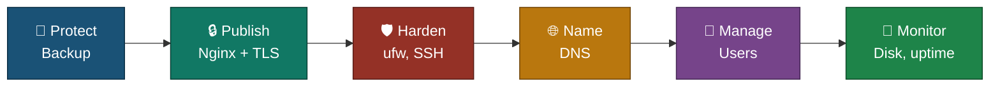
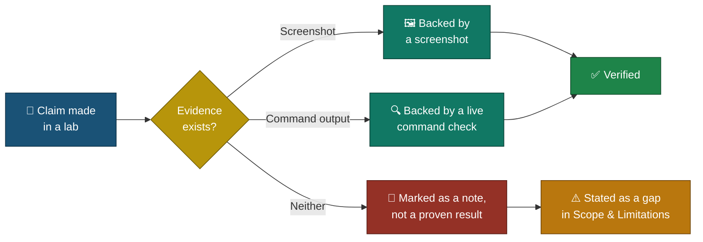

# 🧭 Executive Summary
### Linux SysAdmin Labs

**A one-page read of what this portfolio proves — protect, publish, harden, name, manage, monitor.**

### [📖 Open the full README](README.md)

---

| 🧩 Labs | 🖼️ Screenshots | 🖥 Servers | 📦 Updates Installed | 🌐 DNS Records | ⏱ Restore Time |
|:---:|:---:|:---:|:---:|:---:|:---:|
| **6** | **146** | **1 Ubuntu VM** | **84** | **7** | **2 min 47 s** |

---

## 🧩 The Six Labs, One Thread

---

## 📂 Lab Summary

<table>
<tr>
<td width="50%" valign="top">

**💾 01 — Linux Backup & Restore**
`Bash` `tar` `mysqldump` `SHA-256` `cron`

Backed up a web page and a database, checked the backup, deleted the live data on purpose and restored it.

**Status:** ✅ Complete
[README](./lab01-backup-restore/README.md) · [Index](./lab01-backup-restore/INDEX.md)

</td>
<td width="50%" valign="top">

**🔒 02 — Nginx Reverse Proxy & TLS**
`Nginx` `Apache` `OpenSSL` `Azure NSG`

Put Nginx with a self-signed certificate in front of Apache. HTTP now redirects to HTTPS.

**Status:** ✅ Complete
[README](./lab02-nginx-tls/README.md) · [Index](./lab02-nginx-tls/INDEX.md)

</td>
</tr>
<tr>
<td width="50%" valign="top">

**🛡️ 03 — SSH Hardening, Firewall & Patching**
`ufw` `OpenSSH` `apt` `fail2ban`

Snapshot first, then firewall, SSH settings, 84 updates with a reboot, automatic updates and fail2ban.

**Status:** ✅ Complete
[README](./lab03-ssh-firewall-patching/README.md) · [Index](./lab03-ssh-firewall-patching/INDEX.md)

</td>
<td width="50%" valign="top">

**🌐 04 — BIND9 DNS Server**
`BIND9` `dig` `nslookup`

Built a DNS server for `lab.local` and tested all 7 records plus a missing name.

**Status:** ✅ Complete
[README](./lab04-bind9-dns/README.md) · [Index](./lab04-bind9-dns/INDEX.md)

</td>
</tr>
<tr>
<td width="50%" valign="top">

**👤 05 — User Management & Offboarding**
`adduser` `sudo` `chage` `tar`

Created a test user with sudo, then locked, archived and deleted it in a safe order.

**Status:** ✅ Complete
[README](./lab05-users-offboarding/README.md) · [Index](./lab05-users-offboarding/INDEX.md)

</td>
<td width="50%" valign="top">

**📡 06 — Disk & Uptime Monitoring**
`Bash` `cron` `syslog` `Uptime Kuma` `pm2`

Wrote a disk alert, then stopped Nginx on purpose and watched the monitor go DOWN and recover.

**Status:** ✅ Complete
[README](./lab06-monitoring/README.md) · [Index](./lab06-monitoring/INDEX.md)

</td>
</tr>
</table>

---

## 🔎 How a Claim Gets Verified

<em>This is the rule every lab follows, applied to the checks below.</em>

---

## 🎯 Verification Snapshot

| Check | Status |
|---|:---:|
| Backup restored and the data seen again (page and 3 table rows) | ✅ |
| Proxy and redirect tested from the VM and from my laptop | ✅ |
| SSH changes proven with a fresh login after restart | ✅ |
| New kernel confirmed running after the reboot | ✅ |
| DNS answers checked with `dig` and `nslookup` | ✅ |
| Test user confirmed deleted, archive kept | ✅ |
| Monitor shown going DOWN, then UP | ✅ |
| Backup copy stored off the VM | ⚠️ Kept on the same VM |

> [!NOTE]
> This is a summary only — full methodology, screenshots and limitations for each finding live in that lab's own README.

---

[⬆️ Back to top](#top) &nbsp;·&nbsp; [📖 Full README](README.md)

