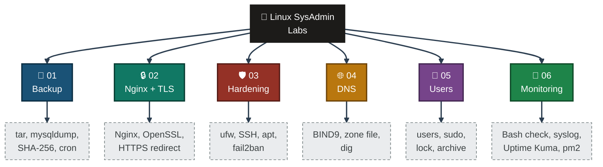
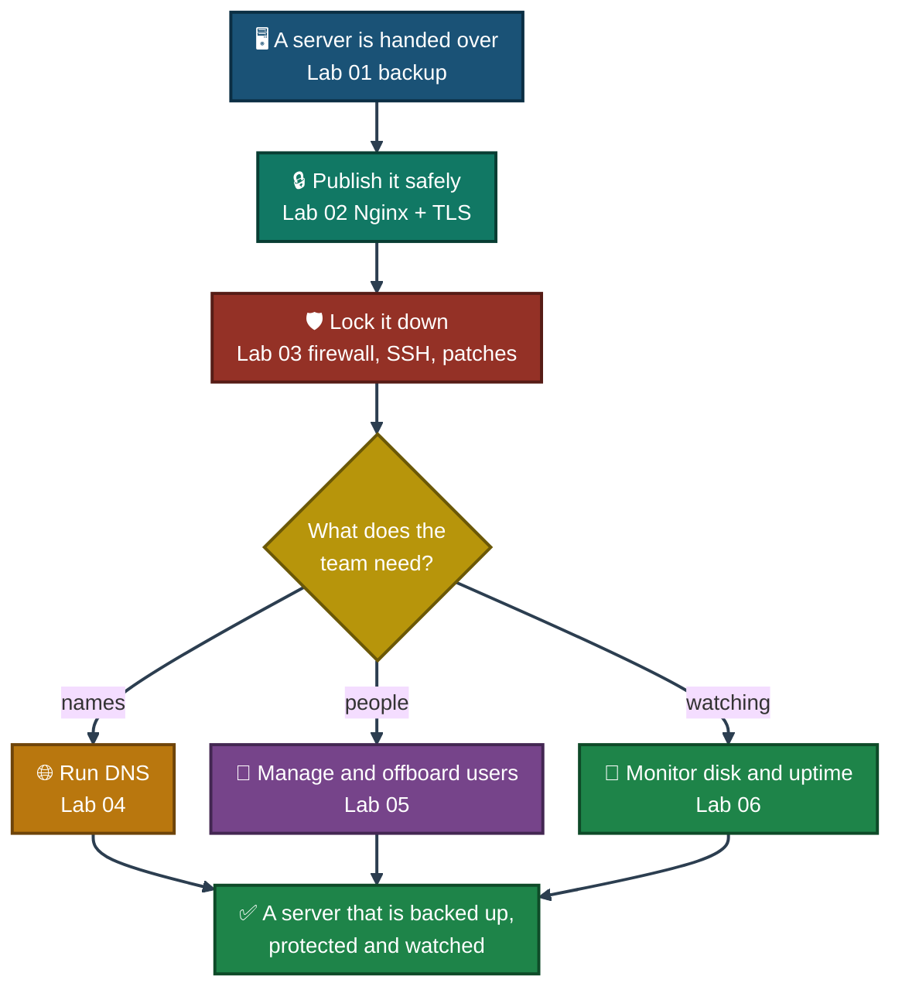

<div align="center">

# 🐧 Linux SysAdmin Labs

**Hands-on Linux Server Administration Portfolio — 6 Labs**

Backup and restore, an Nginx reverse proxy with TLS, SSH and firewall hardening, a BIND9 DNS server, user offboarding, and disk and uptime monitoring — all on one Ubuntu VM in Azure.


Six labs, one thread: protect a server, publish it safely, lock it down, name it, manage who can use it, and watch it. Every result is backed by a screenshot, and every limit of the work is written down.

### [📂 Jump to the labs](#labs-index)

</div>

---

## 📑 Table of Contents

1. [At a Glance](#at-a-glance)
2. [About This Repo](#about)
3. [Portfolio Map](#portfolio-map)
4. [Environment & Tools](#environment)
5. [Lab 01 — Backup & Restore](#lab-01)
6. [Lab 02 — Nginx Reverse Proxy & TLS](#lab-02)
7. [Lab 03 — SSH Hardening, Firewall & Patching](#lab-03)
8. [Lab 04 — BIND9 DNS Server](#lab-04)
9. [Lab 05 — User Management & Offboarding](#lab-05)
10. [Lab 06 — Disk & Uptime Monitoring](#lab-06)
11. [A Sysadmin's Path](#sysadmin-path)
12. [Coverage Snapshot](#coverage-snapshot)
13. [Skills Across the Labs](#skills)
14. [Verification, Not Assumption](#verification)
15. [Scope & Limitations](#scope-limitations)
16. [What I Learned](#what-i-learned)
17. [Labs Index](#labs-index)
18. [Repo Structure](#repo-structure)

---

<a id="at-a-glance"></a>
## 📊 At a Glance

| 🧩 Labs | 🖼️ Screenshots | 🖥 Servers | ☁️ Cloud | 🐧 OS | 💰 Cost |
|:---:|:---:|:---:|:---:|:---:|:---:|
| **6** | **146** | **1 Ubuntu VM** | **Azure (India South Central)** | **Ubuntu 24.04 LTS** | **Free tools + Azure student credit** |

---

<a id="about"></a>
## 📖 About This Repo

A sysadmin keeps a server running, safe and recoverable. These six labs practise that from six sides, all on the same Azure VM, one building on the last:

- **Lab 01 — Backup & Restore:** Back up a web page and a database with a script, check the backup with checksums, schedule it with cron, delete the live data on purpose, then restore it.
- **Lab 02 — Nginx Reverse Proxy & TLS:** Move Apache to port 8080, put Nginx in front, add a self-signed certificate, redirect HTTP to HTTPS and open port 443 in Azure.
- **Lab 03 — SSH Hardening, Firewall & Patching:** Take a snapshot, turn on ufw, tighten SSH, install 84 updates and reboot, then add automatic updates and fail2ban.
- **Lab 04 — BIND9 DNS Server:** Build a DNS server for `lab.local` and test every record with `dig` and `nslookup`.
- **Lab 05 — User Management & Offboarding:** Create a test user with admin rights, then close the account the way an admin does when someone leaves.
- **Lab 06 — Disk & Uptime Monitoring:** Write a disk-space alert, run it with cron, install Uptime Kuma, stop Nginx on purpose and watch the monitor go DOWN and recover.

> [!NOTE]
> Each lab keeps the same rule: a result is only written as done if a screenshot shows it. Every lab lists its own limits at the end of its README.

---

<a id="portfolio-map"></a>
## 🗺️ Portfolio Map



---

<a id="environment"></a>
## 🖧 Environment & Tools

| Area | Tools Used |
|---|---|
| **Cloud** | Azure VM (India South Central), Azure portal, NSG rules, disk snapshot |
| **Operating System** | Ubuntu 24.04 LTS, SSH with a key file |
| **Web & Database** | Apache 2.4, MySQL 8.0, Nginx 1.24 |
| **Backup & Automation** | Bash, `tar`, `mysqldump`, `sha256sum`, cron |
| **Security** | OpenSSL, OpenSSH, ufw, unattended-upgrades, fail2ban |
| **DNS** | BIND 9.18, `dig`, `nslookup`, `named-checkconf`, `named-checkzone` |
| **Accounts** | `adduser`, `usermod`, `gpasswd`, `chage`, `deluser` |
| **Monitoring** | Bash disk check, `logger`, syslog, Node.js 20, Uptime Kuma 2.5.5, pm2 |

---

<a id="lab-01"></a>
## 💾 Lab 01 — Linux Backup & Restore

<div align="center">


</div>

**Goal:** Protect a small web server and recover it after data loss.

<table>
<tr><td width="20%"><b>🖧 Environment</b></td><td>Azure VM, Ubuntu 24.04, Apache 2.4, MySQL 8.0</td></tr>
<tr><td><b>🔧 Work Performed</b></td><td>Test data → backup script (<code>tar</code> + <code>mysqldump</code>) → SHA-256 check → cron job → delete live data → restore</td></tr>
<tr><td><b>✅ Result</b></td><td>3 backup files, both checksums OK, web page and database (3 rows) restored in 2 min 47 s</td></tr>
<tr><td><b>⚠️ Honest Note</b></td><td>Backup sits on the same VM, and cron was listed but never seen running on its own</td></tr>
</table>

<div align="center">

**[📄 Full README](./lab01-backup-restore/README.md)** · **[🗂️ Visual Index](./lab01-backup-restore/INDEX.md)**

</div>

---

<a id="lab-02"></a>
## 🔒 Lab 02 — Nginx Reverse Proxy & TLS

<div align="center">


</div>

**Goal:** Put a reverse proxy with HTTPS in front of a web server.

<table>
<tr><td width="20%"><b>🖧 Environment</b></td><td>Azure VM, Ubuntu 24.04, Nginx 1.24.0, Apache 2.4.58, Azure NSG</td></tr>
<tr><td><b>🔧 Work Performed</b></td><td>Moved Apache to 8080 → installed Nginx as proxy → made a self-signed certificate → HTTP to HTTPS redirect → opened port 443 in the NSG</td></tr>
<tr><td><b>✅ Result</b></td><td>HTTP gives <code>301</code>, HTTPS gives <code>200</code>; redirect confirmed from the VM and from my laptop; page opened in the browser over HTTPS</td></tr>
<tr><td><b>⚠️ Honest Note</b></td><td>Self-signed certificate (browser warning) tied to the IP address; the SSH rule in the NSG is still open to any source</td></tr>
</table>

<div align="center">

**[📄 Full README](./lab02-nginx-tls/README.md)** · **[🗂️ Visual Index](./lab02-nginx-tls/INDEX.md)**

</div>

---

<a id="lab-03"></a>
## 🛡️ Lab 03 — SSH Hardening, Firewall & Patching

<div align="center">


</div>

**Goal:** Make a public server safer without locking myself out.

<table>
<tr><td width="20%"><b>🖧 Environment</b></td><td>Azure VM, Ubuntu 24.04, OpenSSH, ufw, fail2ban, Nginx, Apache, MySQL</td></tr>
<tr><td><b>🔧 Work Performed</b></td><td>Disk snapshot → ufw (22, 80, 443) → SSH settings tightened → 84 updates and reboot → automatic updates → fail2ban</td></tr>
<tr><td><b>✅ Result</b></td><td>Firewall active, root SSH login off, 84 pending updates → 0, new kernel running, 1 IP banned by fail2ban, all services up after reboot</td></tr>
<tr><td><b>⚠️ Honest Note</b></td><td>SSH is still open to any address in both ufw and the Azure rule; only package updates were installed, no release upgrade</td></tr>
</table>

<div align="center">

**[📄 Full README](./lab03-ssh-firewall-patching/README.md)** · **[🗂️ Visual Index](./lab03-ssh-firewall-patching/INDEX.md)**

</div>

---

<a id="lab-04"></a>
## 🌐 Lab 04 — BIND9 DNS Server

<div align="center">


</div>

**Goal:** Set up an authoritative DNS server on Linux and prove it answers correctly.

<table>
<tr><td width="20%"><b>🖧 Environment</b></td><td>Azure VM, Ubuntu 24.04, BIND 9.18.39, zone <code>lab.local</code></td></tr>
<tr><td><b>🔧 Work Performed</b></td><td>Checked port 53 → installed BIND9 → wrote the zone file → <code>named-checkconf</code> and <code>named-checkzone</code> → restarted → queried every record</td></tr>
<tr><td><b>✅ Result</b></td><td>7 records answered correctly (A, MX, TXT, NS, SOA), <code>NXDOMAIN</code> for a missing name, <code>nslookup</code> matched <code>dig</code></td></tr>
<tr><td><b>⚠️ Honest Note</b></td><td>One server, one private test zone; every query was run on the VM itself, not from another machine</td></tr>
</table>

<div align="center">

**[📄 Full README](./lab04-bind9-dns/README.md)** · **[🗂️ Visual Index](./lab04-bind9-dns/INDEX.md)**

</div>

---

<a id="lab-05"></a>
## 👤 Lab 05 — User Management & Offboarding

<div align="center">


</div>

**Goal:** Manage Linux accounts and close one down properly when a person leaves.

<table>
<tr><td width="20%"><b>🖧 Environment</b></td><td>Azure VM, Ubuntu 24.04, test account <code>intern1</code> (made up, not a real person)</td></tr>
<tr><td><b>🔧 Work Performed</b></td><td>Created user with sudo → locked and expired the account → removed sudo → archived the home folder → checked the archive → deleted the user</td></tr>
<tr><td><b>✅ Result</b></td><td>User gone (<code>no such user</code>), 2,351-byte archive kept in <code>/var/backups/offboarded</code>, VM resized to save credit</td></tr>
<tr><td><b>⚠️ Honest Note</b></td><td>Archive is on the same VM, unencrypted and world-readable; I did not check <code>/etc/sudoers.d</code>, running processes or files outside the home folder</td></tr>
</table>

<div align="center">

**[📄 Full README](./lab05-users-offboarding/README.md)** · **[🗂️ Visual Index](./lab05-users-offboarding/INDEX.md)**

</div>

---

<a id="lab-06"></a>
## 📡 Lab 06 — Disk & Uptime Monitoring

<div align="center">


</div>

**Goal:** Notice a problem on a server before a user does.

<table>
<tr><td width="20%"><b>🖧 Environment</b></td><td>Azure VM, Ubuntu 24.04, Nginx, Node.js 20, Uptime Kuma 2.5.5, pm2</td></tr>
<tr><td><b>🔧 Work Performed</b></td><td>Disk check script (80% alert) → cron every 10 min → Uptime Kuma via SSH tunnel → stopped Nginx on purpose → pm2 to keep it running</td></tr>
<tr><td><b>✅ Result</b></td><td>Alert fired at a test threshold and reached syslog; monitor showed DOWN at 22:05:52 and UP at 22:07:32; Uptime Kuma kept its data after a pm2 restart</td></tr>
<tr><td><b>⚠️ Honest Note</b></td><td>Alerts go only to a log and the dashboard (no email or chat), the monitor runs on the same VM it watches, and pm2 start-at-boot was set up but not tested with a reboot</td></tr>
</table>

<div align="center">

**[📄 Full README](./lab06-monitoring/README.md)** · **[🗂️ Visual Index](./lab06-monitoring/INDEX.md)**

</div>

---

<a id="sysadmin-path"></a>
## 🧭 A Sysadmin's Path

How the six labs map to the work of a junior Linux sysadmin:


<p align="center"><em>An illustration of how the labs fit together. It is not a screenshot. The labs were done on one VM, one after another, but not as one connected case.</em></p>

---

<a id="coverage-snapshot"></a>
## 🌟 Coverage Snapshot

| 🛡️ Domain | 📌 Where It Appears | ✅ What Was Demonstrated |
|---|---|---|
| Backup & Recovery | Lab 01 | `tar` and `mysqldump` backup, SHA-256 check, cron schedule, full restore after deleting the data |
| Web Server & Reverse Proxy | Lab 02 | Apache on 8080, Nginx in front, self-signed TLS, HTTP to HTTPS redirect |
| Cloud Firewall | Labs 02, 03 | Azure NSG rule for port 443, ufw alongside it as a separate layer |
| Server Hardening | Lab 03 | ufw, SSH settings, patching with reboot, unattended-upgrades, fail2ban |
| DNS Administration | Lab 04 | BIND9 install, zone file, config checks, `dig` and `nslookup` testing |
| Account Management | Lab 05 | Users, groups, sudo, lock and expiry, safe offboarding order |
| Monitoring & Alerting | Lab 06 | Bash disk alert, cron, syslog, Uptime Kuma, DOWN test, pm2 |

---

<a id="skills"></a>
## 🛠️ Skills Across the Labs

| Skill | 01 | 02 | 03 | 04 | 05 | 06 |
|---|:---:|:---:|:---:|:---:|:---:|:---:|
| SSH access with a key file | ✅ | ✅ | ✅ | ✅ | ✅ | ✅ |
| Azure VM and portal work | ✅ | ✅ | ✅ | ✅ | ✅ | ✅ |
| Bash scripting | ✅ | | | | | ✅ |
| Cron scheduling | ✅ | | | | | ✅ |
| Backup, checksums and restore | ✅ | | | | ✅ | |
| Nginx, Apache and ports | ✅ | ✅ | | | | ✅ |
| TLS certificates with OpenSSL | | ✅ | | | | |
| Firewalls (ufw and Azure NSG) | | ✅ | ✅ | ✅ | | |
| SSH hardening and fail2ban | | | ✅ | | | |
| Patching with apt | | | ✅ | | | ✅ |
| DNS with BIND9, `dig` and `nslookup` | | | | ✅ | | |
| Users, groups and sudo | | | | | ✅ | |
| Logs and syslog | | | | ✅ | | ✅ |
| Service monitoring | | | ✅ | | | ✅ |
| Proving each result with a screenshot | ✅ | ✅ | ✅ | ✅ | ✅ | ✅ |
| Marking what was not proven | ✅ | ✅ | ✅ | ✅ | ✅ | ✅ |

---

<a id="verification"></a>
## ✅ Verification, Not Assumption

A rule that holds across all six labs: a claim is not made until it is backed by direct evidence.

| Check | Method | Outcome |
|---|---|---|
| The backup is usable | Deleted the live data, then restored it and looked at the page and the table | ✅ Confirmed (Lab 01) |
| The proxy chain works | `curl -I` on the VM and `curl.exe` from my laptop, plus the browser | ✅ Confirmed (Lab 02) |
| SSH changes are safe | `sshd -t`, restart, then a fresh login from a new window | ✅ Confirmed (Lab 03) |
| The new kernel is running | `uname -r` after the reboot, not just the update message | ✅ Confirmed (Lab 03) |
| DNS answers are correct | `dig` and `nslookup` against `127.0.0.1` and the private IP | ✅ Confirmed (Lab 04) |
| The account is really gone | `id intern1`, `/home` listing, archive still present | ✅ Confirmed (Lab 05) |
| The monitor really detects a failure | Stopped Nginx and watched DOWN, then UP | ✅ Confirmed (Lab 06) |

---

<a id="scope-limitations"></a>
## 🚧 Scope & Limitations

- **Lab environment only.** One VM, one test setup, made-up data and a made-up user. No real customer, company system or real user data was touched.
- **Lab 01:** The backup is on the same VM, and cron was listed but not seen running on its own. Restore time (2 min 47 s) includes my typing and a tiny data set.
- **Lab 02:** The certificate is self-signed and tied to the IP address, so browsers warn. The page is tiny, so this proves the chain works, not how it performs under load.
- **Lab 03:** SSH is still open to any address in both ufw and the Azure rule. Only package updates were installed, and no release upgrade was done.
- **Lab 04:** One private test zone (`lab.local`) on one server. Queries were run from the VM itself, not from another machine.
- **Lab 05:** One test user and one small file. The archive is unencrypted and readable by other users on the VM, and files outside the home folder were not checked.
- **Lab 06:** The disk alert was tested with a temporary threshold, not a full disk. Alerts reach only a log and the dashboard, the monitor runs on the VM it watches, and start-at-boot with pm2 was not tested with a reboot.

These gaps are marked here instead of hidden, so the labs show exactly what was done and what remains open.

---

<a id="what-i-learned"></a>
## 🧠 What I Learned

- **A backup is not proven until it is restored.** Checksums show the files are intact; only a restore shows the data comes back.
- **A firewall has layers.** ufw on the VM and the Azure NSG are separate, and both must allow a port.
- **Have a way back before changing access.** A snapshot and a second SSH window removed most of the lockout risk.
- **Test the config before the restart.** `nginx -t`, `sshd -t` and `named-checkzone` catch mistakes before they stop a service.
- **Two services cannot share one port.** Apache moved to 8080 for Nginx, and BIND had to avoid `systemd-resolved` on port 53.
- **Lock first, delete last.** An account is locked, its data archived and checked, and only then removed.
- **A check is not proven until it fires.** I lowered a threshold and stopped Nginx to see the script and the monitor react.
- **Time zones change the evidence.** The VM and syslog use UTC, while the Uptime Kuma dashboard shows Pakistan time (UTC+5).
- **Run each command in the right terminal.** Several mistakes came from running a laptop command inside the VM.

---

<a id="labs-index"></a>
## 📂 Labs Index

| # | Lab | Stack | Status |
|:---:|---|---|:---:|
| 1 | [💾 Linux Backup & Restore](./lab01-backup-restore/README.md) | Bash · tar · mysqldump · SHA-256 · cron | ✅ Complete |
| 2 | [🔒 Nginx Reverse Proxy & TLS](./lab02-nginx-tls/README.md) | Nginx · Apache · OpenSSL · Azure NSG | ✅ Complete |
| 3 | [🛡️ SSH Hardening, Firewall & Patching](./lab03-ssh-firewall-patching/README.md) | ufw · OpenSSH · apt · fail2ban | ✅ Complete |
| 4 | [🌐 BIND9 DNS Server](./lab04-bind9-dns/README.md) | BIND9 · dig · nslookup · zone files | ✅ Complete |
| 5 | [👤 User Management & Offboarding](./lab05-users-offboarding/README.md) | adduser · sudo · chage · tar | ✅ Complete |
| 6 | [📡 Disk & Uptime Monitoring](./lab06-monitoring/README.md) | Bash · cron · syslog · Uptime Kuma · pm2 | ✅ Complete |

---

<a id="repo-structure"></a>
## 📁 Repo Structure

```text
Linux-SysAdmin-Labs/
|-- README.md                                  <- you are here
|-- LICENSE
|-- lab01-backup-restore/
|   |-- README.md
|   |-- INDEX.md
|   `-- screenshots/
|-- lab02-nginx-tls/
|   |-- README.md
|   |-- INDEX.md
|   `-- screenshots/
|-- lab03-ssh-firewall-patching/
|   |-- README.md
|   |-- INDEX.md
|   `-- screenshots/
|-- lab04-bind9-dns/
|   |-- README.md
|   |-- INDEX.md
|   `-- screenshots/
|-- lab05-users-offboarding/
|   |-- README.md
|   |-- INDEX.md
|   `-- screenshots/
`-- lab06-monitoring/
    |-- README.md
    |-- INDEX.md
    `-- screenshots/
```

<div align="center">

💾 **[Lab 01](./lab01-backup-restore/README.md)** · 🔒 **[Lab 02](./lab02-nginx-tls/README.md)** · 🛡️ **[Lab 03](./lab03-ssh-firewall-patching/README.md)** · 🌐 **[Lab 04](./lab04-bind9-dns/README.md)** · 👤 **[Lab 05](./lab05-users-offboarding/README.md)** · 📡 **[Lab 06](./lab06-monitoring/README.md)** · 🧭 **[Sysadmin Path](#sysadmin-path)**

</div>
