

# 💾 Lab 01 — Index
### Linux Backup & Restore — Ubuntu 24.04 on Azure
**Lab 01 of 4 — Linux SysAdmin Labs**

**Quick guide to every step and screenshot in this lab.**

### [📖 Open the full README](README.md)

---

| 🧩 Phases | 🖼️ Screenshots | 🛠️ Tools Used | ⏱️ Restore Time |
|:---:|:---:|:---:|:---:|
| **9** | **15** | **8** | **2 min 47 s** |

🧩 <b>Case:</b> Web page + one MySQL database backed up and restored · VM <code>lab-server</code> (Ubuntu 24.04) · Backup stamp <code>2026-10-13_1235</code>

---

## 📑 Step Index

| # | Step | Module | Result | Evidence |
|:---:|---|:---:|---|:---:|
| 1 | Check the VM in Azure | 🔵 Module 1 | B4as v2, India South Central, status Running | [Exhibit 1](#ex1) |
| 2 | Connect over SSH | 🔵 Module 2 | Logged in to Ubuntu 24.04.4 with the key file | [Exhibit 2](#ex2) |
| 3 | Check the services | 🟣 Module 3 | Apache and MySQL running, port 80 listening, `ufw` inactive | [Exhibits 3–7](#ex3) |
| 4 | Create the test data | 🟠 Module 4 | `index.html` page and `labdb` with 3 rows | [Exhibits 8–9](#ex8) |
| 5 | Write the backup script | 🟠 Module 5 | `backup.sh` created, 8 lines | [Exhibit 10](#ex10) |
| 6 | Run the backup and verify it | 🟢 Module 6 | 3 files created, both checksums `OK` | [Exhibit 11](#ex11) |
| 7 | Schedule it with cron | 🟢 Module 7 | `0 2 * * *` job added and listed in crontab | [Exhibit 12](#ex12) |
| 8 | Destroy the data | 🔴 Module 8 | Page deleted and `labdb` dropped at 12:43:42 UTC | [Exhibit 13](#ex13) |
| 9 | Restore from the backup | 🔴 Module 9 | Page and 3 rows back at 12:46:29 UTC | [Exhibits 14–15](#ex14) |

---

## 🔵 Module 1–2 — Environment Setup

Exhibits 1 to 2.

<table>
<tr>
<td align="center" valign="top" width="50%">

<a href="screenshots/00-azure-vm-overview.png">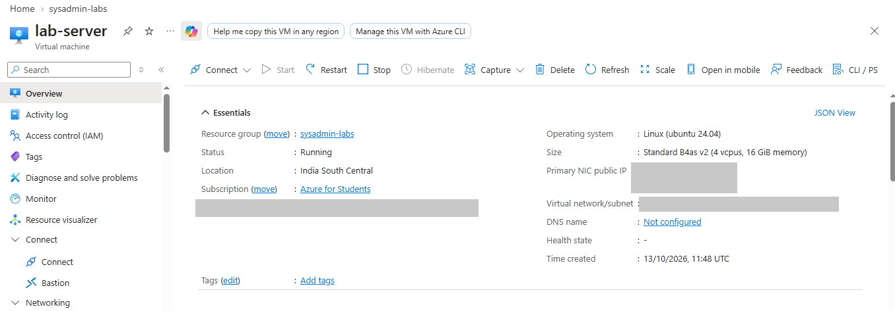</a>
 <b>Exhibit 1 — Azure VM overview</b>
 VM details: B4as v2, India South Central, Running
</td>
<td align="center" valign="top" width="50%">

<a href="screenshots/01-ssh-connected.png">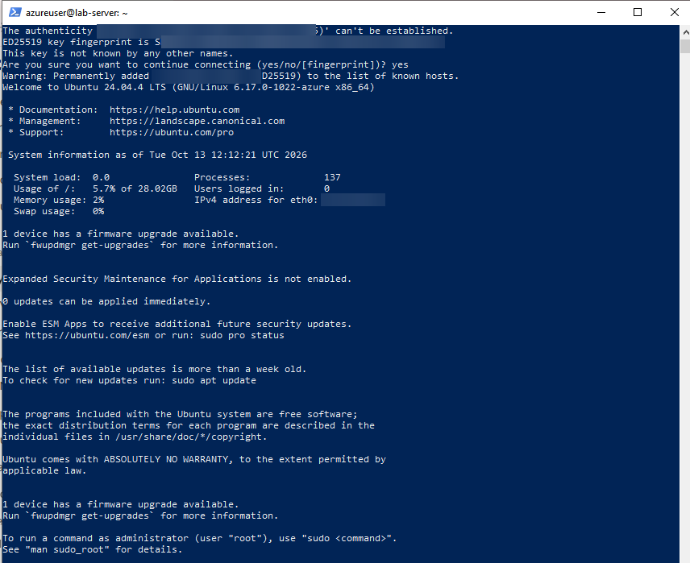</a>
 <b>Exhibit 2 — SSH connected</b>
 Logged in to lab-server over SSH
</td>
</tr>
</table>

---

## 🟣 Module 3 — Service Checks

Exhibits 3 to 7.

<table>
<tr>
<td align="center" valign="top" width="50%">

<a href="screenshots/02-apache-active.png">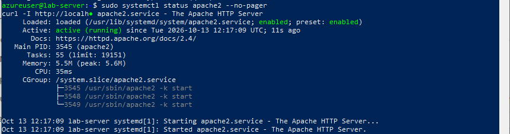</a>
 <b>Exhibit 3 — Apache running</b>
 Apache service is active (running)
</td>
<td align="center" valign="top" width="50%">

<a href="screenshots/02a-apache-curl-200.png">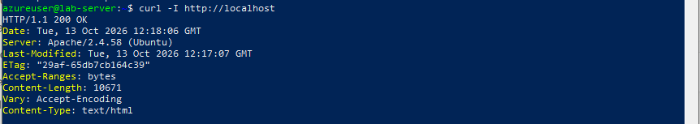</a>
 <b>Exhibit 4 — Apache answers</b>
 curl returns 200 OK on localhost
</td>
</tr>
<tr>
<td align="center" valign="top" width="50%">

<a href="screenshots/02b-ufw-inactive.png">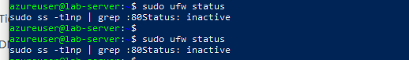</a>
 <b>Exhibit 5 — Firewall status</b>
 ufw shows Status: inactive
</td>
<td align="center" valign="top" width="50%">

<a href="screenshots/02c-apache-listening-80.png">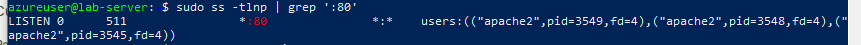</a>
 <b>Exhibit 6 — Port 80 listening</b>
 Apache is listening on port 80
</td>
</tr>
<tr>
<td align="center" valign="top" width="50%">

<a href="screenshots/02d-mysql-running.png">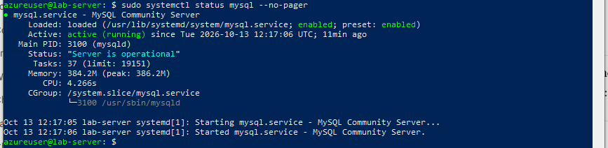</a>
 <b>Exhibit 7 — MySQL running</b>
 MySQL service is active (running)
</td>
<td width="50%"></td>
</tr>
</table>

---

## 🟠 Module 4–5 — Test Data & Backup Script

Exhibits 8 to 10.

<table>
<tr>
<td align="center" valign="top" width="50%">

 <b>Exhibit 8 — Test web page</b>
 index.html created and read back
</td>
<td align="center" valign="top" width="50%">

<a href="screenshots/03-test-data-select.png">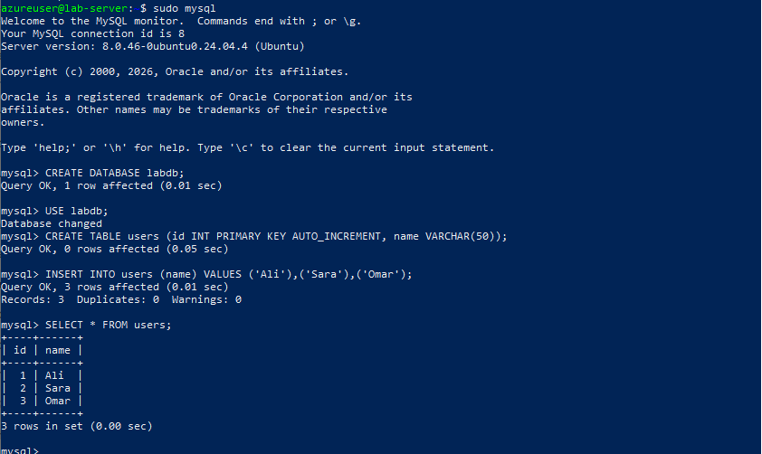</a>
 <b>Exhibit 9 — Test database</b>
 labdb users table has 3 rows
</td>
</tr>
<tr>
<td align="center" valign="top" width="50%">

<a href="screenshots/04-backup-script.png">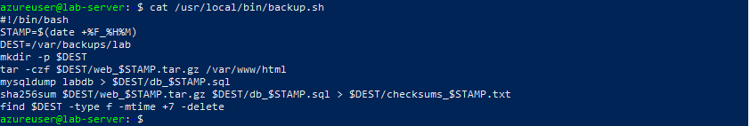</a>
 <b>Exhibit 10 — Backup script</b>
 backup.sh with all 8 lines
</td>
<td width="50%"></td>
</tr>
</table>

---

## 🟢 Module 6–7 — Backup, Verify & Schedule

Exhibits 11 to 12.

<table>
<tr>
<td align="center" valign="top" width="50%">

<a href="screenshots/05-backup-files-checksum-ok.png">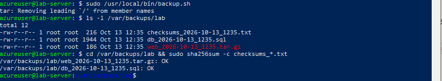</a>
 <b>Exhibit 11 — Backup and checksums</b>
 3 files created, both checksums OK
</td>
<td align="center" valign="top" width="50%">

<a href="screenshots/06-cron-job.png">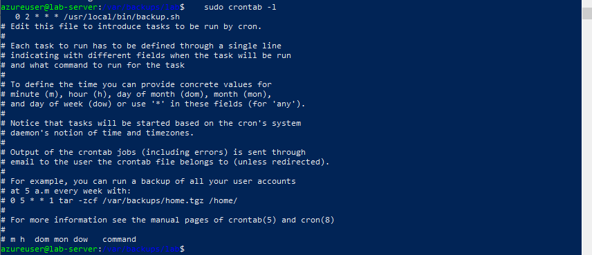</a>
 <b>Exhibit 12 — Cron job</b>
 0 2 * * * entry listed in crontab
</td>
</tr>
</table>

---

## 🔴 Module 8–9 — Disaster & Recovery

Exhibits 13 to 15.

<table>
<tr>
<td align="center" valign="top" width="50%">

<a href="screenshots/07-after-destroy.png">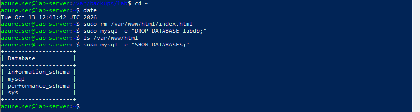</a>
 <b>Exhibit 13 — Data destroyed</b>
 Page deleted and labdb dropped at 12:43:42 UTC
</td>
<td align="center" valign="top" width="50%">

 <b>Exhibit 14 — Restore commands</b>
 tar and mysql restore commands run
</td>
</tr>
<tr>
<td align="center" valign="top" width="50%">

<a href="screenshots/09-restore-verified.png">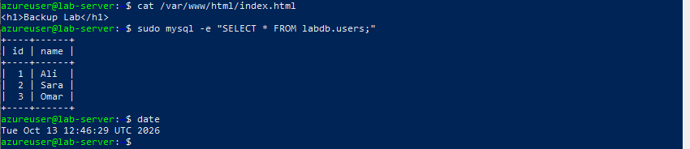</a>
 <b>Exhibit 15 — Restore verified</b>
 Page and 3 rows back at 12:46:29 UTC
</td>
<td width="50%"></td>
</tr>
</table>

---

## 📝 Verdict

**Restore Verified** — the backup was created, checked with checksums, and used to bring back the deleted web page and database.

| Element | Finding |
|---|---|
| Backup files | `web_`, `db_` and `checksums_` files, stamp `2026-10-13_1235` |
| Checksums | Both files `OK` |
| Cron job | `0 2 * * *` added and listed |
| Data destroyed | Page deleted, `labdb` dropped (12:43:42 UTC) |
| Data restored | `<h1>Backup Lab</h1>` and 3 rows (Ali, Sara, Omar) |
| Restore time | 2 min 47 s (12:43:42 → 12:46:29 UTC) |

---

## 🎯 Verification Checklist

| Check | Method | Module | Status |
|:---:|---|---|:---:|
| VM details recorded | Azure overview page | Module 1 | ✅ Confirmed |
| Apache and MySQL running | `systemctl status`, `ss`, `curl` | Module 3 | ✅ Confirmed |
| Backup files intact | `sha256sum -c` | Module 6 | ✅ Confirmed (2 of 2 `OK`) |
| Cron job added | `crontab -l` | Module 7 | ✅ Confirmed (listed) |
| Data really deleted | `ls` and `SHOW DATABASES` | Module 8 | ✅ Confirmed |
| Data restored | `cat` and `SELECT` | Module 9 | ✅ Confirmed (page + 3 rows) |
| Cross-check of backup and restore | Checksums vs restore result | Modules 6 + 9 | ✅ Confirmed (agree) |

> [!NOTE]
> A checksum only proves the backup files were not changed, so the case was verified by restoring the data. The restore time includes typing time and a very small data set. Known limits (backup on the same VM, cron not yet run on schedule, browser access to port 80 not confirmed) are in the README under Scope & Limitations.

---

[⬆️ Back to top](#top) &nbsp;·&nbsp; [📖 Full README](README.md)

🐧 **[Ubuntu Server docs](https://ubuntu.com/server/docs)** · ⏰ **[crontab guru](https://crontab.guru/)** · 🗄️ **[mysqldump docs](https://dev.mysql.com/doc/refman/8.0/en/mysqldump.html)**

