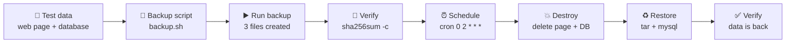

<div align="center">

# 💾 Lab 01 — Linux Backup & Restore

**Ubuntu 24.04 on Azure · Apache + MySQL · Backup Script · Checksums · Cron · Disaster Test · Restore**

A hands-on Linux sysadmin lab. I backed up a web page and a database with a script, checked the backup with checksums, scheduled it with cron, deleted the live data on purpose, and restored everything from the backup.


The method: set up test data, back it up, verify the backup, break the system, restore it, and keep the evidence.

### [📸 Jump to the steps](#steps)

</div>

---

## 📑 Table of Contents

1. [At a Glance](#at-a-glance)
2. [Objective](#objective)
3. [Environment](#environment)
4. [Tools & Technologies](#tools)
5. [The Lab Flow](#flow)
6. [Steps](#steps)
7. [Results](#results)
8. [Command Cheat Sheet](#cheat-sheet)
9. [Challenges & Fixes](#problems-fixes)
10. [Scope & Limitations](#scope-limitations)
11. [What I Learned](#what-i-learned)
12. [Skills Demonstrated](#skills-demonstrated)
13. [Folder Structure](#folder-structure)

---

<a id="at-a-glance"></a>
## 📊 At a Glance

| 🖥 Server | 🧩 Backed Up | 🔐 Integrity Check | ⏱ Restore Time |
|:---:|:---:|:---:|:---:|
| **1 Ubuntu 24.04 VM** | **Web files + 1 database** | **SHA-256, both files OK** | **2 min 47 s** |

---

<a id="objective"></a>
## 🎯 Objective

Show that I can protect a small web server and recover it after data loss.

- Back up the website files and a MySQL database with one script.
- Prove the backup files are not damaged by checking SHA-256 checksums.
- Schedule the script with cron.
- Delete the live data, then restore it from the backup and confirm it is back.

---

<a id="environment"></a>
## 🧱 Environment

| Item | Value |
|---|---|
| Cloud | Azure virtual machine, India South Central |
| VM name / size | `lab-server` · Standard B4as v2 (4 vCPU, 16 GiB) |
| Operating system | Ubuntu 24.04.4 LTS |
| Web server | Apache 2.4.58 |
| Database | MySQL 8.0.46 |
| Access | SSH with a key file, user `azureuser` |
| Firewall (`ufw`) | Inactive during this lab |
| Date of lab | 13 Oct 2026 (VM clock is UTC) |

> [!NOTE]
> Public IP, subscription details and key fingerprints are blurred in the screenshots. The VM details are shown in Step 1.

---

<a id="tools"></a>
## 🛠️ Tools & Technologies

| Tool | Purpose |
|------|---------|
| `ssh` | Connect to the VM from my laptop |
| `systemctl status` | Check that Apache and MySQL are running |
| `ss -tlnp`, `curl -I` | Check that Apache listens on port 80 and answers |
| `mysql`, `mysqldump` | Create test data and export the database |
| `tar` | Pack and unpack the website folder |
| `sha256sum` | Create and verify checksums for the backup files |
| `crontab` | Schedule the backup |
| `nano`, `chmod` | Write the script and make it executable |

---

<a id="flow"></a>
## ⏱️ The Lab Flow



---

<a id="steps"></a>
## 📸 Steps

### Step 1 — Check the VM in Azure

The VM `lab-server` in the `sysadmin-labs` resource group: Linux (Ubuntu 24.04), Standard B4as v2, India South Central, created 13/10/2026 11:48 UTC. Status was `Running` when this screenshot was taken.


### Step 2 — Connect to the server

Connected to `lab-server` over SSH with the key file.


### Step 3 — Check the services

Apache is `active (running)`.


`curl -I http://localhost` returns `200 OK`.


`ufw` shows `Status: inactive`.


Apache is listening on port 80.


MySQL is `active (running)`.


### Step 4 — Create the test data

A simple web page:

```bash
echo "<h1>Backup Lab</h1>" | sudo tee /var/www/html/index.html
cat /var/www/html/index.html
```


A database `labdb` with a `users` table and 3 rows:

```sql
CREATE DATABASE labdb;
USE labdb;
CREATE TABLE users (id INT PRIMARY KEY AUTO_INCREMENT, name VARCHAR(50));
INSERT INTO users (name) VALUES ('Ali'),('Sara'),('Omar');
SELECT * FROM users;
```


### Step 5 — Write the backup script

`/usr/local/bin/backup.sh`, made executable with `chmod +x`:

```bash
#!/bin/bash
STAMP=$(date +%F_%H%M)
DEST=/var/backups/lab
mkdir -p $DEST
tar -czf $DEST/web_$STAMP.tar.gz /var/www/html
mysqldump labdb > $DEST/db_$STAMP.sql
sha256sum $DEST/web_$STAMP.tar.gz $DEST/db_$STAMP.sql > $DEST/checksums_$STAMP.txt
find $DEST -type f -mtime +7 -delete
```

What each line does:

- `STAMP` puts the date and time in every file name.
- `tar` packs the website folder. `mysqldump` exports the database.
- `sha256sum` saves a checksum for each backup file.
- `find ... -mtime +7 -delete` removes backup files older than 7 days.


### Step 6 — Run the backup and verify it

```bash
sudo /usr/local/bin/backup.sh
ls -l /var/backups/lab
cd /var/backups/lab && sudo sha256sum -c checksums_*.txt
```

Three files were created with the same timestamp (`2026-10-13_1235`), and both checksums returned `OK`.


### Step 7 — Schedule it with cron

```bash
sudo crontab -e
sudo crontab -l
```

Entry added: `0 2 * * * /usr/local/bin/backup.sh` (every day at 02:00 server time).


### Step 8 — Destroy the data

Noted the time (**12:43:42 UTC**), then deleted the page and the database:

```bash
sudo rm /var/www/html/index.html
sudo mysql -e "DROP DATABASE labdb;"
ls /var/www/html
sudo mysql -e "SHOW DATABASES;"
```

`/var/www/html` is empty and `labdb` is gone from the database list. The backup folder was not touched.


### Step 9 — Restore from the backup

```bash
sudo tar -xzf /var/backups/lab/web_2026-10-13_1235.tar.gz -C /
sudo mysql -e "CREATE DATABASE labdb;"
sudo mysql labdb < /var/backups/lab/db_2026-10-13_1235.sql
```


Then checked the result:

```bash
cat /var/www/html/index.html
sudo mysql -e "SELECT * FROM labdb.users;"
date
```

The page shows `<h1>Backup Lab</h1>` and the table has all 3 rows again. End time: **12:46:29 UTC**.


---

<a id="results"></a>
## ✅ Results

| Check | Result |
|---|---|
| Backup files created | 3 files: web archive, database dump, checksum list |
| Checksum verification | Both files `OK` |
| Cron job | Added and listed with `crontab -l` |
| Data destroyed | Web page deleted, `labdb` dropped |
| Web page restored | `<h1>Backup Lab</h1>` is back |
| Database restored | `users` table has 3 rows (Ali, Sara, Omar) |
| Restore time | 12:43:42 → 12:46:29 UTC = **2 min 47 s** |

> [!NOTE]
> The 2 min 47 s includes my own typing time and a very small data set (web archive 186 bytes, SQL dump 1,944 bytes). It is not a measure of how long a real restore would take.

---

<a id="cheat-sheet"></a>
## 🧾 Command Cheat Sheet

| Command | Purpose |
|---------|---------|
| `sudo systemctl status apache2 --no-pager` | Check that Apache is running |
| `sudo ss -tlnp \| grep ':80'` | See what is listening on port 80 |
| `curl -I http://localhost` | Check that the web server answers |
| `tar -czf <file>.tar.gz <folder>` | Create a compressed archive |
| `tar -xzf <file>.tar.gz -C /` | Extract an archive back to its original path |
| `mysqldump <db> > <file>.sql` | Export a database |
| `mysql <db> < <file>.sql` | Load an export into a database |
| `sha256sum <files> > <list>.txt` | Save checksums |
| `sha256sum -c <list>.txt` | Check files against saved checksums |
| `sudo crontab -e` · `sudo crontab -l` | Edit and list scheduled jobs |
| `find <dir> -type f -mtime +7 -delete` | Delete files older than 7 days |

---

<a id="problems-fixes"></a>
## ⚠️ Challenges & Fixes

| ❌ Challenge | ✅ Solution |
|---|---|
| `Test-NetConnection` gave `command not found` | It is a Windows PowerShell command, and I ran it inside the Linux SSH session. Used `curl -I http://localhost` and `ss -tlnp` on the VM instead |
| A pasted `cat` command was cut in the middle and ran `p.sh` as a command | The terminal paste glitched. Typed the command by hand and it showed the full script |
| Pasted the cron line into the editor choice menu instead of choosing an editor | The menu rejected it and nothing broke. Chose `1` (nano), then added the line inside nano |
| The page was not reachable from my laptop browser on port 80 | **Cause not confirmed.** The VM side checked out locally (`ss` and `curl`), so I used `curl` on the VM as proof |

---

<a id="scope-limitations"></a>
## 🚧 Scope & Limitations

- **Backup is on the same VM.** If the VM is lost, the backup is lost too. A real setup copies it to Azure Blob Storage or another server.
- **Cron has not run on its own yet.** I only checked that the job is listed. I did not wait for 02:00 to see it run.
- **Cron uses the server clock, which is UTC.** 02:00 there is 07:00 in Pakistan.
- **The cron line sits at the top of the crontab file,** not the bottom. Cron does not care about position.
- **No alert if the backup fails.** The script does not check whether each step worked.
- **Checksums prove the files were not changed, not that they restore well.** The restore test covers that part, but only once.
- **MySQL root login uses the local socket,** so `sudo mysql` needs no password and none is stored in the script.
- **Browser access to port 80 from my laptop was not confirmed** (see Challenges). The page was checked with `curl` on the VM.
- **Tiny data set.** Restore time will be much longer with real data.

---

<a id="what-i-learned"></a>
## 🧠 What I Learned

- **A backup is not proven until it is restored.** The checksum says the files are intact; only the restore shows the data comes back.
- **Time-stamped file names** keep each backup separate and make the restore command easy to build.
- **Checksums** are a quick way to catch a damaged backup file.
- **`tar` and `mysqldump` solve two different problems:** files and database content need separate handling.
- **Keep the backup away from the data it protects.** Same-VM storage is a weak point, noted in the limitations.
- **Keep the evidence.** Screenshots with times let me show how long the recovery took.

---

<a id="skills-demonstrated"></a>
## 🛠️ Skills Demonstrated

- Connecting to a Linux server over SSH with a key
- Checking service and port status on Ubuntu
- Writing and running a Bash backup script
- Backing up files with `tar` and a database with `mysqldump`
- Verifying backup integrity with SHA-256 checksums
- Scheduling jobs with cron
- Restoring a website and a database after data loss
- Documenting a lab with commands, times, screenshots and honest limits

---

<a id="folder-structure"></a>
## 📁 Folder Structure

```text
lab01-backup-restore/
|-- README.md
`-- screenshots/
    |-- 00-azure-vm-overview.png
    |-- 01-ssh-connected.png
    |-- 02-apache-active.png
    |-- 02a-apache-curl-200.png
    |-- 02b-ufw-inactive.png
    |-- 02c-apache-listening-80.png
    |-- 02d-mysql-running.png
    |-- 03a-web-page-created.png
    |-- 03-test-data-select.png
    |-- 04-backup-script.png
    |-- 05-backup-files-checksum-ok.png
    |-- 06-cron-job.png
    |-- 07-after-destroy.png
    |-- 08-restore-commands.png
    `-- 09-restore-verified.png
```
