<div align="center">

# 🔒 Lab 02 — Nginx Reverse Proxy & TLS

**Ubuntu 24.04 on Azure · Apache on 8080 · Nginx in Front · Self-Signed Certificate · HTTP to HTTPS Redirect · NSG Port 443**

A hands-on Linux sysadmin lab. I moved Apache to port 8080, put Nginx in front of it as a reverse proxy, created a self-signed TLS certificate, redirected HTTP to HTTPS, opened port 443 in the Azure firewall, and tested the result from the VM and from my laptop browser.


The method: move the backend, put the proxy in front, add TLS, test every layer, and keep the evidence.

### [📸 Jump to the steps](#steps) &nbsp;·&nbsp; [📑 Open the Index](INDEX.md)

</div>

---

## 📑 Table of Contents

1. [At a Glance](#at-a-glance)
2. [Objective](#objective)
3. [Environment](#environment)
4. [Tools & Technologies](#tools)
5. [The Lab Flow](#flow)
6. [Which Step Do I Need?](#which-step)
7. [Steps](#steps)
8. [Results](#results)
9. [Where the Request Can Break](#request-breaks)
10. [Proxy Method Pipeline](#pipeline)
11. [Command Cheat Sheet](#cheat-sheet)
12. [Challenges & Fixes](#problems-fixes)
13. [Scope & Limitations](#scope-limitations)
14. [What I Learned](#what-i-learned)
15. [Skills Demonstrated](#skills-demonstrated)
16. [Folder Structure](#folder-structure)

---

<a id="at-a-glance"></a>
## 📊 At a Glance

| 🖥 Server | 🔀 Proxy Chain | 🔐 Certificate | 🌐 HTTP Behavior |
|:---:|:---:|:---:|:---:|
| **1 Ubuntu 24.04 VM** | **Nginx (80, 443) → Apache (8080)** | **Self-signed, 365 days** | **HTTP `301` → HTTPS `200`** |

---

<a id="objective"></a>
## 🎯 Objective

Show that I can put a reverse proxy with HTTPS in front of a web server.

- Move Apache from port 80 to port 8080 so Nginx can use port 80.
- Install Nginx and make it pass requests to Apache.
- Create a self-signed TLS certificate (no domain name, so no Let's Encrypt).
- Redirect HTTP to HTTPS and open port 443 in the Azure network security group (NSG).
- Check the certificate dates and test the page from a browser.

<div align="center">

### 🧩 Lab Workflow at a Glance

<table>
<tr>
<td align="center" valign="top" width="18%">

**🔧 Move**<br>
<sub>Apache from<br>80 to 8080</sub>

</td>
<td align="center" valign="middle" width="2.5%">

**➜**

</td>
<td align="center" valign="top" width="18%">

**🔀 Proxy**<br>
<sub>Install Nginx,<br>pass to Apache</sub>

</td>
<td align="center" valign="middle" width="2.5%">

**➜**

</td>
<td align="center" valign="top" width="18%">

**🔐 Encrypt**<br>
<sub>Certificate,<br>443, redirect</sub>

</td>
<td align="center" valign="middle" width="2.5%">

**➜**

</td>
<td align="center" valign="top" width="18%">

**🧪 Test**<br>
<sub>curl on the VM,<br>dates check</sub>

</td>
<td align="center" valign="middle" width="2.5%">

**➜**

</td>
<td align="center" valign="top" width="18%">

**🌐 Browse**<br>
<sub>Open the page<br>from my laptop</sub>

</td>
</tr>
<tr>
<td colspan="9" align="center">


<br>
<sub>Built-in Linux tools and free software, no paid software</sub>

</td>
</tr>
</table>

</div>

---

<a id="environment"></a>
## 🧱 Environment

| Item | Value |
|---|---|
| Cloud | Azure virtual machine, India South Central |
| VM name / size | `lab-server` · Standard B2ls_v2 (2 vCPU, 4 GiB), resized from B4as v2 before this lab to save credit |
| Operating system | Ubuntu 24.04.4 LTS |
| Reverse proxy | Nginx 1.24.0 (Ubuntu), installed in this lab |
| Backend web server | Apache 2.4.58 (installed in Lab 1), moved to port 8080 |
| Access | SSH with a key file, user `azureuser` |
| Azure NSG rules | `HTTP` 80, `SSH` 22, `AllowHTTPS` 443 (added in this lab) |
| Firewall (`ufw`) | Inactive in Lab 1, not changed in this lab |
| Date of lab | 13 Oct 2026 (VM clock is UTC) |

> [!NOTE]
> Blurred in the screenshots: Subscription ID, account email, portal address bar and link, the VM public IP, and the client IP in the `Last login` line. In this README the VM public IP is written as `<VM-PUBLIC-IP>`.

---

<a id="tools"></a>
## 🛠️ Tools & Technologies

| Tool | Purpose |
|------|---------|
| `ssh` | Connect to the VM from my laptop |
| `ss -tlnp` | See which program listens on which port |
| `grep`, `sed` | Find and change the port settings in the Apache config |
| `apache2ctl configtest` | Check the Apache config before restarting |
| `apt`, `systemctl` | Install Nginx, restart and reload services |
| `nginx -t` | Check the Nginx config before reloading |
| `openssl` | Create the self-signed certificate and read its dates |
| `curl -I`, `curl -kI` | Test the redirect and HTTPS from the VM |
| `curl.exe` (Windows PowerShell) | Test the redirect from my laptop, outside the VM |
| Azure portal (NSG) | Open port 443 for the VM |

---

<a id="flow"></a>
## ⏱️ The Lab Flow

```mermaid
flowchart LR
    subgraph G1["🟣 PREPARE"]
        direction TB
        A1["Check ports<br/>Apache on 80"]
        A2["Move Apache<br/>80 to 8080"]
    end
    subgraph G2["🔵 PROXY"]
        direction TB
        B1["Install Nginx"]
        B2["Proxy config<br/>pass to 8080"]
    end
    subgraph G3["🟠 ENCRYPT"]
        direction TB
        C1["Open 443<br/>in the NSG"]
        C2["Self-signed<br/>certificate"]
        C3["TLS + redirect<br/>config"]
    end
    subgraph G4["🟢 VERIFY"]
        direction TB
        D1["curl tests<br/>301 and 200"]
        D2["Certificate dates"]
        D3["Browser test"]
    end
    G1 ==> G2 ==> G3 ==> G4

    classDef pr fill:#f0eaf8,stroke:#6f42c1,stroke-width:2px,color:#000
    classDef po fill:#e8f1fb,stroke:#005EB8,stroke-width:2px,color:#000
    classDef di fill:#fff4e5,stroke:#e08a00,stroke-width:2px,color:#000
    classDef re fill:#eef7ee,stroke:#2ea44f,stroke-width:2px,color:#000
    class A1,A2 pr
    class B1,B2 po
    class C1,C2,C3 di
    class D1,D2,D3 re
```

<p align="center"><em>The groups show the four stages of the lab, from freeing port 80 to opening the page in a browser.</em></p>

---

<a id="which-step"></a>
## 🧭 Which Step Do I Need?

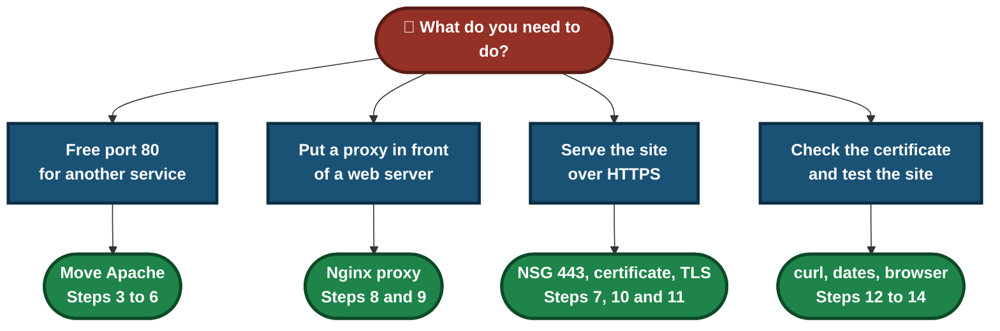

---

<a id="steps"></a>
## 📸 Steps

### Step 1 — Check the VM in Azure

The VM `lab-server` was `Stopped (deallocated)` and still on Standard B4as v2.


After the resize to Standard B2ls_v2 (2 vCPU, 4 GiB) and a start, the status is `Running`.

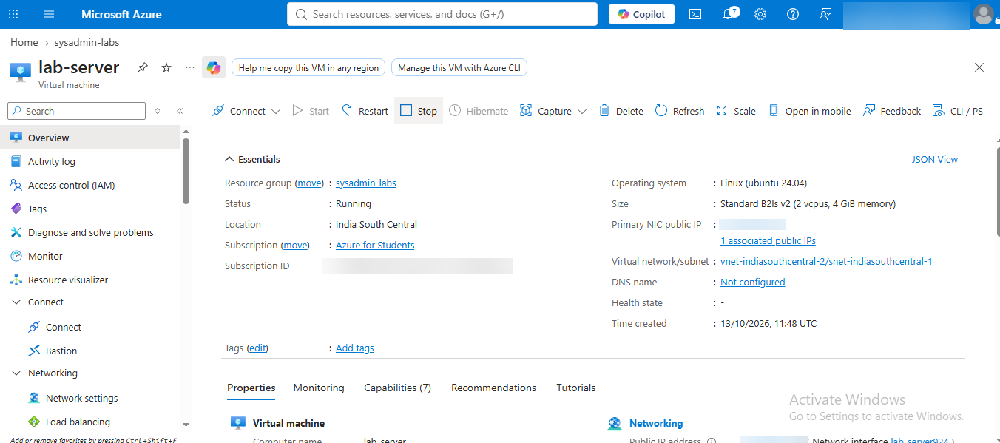

### Step 2 — Connect to the server

```powershell
ssh -i $HOME\Downloads\lab-server_key.pem azureuser@<VM-PUBLIC-IP>
```

Connected to `lab-server` over SSH with the key file.

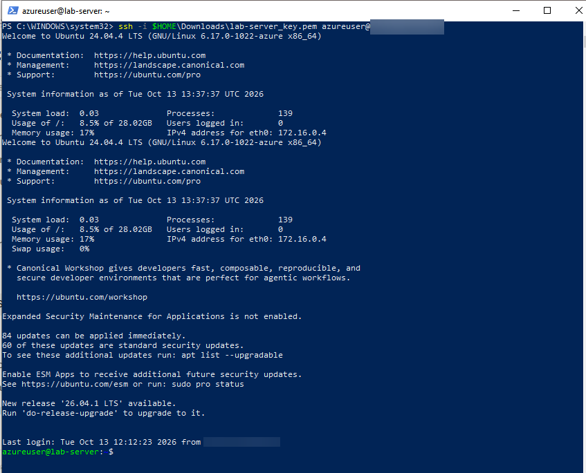

### Step 3 — See what listens on port 80

```bash
sudo ss -tlnp | grep -E ':80|:443|:8080'
```

Only Apache is listening, on port 80. Ports 443 and 8080 are empty.

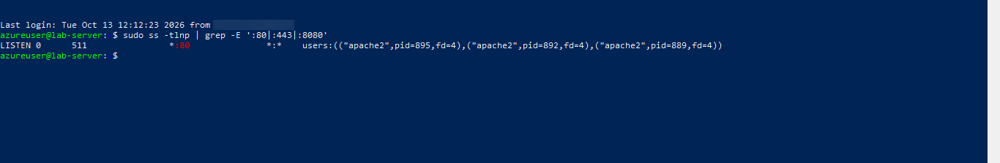

### Step 4 — Find the port settings in the Apache config

```bash
grep -rn "80" /etc/apache2/ports.conf /etc/apache2/sites-enabled/
sudo grep -Rn "VirtualHost" /etc/apache2/sites-enabled/
```

The first command only found `Listen 80` on line 5 of `ports.conf`.

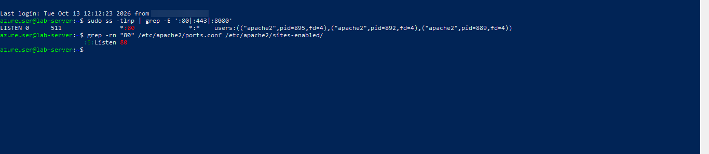

The second command (capital `-R`) also found `<VirtualHost *:80>` on line 1 of `000-default.conf`.

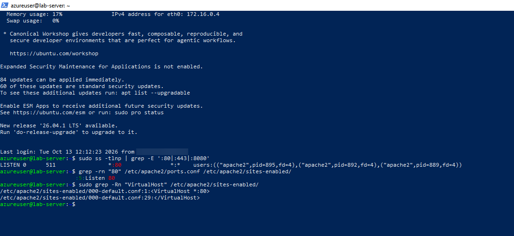

### Step 5 — Move Apache to port 8080

```bash
sudo sed -i 's/^Listen 80$/Listen 8080/' /etc/apache2/ports.conf
grep -n "Listen" /etc/apache2/ports.conf
```

Line 5 now says `Listen 8080`.

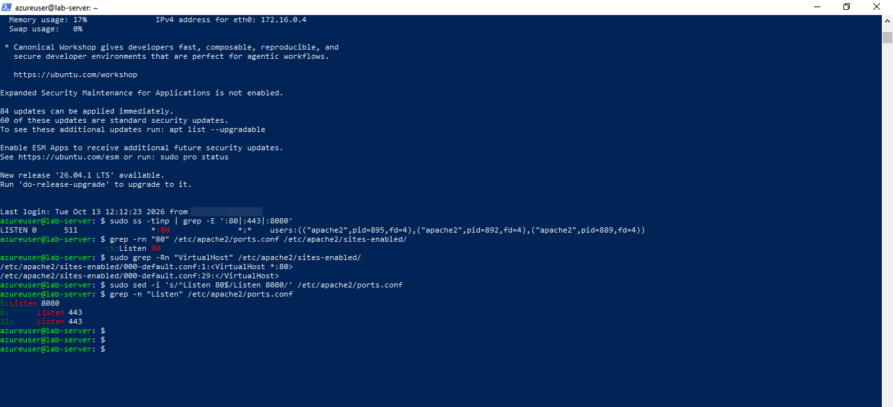

```bash
sudo sed -i 's/<VirtualHost \*:80>/<VirtualHost *:8080>/' /etc/apache2/sites-available/000-default.conf
sudo grep -n "VirtualHost" /etc/apache2/sites-enabled/000-default.conf
```

Line 1 now says `<VirtualHost *:8080>`.

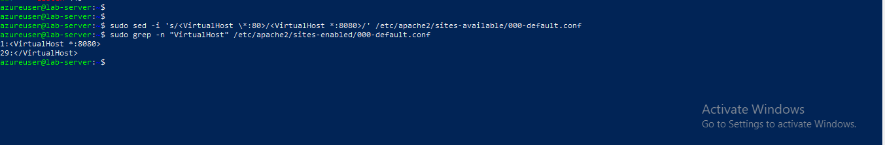

### Step 6 — Check the config and restart Apache

```bash
sudo apache2ctl configtest
```

The config test returned `Syntax OK`.

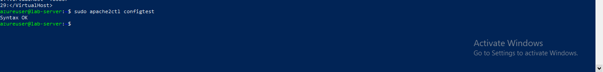

```bash
sudo systemctl restart apache2
sudo ss -tlnp | grep -E ':80|:443|:8080'
```

Apache now listens only on `*:8080`. Ports 80 and 443 are free.

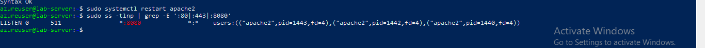

### Step 7 — Open port 443 in the Azure NSG

Before: 5 inbound rules (`HTTP` 80, `SSH` 22 and the 3 default rules).

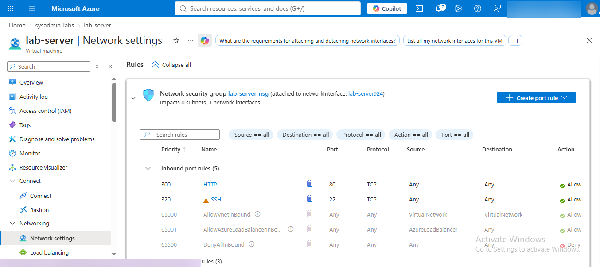

New inbound rule: destination port `443`, protocol TCP, action Allow, priority `330`, name `AllowHTTPS`.

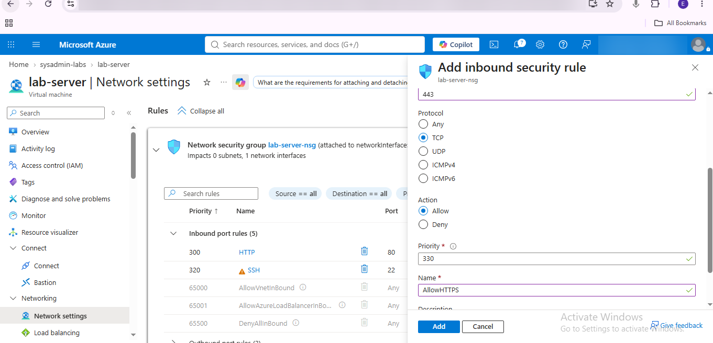

After: 6 inbound rules, with `AllowHTTPS` (443, TCP, Any, Allow) in the list.

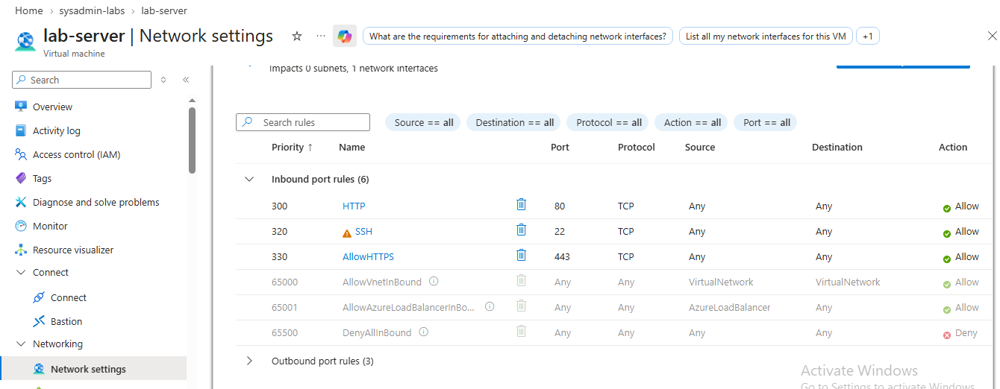

### Step 8 — Install Nginx

```bash
sudo apt install -y nginx
sudo systemctl status nginx --no-pager
```

Nginx 1.24.0 was installed and is `active (running)`.

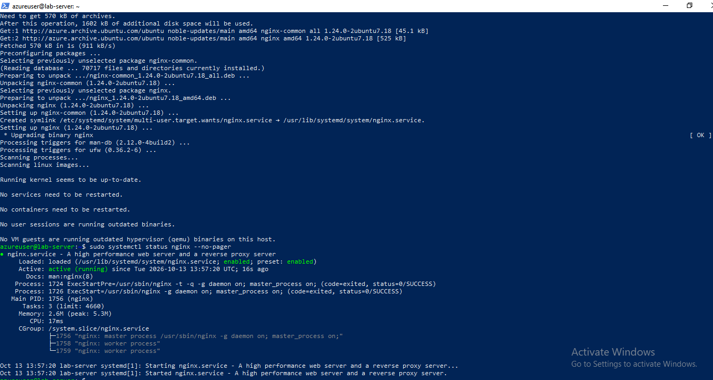

### Step 9 — Set up the reverse proxy

I wrote the proxy config to `/etc/nginx/sites-available/lab` and printed it with `cat`. At this stage it only listens on port 80:

```nginx
server {
    listen 80;
    server_name _;
    location / {
        proxy_pass http://127.0.0.1:8080;
        proxy_set_header Host $host;
        proxy_set_header X-Real-IP $remote_addr;
    }
}
```

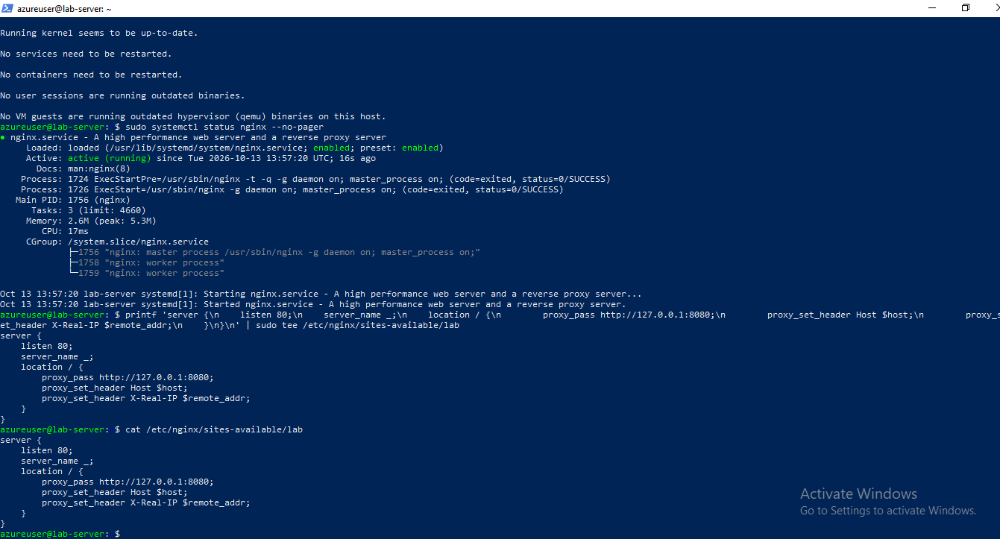

Enabled the site with a symlink and removed the default site:

```bash
sudo ln -s /etc/nginx/sites-available/lab /etc/nginx/sites-enabled/lab && sudo rm /etc/nginx/sites-enabled/default
ls -l /etc/nginx/sites-enabled/
```

`sites-enabled` now holds only `lab`, which points to `/etc/nginx/sites-available/lab`.

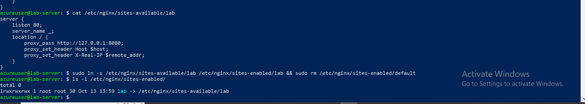

```bash
sudo nginx -t
```

`syntax is ok` and `test is successful`.

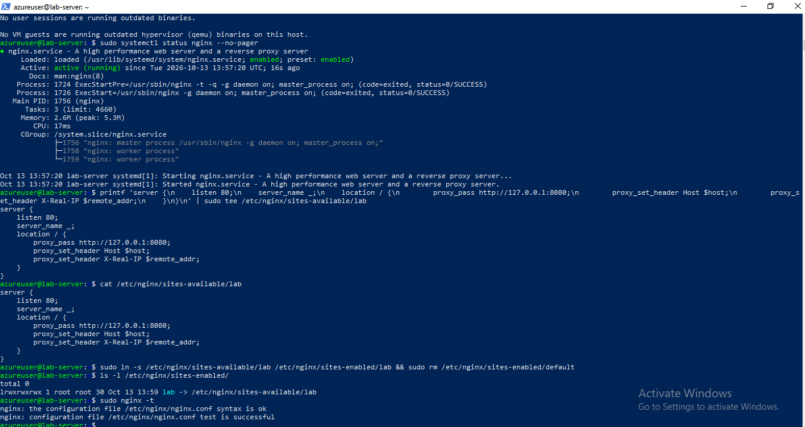

```bash
sudo systemctl reload nginx
curl -I http://localhost
```

The answer is `HTTP/1.1 200 OK` with `Server: nginx/1.24.0 (Ubuntu)`. The page itself comes from Apache on 8080, so the proxy works.

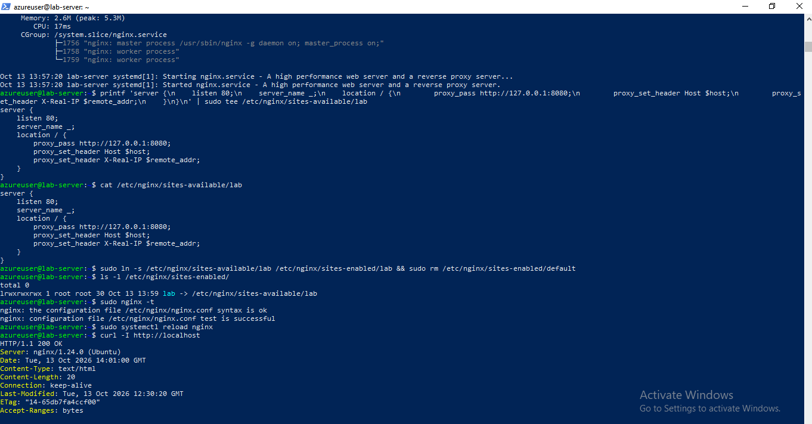

### Step 10 — Create the self-signed certificate

```bash
sudo openssl req -x509 -nodes -days 365 -newkey rsa:2048 \
  -keyout /etc/ssl/private/lab.key -out /etc/ssl/certs/lab.crt \
  -subj "/CN=<VM-PUBLIC-IP>" -addext "subjectAltName=IP:<VM-PUBLIC-IP>"
sudo ls -l /etc/ssl/private/lab.key /etc/ssl/certs/lab.crt
```

Both files exist: `lab.crt` (`-rw-r--r--`, 1151 bytes) and `lab.key` (`-rw-------`, 1704 bytes, readable only by root).

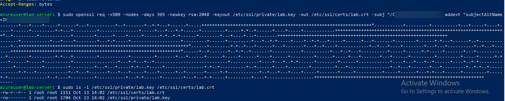

### Step 11 — Add TLS and the redirect to the Nginx config

I rewrote `/etc/nginx/sites-available/lab` with two server blocks. Port 80 redirects, port 443 serves TLS and proxies to Apache:

```nginx
server {
    listen 80;
    server_name _;
    return 301 https://$host$request_uri;
}

server {
    listen 443 ssl;
    server_name _;
    ssl_certificate /etc/ssl/certs/lab.crt;
    ssl_certificate_key /etc/ssl/private/lab.key;
    location / {
        proxy_pass http://127.0.0.1:8080;
        proxy_set_header Host $host;
        proxy_set_header X-Real-IP $remote_addr;
    }
}
```

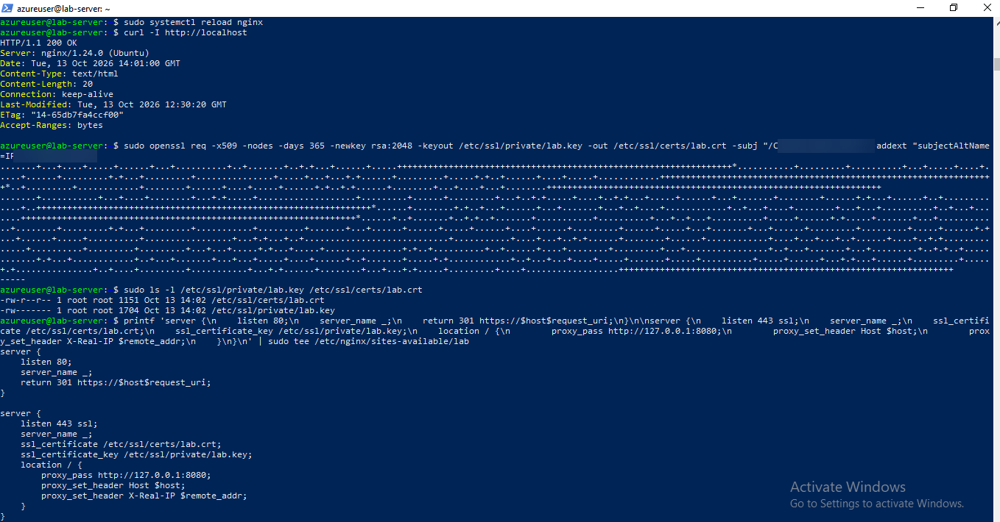

```bash
sudo nginx -t
sudo systemctl reload nginx
```

`syntax is ok`, `test is successful`, and the reload gave no error.

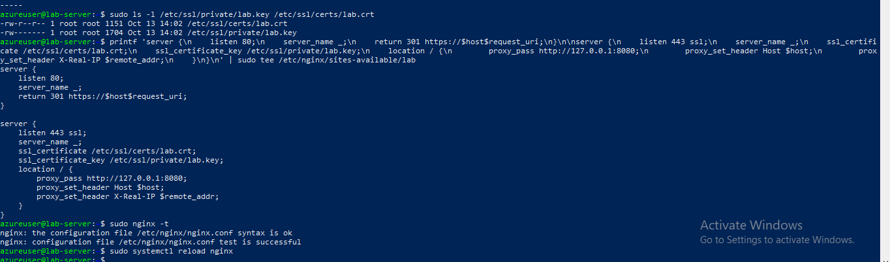

### Step 12 — Test the redirect and HTTPS from the VM

```bash
curl -I http://localhost
curl -kI https://localhost
```

HTTP answers `301 Moved Permanently` with `Location: https://localhost/`. HTTPS answers `200 OK` with `Server: nginx/1.24.0 (Ubuntu)` (`-k` is needed because the certificate is self-signed).

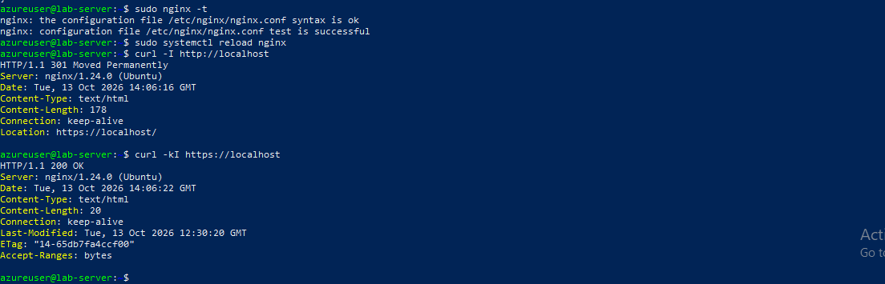

### Step 13 — Check the certificate dates

```bash
openssl x509 -in /etc/ssl/certs/lab.crt -noout -dates
```

`notBefore=Oct 13 14:02:01 2026 GMT` and `notAfter=Oct 13 14:02:01 2027 GMT`, which is 365 days.

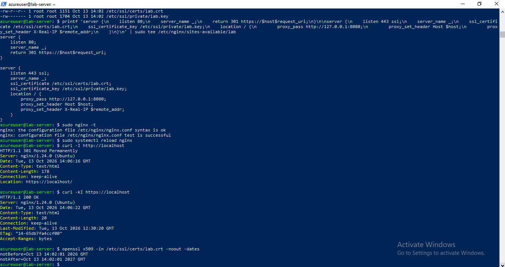

### Step 14 — Test from the laptop browser

Opening `https://<VM-PUBLIC-IP>` first shows Chrome's warning `NET::ERR_CERT_AUTHORITY_INVALID`, because the certificate is self-signed.

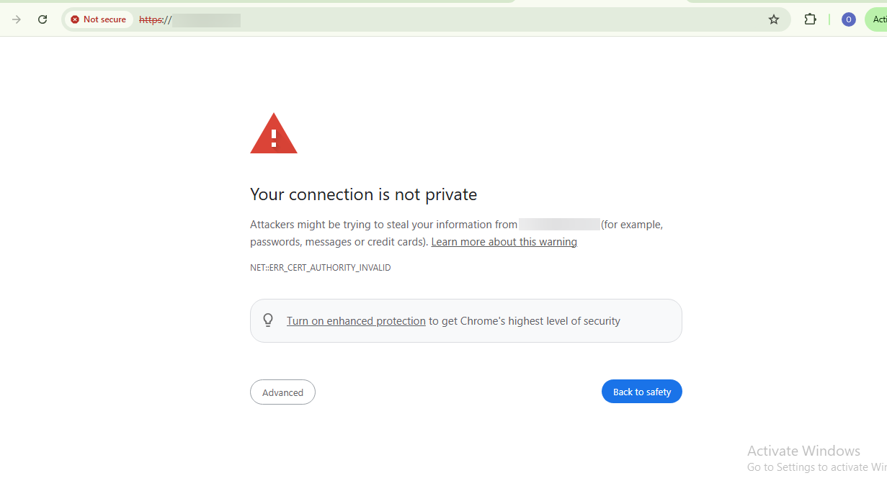

After choosing **Advanced** and proceeding, the page from Lab 1 opens ("Backup Lab"). The address bar shows `Not secure` and `https://`.

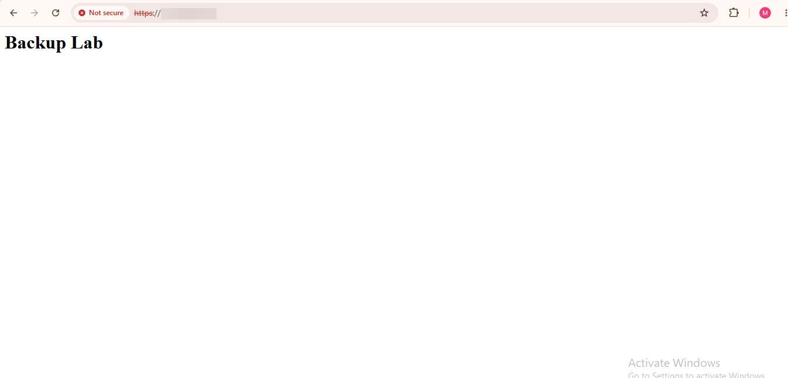

### Step 15 — Test the redirect from outside the VM

I started the VM again on 17 Oct 2026. The public IP was the same as before. From Windows PowerShell on my laptop:

```powershell
curl.exe -I http://<VM-PUBLIC-IP>
```

The answer is `HTTP/1.1 301 Moved Permanently` from `Server: nginx/1.24.0 (Ubuntu)`, with `Location: https://<VM-PUBLIC-IP>/`. This test goes through the Azure NSG, so port 80 is open from outside and the redirect works there too.

The first two lines of the output say `Could not resolve host` because my paste joined the command three times. The third copy ran correctly.

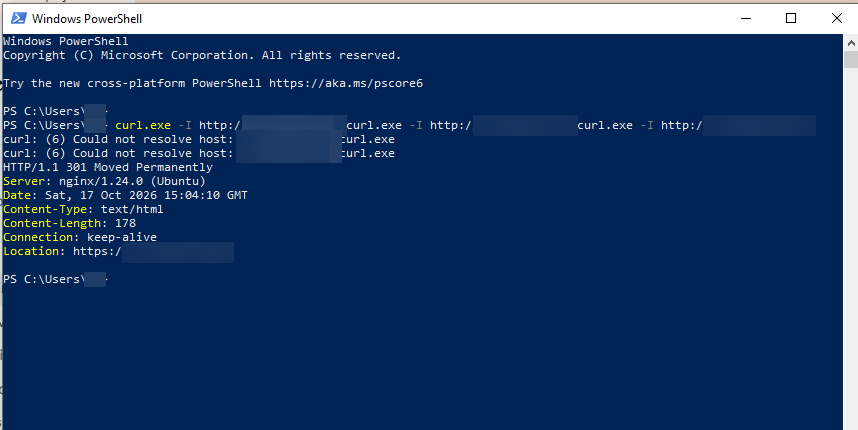

---

<a id="results"></a>
## ✅ Results

| Check | Result |
|---|---|
| Apache port | Listens only on `*:8080` (ports 80 and 443 free) |
| Apache config test | `Syntax OK` |
| NSG | `AllowHTTPS` rule added (443, TCP, Allow, priority 330), 6 inbound rules |
| Nginx | 1.24.0 installed, `active (running)` |
| Proxy test | `curl -I http://localhost` gave `200 OK`, `Server: nginx/1.24.0 (Ubuntu)` (before TLS) |
| Certificate | Self-signed, RSA 2048, CN and SAN = VM public IP, key file mode 600 |
| Certificate dates | 13 Oct 2026 14:02:01 GMT to 13 Oct 2027 14:02:01 GMT |
| HTTP | `301 Moved Permanently`, `Location: https://localhost/` |
| HTTPS | `200 OK`, `Server: nginx/1.24.0 (Ubuntu)` |
| Redirect from outside the VM | `curl.exe` on my laptop: `301`, `Location: https://<VM-PUBLIC-IP>/` |
| Browser | Certificate warning shown, then the "Backup Lab" page opened over HTTPS |

> [!NOTE]
> The page is the tiny static page from Lab 1 (20 bytes). The test proves the proxy chain works, not how it performs under load.

---

<a id="request-breaks"></a>
## 🔍 Where the Request Can Break

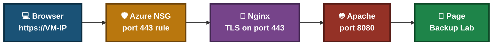

<p align="center"><em>Each box is one place where the page can fail: the Azure rule, the Nginx config, the certificate, or Apache.</em></p>

### 🔍 Analyst Note — Why Test Every Layer

A working `curl` on the VM does not prove the browser can reach the site. It skips the Azure NSG. The browser test from the laptop is the one that includes it.

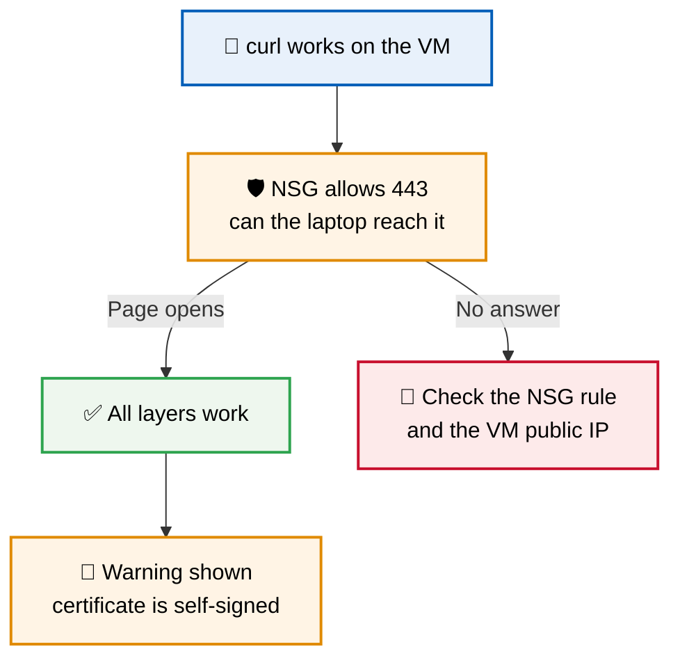

---

<a id="pipeline"></a>
## 🧭 Proxy Method Pipeline

How the lab turns a plain Apache server into an HTTPS site behind a reverse proxy

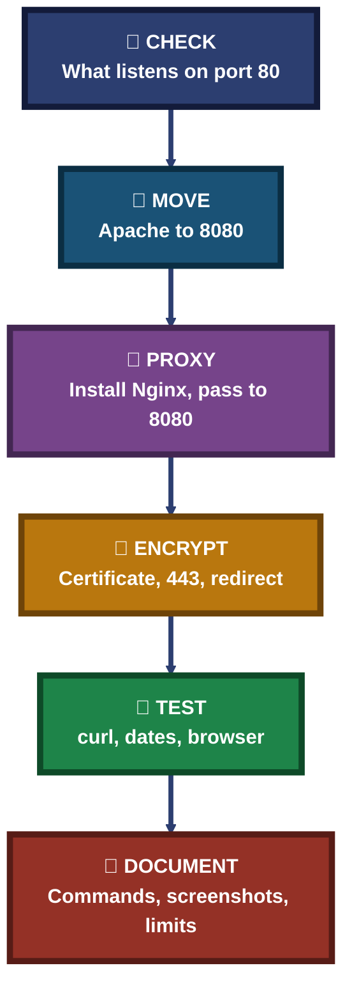

---

<a id="cheat-sheet"></a>
## 🧾 Command Cheat Sheet

| Command | Purpose |
|---------|---------|
| `sudo ss -tlnp \| grep -E ':80\|:443\|:8080'` | See which program listens on these ports |
| `sudo grep -Rn "VirtualHost" /etc/apache2/sites-enabled/` | Search through symlinks too (`-R`, not `-r`) |
| `sudo apache2ctl configtest` | Check the Apache config before restart |
| `sudo systemctl restart apache2` | Restart Apache |
| `sudo apt install -y nginx` | Install Nginx |
| `sudo ln -s <available> <enabled>` | Enable an Nginx site |
| `sudo nginx -t` | Check the Nginx config before reload |
| `sudo systemctl reload nginx` | Apply the new Nginx config |
| `sudo openssl req -x509 -nodes -days 365 -newkey rsa:2048 -keyout <key> -out <crt>` | Create a self-signed certificate |
| `openssl x509 -in <crt> -noout -dates` | Show certificate start and end dates |
| `curl -I http://localhost` | Show the response headers (redirect check) |
| `curl -kI https://localhost` | Same over HTTPS, ignoring the self-signed warning |

---

<a id="problems-fixes"></a>
## ⚠️ Challenges & Fixes

| ❌ Challenge | ✅ Solution |
|---|---|
| `grep -rn "80"` on `sites-enabled` did not show the `<VirtualHost *:80>` line | Files in `sites-enabled` are symlinks and `-r` skips them. Used `grep -Rn` (capital R) and found the line in `000-default.conf` |

---

<a id="scope-limitations"></a>
## 🚧 Scope & Limitations

- **Self-signed certificate.** Browsers show a warning because no trusted authority signed it. I had no domain name, so I did not use Let's Encrypt.
- **The certificate is for the IP address.** If the IP changes, the name no longer matches and the browser warns again.
- **The NSG rule for SSH (port 22) is open to any source.** Azure shows an orange warning on it. I did not restrict it in this lab.
- **Tiny test page.** It proves the chain works, not how it behaves under real traffic.

---

<a id="what-i-learned"></a>
## 🧠 What I Learned

- **Two web servers cannot share one port.** Apache had to move to 8080 before Nginx could use port 80.
- **A reverse proxy** takes the request from the outside and hands it to the backend. The `Server:` header showed `nginx` even though Apache served the page.
- **`grep -r` skips symlinks,** which matters in `sites-enabled` folders.
- **Test the config first.** `apache2ctl configtest` and `nginx -t` catch mistakes before a restart or reload.
- **Azure has its own firewall layer.** Port 443 had to be allowed in the NSG as well as configured on the VM.
- **A self-signed certificate encrypts traffic but is not trusted,** which is why the browser warns.

---

<a id="skills-demonstrated"></a>
## 🛠️ Skills Demonstrated

- Connecting to a Linux server over SSH with a key
- Reading listening ports with `ss` and changing Apache's port
- Installing and configuring Nginx as a reverse proxy
- Creating a self-signed TLS certificate with OpenSSL
- Setting up an HTTP-to-HTTPS redirect
- Opening a port in an Azure network security group
- Testing a web service with `curl` and a browser
- Documenting a lab with commands, screenshots and honest limits

---

<a id="folder-structure"></a>
## 📁 Folder Structure

```text
lab02-nginx-tls/
|-- README.md
|-- INDEX.md
`-- screenshots/
    |-- 00-vm-stopped-before-resize.png
    |-- 01-vm-started-b2ls-v2.png
    |-- 02-ssh-login.png
    |-- 03-ports-before.png
    |-- 04a-grep-ports-conf-only.png
    |-- 04-apache-config-before.png
    |-- 05-ports-conf-changed.png
    |-- 06-virtualhost-changed.png
    |-- 07-apache-configtest.png
    |-- 08-apache-on-8080.png
    |-- 09-nsg-before.png
    |-- 10-nsg-rule-form.png
    |-- 11-nsg-443-rule.png
    |-- 12-nginx-installed.png
    |-- 13-nginx-lab-config.png
    |-- 14-nginx-site-enabled.png
    |-- 15-nginx-configtest.png
    |-- 16-curl-nginx-proxy.png
    |-- 17-cert-created.png
    |-- 18-nginx-tls-config.png
    |-- 19-nginx-tls-configtest.png
    |-- 20-redirect-and-https.png
    |-- 21-cert-expiry.png
    |-- 22-browser-warning.png
    |-- 23-browser-https-page.png
    `-- 24-redirect-from-laptop.png
```
