

# 🛡️ Lab 03 — Index
### SSH Hardening, Firewall & Patching
**Lab 03 — Linux SysAdmin Labs**

**Quick guide to every step and screenshot in this lab.**

### [📖 Open the full README](README.md)

---

| 🧩 Steps | 🖼️ Screenshots | 🛠️ Tools Used | 📦 Updates Left |
|:---:|:---:|:---:|:---:|
| **12** | **30** | **5** | **0** |

🧩 <b>Case:</b> Snapshot <code>lab-server-before-lab3</code> · ufw ports 22, 80, 443 · kernel <code>6.17.0-1022-azure</code> → <code>7.0.0-1017-azure</code>

---

## 📑 Step Index

| # | Step | Module | Result | Evidence |
|:---:|---|:---:|---|:---:|
| 1 | Check the VM in Azure | 🟣 Module 1 | `lab-server` running, B2ls_v2 | [Exhibit 1](#ex1) |
| 2 | Take a snapshot before changing anything | 🟣 Module 1 | Snapshot `lab-server-before-lab3` created | [Exhibits 2–5](#ex2) |
| 3 | Record the SSH settings before | 🟣 Module 1 | Root login `without-password`, password login `no` | [Exhibit 6](#ex6) |
| 4 | Open a second SSH window | 🟣 Module 1 | Safety net open, 84 updates pending | [Exhibit 7](#ex7) |
| 5 | Turn on the firewall (ufw) | 🔵 Module 2 | Active, ports 22, 80, 443 allowed | [Exhibits 8–12](#ex8) |
| 6 | Check that the website still works | 🔵 Module 2 | `Backup Lab` opens over HTTPS | [Exhibits 13–14](#ex13) |
| 7 | Harden SSH | 🔵 Module 2 | Root login `no`, 3 tries, 30 s, new login works | [Exhibits 15–19](#ex15) |
| 8 | Install the updates | 🟠 Module 3 | 73 upgradable after refresh, none left after upgrade | [Exhibits 20–23](#ex20) |
| 9 | Reboot and check the kernel | 🟠 Module 3 | Kernel `7.0.0-1017-azure`, 0 updates | [Exhibit 24](#ex24) |
| 10 | Check the firewall and services after the reboot | 🟠 Module 3 | ufw, Nginx, Apache, MySQL active, site opens | [Exhibits 25–26](#ex25) |
| 11 | Turn on automatic updates | 🟢 Module 4 | `unattended-upgrades` enabled and active | [Exhibit 27](#ex27) |
| 12 | Install and check fail2ban | 🟢 Module 4 | `sshd` jail active, 1 IP banned | [Exhibits 28–30](#ex28) |

---

## 🟣 Module 1 — Safety Net

Exhibits 1 to 7.

<table>
<tr>
<td align="center" valign="top" width="50%">

<a href="screenshots/01-vm-running.png">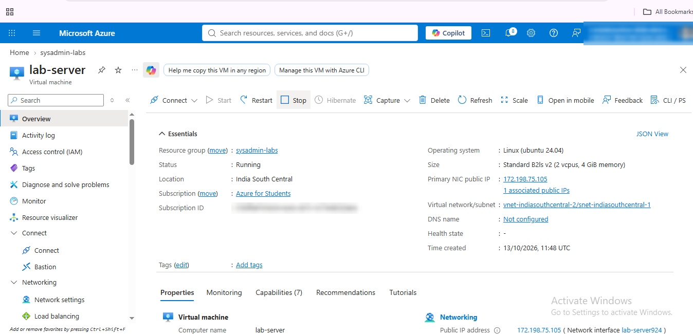</a>
 <b>Exhibit 1 — VM running</b>
 <code>lab-server</code>, Standard B2ls_v2, status Running
</td>
<td align="center" valign="top" width="50%">

<a href="screenshots/02-vm-disks.png">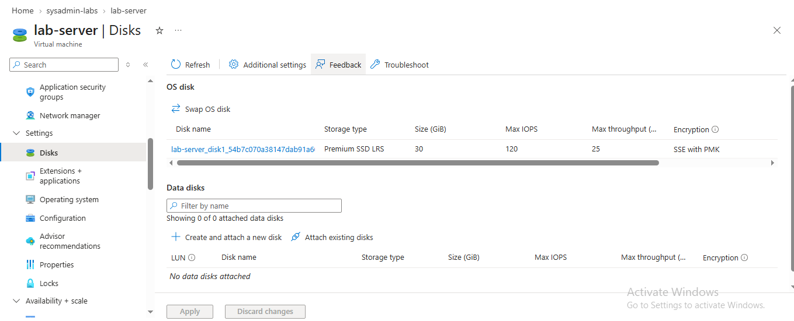</a>
 <b>Exhibit 2 — OS disk</b>
 30 GiB Premium SSD, no data disks
</td>
</tr>
<tr>
<td align="center" valign="top" width="50%">

<a href="screenshots/03-os-disk-page.png">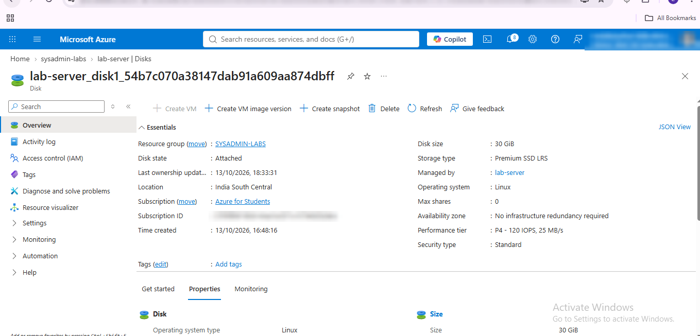</a>
 <b>Exhibit 3 — Create snapshot</b>
 OS disk page with the snapshot option
</td>
<td align="center" valign="top" width="50%">

<a href="screenshots/04-snapshot-form.png">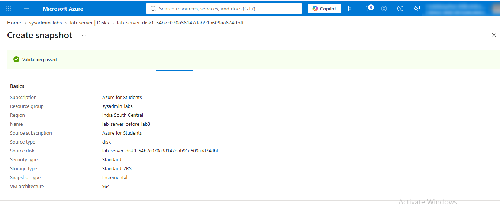</a>
 <b>Exhibit 4 — Snapshot form</b>
 <code>lab-server-before-lab3</code>, Incremental, validation passed
</td>
</tr>
<tr>
<td align="center" valign="top" width="50%">

<a href="screenshots/05-snapshot-created.png">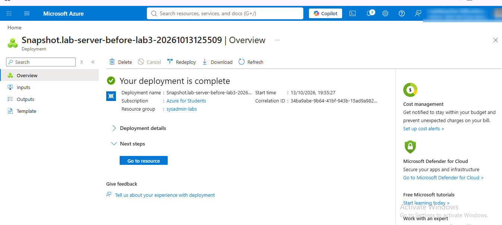</a>
 <b>Exhibit 5 — Snapshot created</b>
 Deployment complete
</td>
<td align="center" valign="top" width="50%">

<a href="screenshots/06-ssh-settings-before.png">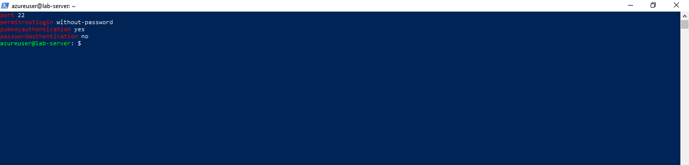</a>
 <b>Exhibit 6 — SSH settings before</b>
 Root login <code>without-password</code>, password login <code>no</code>
</td>
</tr>
<tr>
<td align="center" valign="top" width="50%">

<a href="screenshots/07-second-ssh-window.png">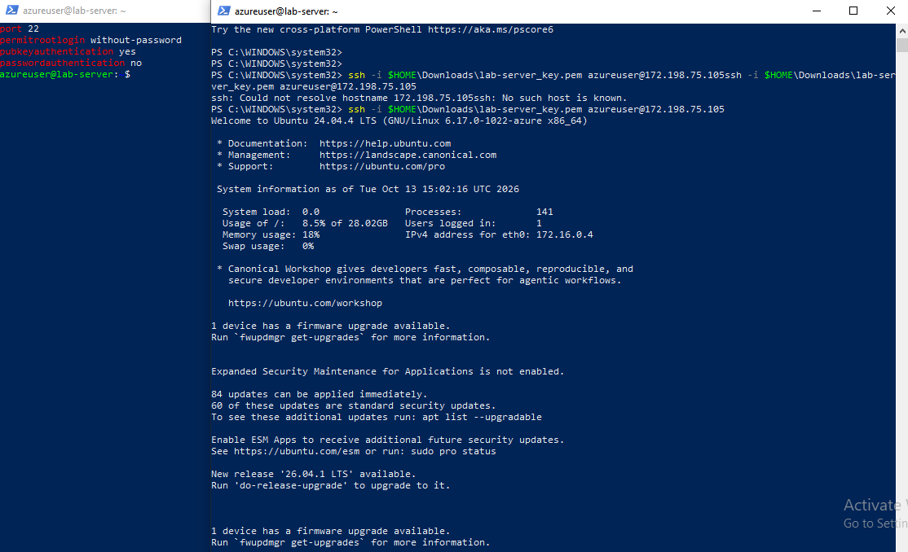</a>
 <b>Exhibit 7 — Second SSH window</b>
 Safety net open, banner shows 84 updates (60 security)
</td>
<td width="50%"></td>
</tr>
</table>

---

## 🔵 Module 2 — Firewall and SSH

Exhibits 8 to 19.

<table>
<tr>
<td align="center" valign="top" width="50%">

<a href="screenshots/08-ufw-allow-ssh.png">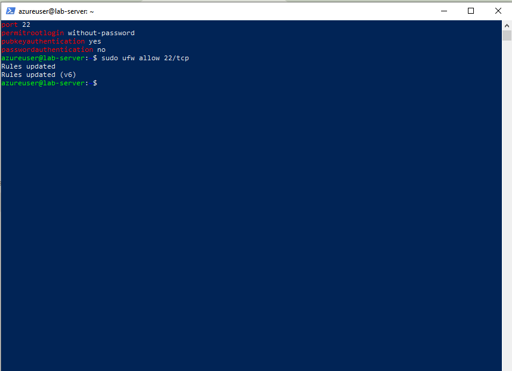</a>
 <b>Exhibit 8 — Allow SSH in ufw</b>
 Rule added before ufw is turned on
</td>
<td align="center" valign="top" width="50%">

<a href="screenshots/09-ufw-allow-80.png">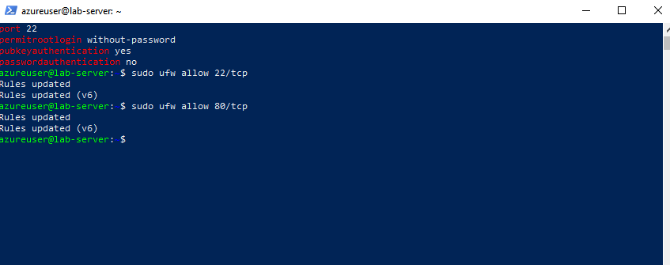</a>
 <b>Exhibit 9 — Allow port 80</b>
 HTTP rule added
</td>
</tr>
<tr>
<td align="center" valign="top" width="50%">

<a href="screenshots/10-ufw-allow-443.png">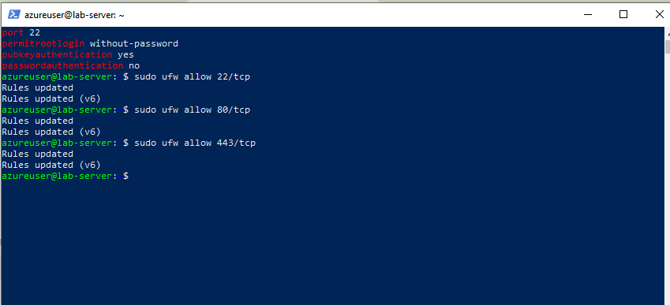</a>
 <b>Exhibit 10 — Allow port 443</b>
 HTTPS rule added
</td>
<td align="center" valign="top" width="50%">

<a href="screenshots/11-ufw-enabled.png">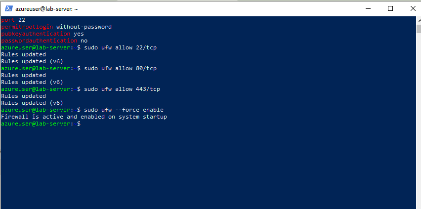</a>
 <b>Exhibit 11 — ufw enabled</b>
 Firewall active and enabled on system startup
</td>
</tr>
<tr>
<td align="center" valign="top" width="50%">

<a href="screenshots/12-ufw-status.png">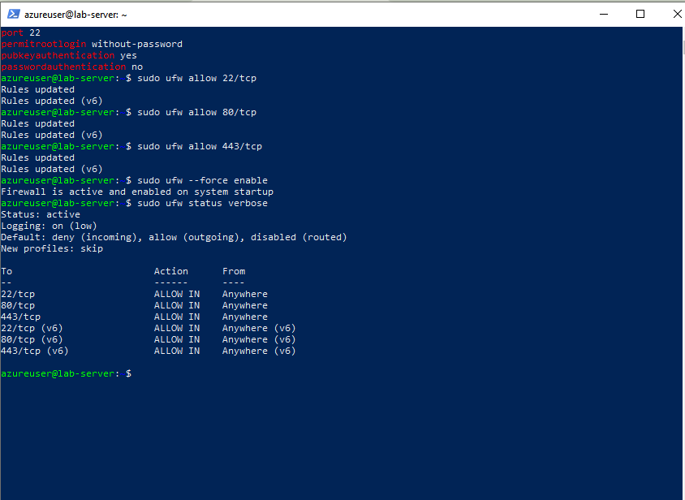</a>
 <b>Exhibit 12 — ufw status</b>
 22, 80, 443 allowed for IPv4 and IPv6
</td>
<td align="center" valign="top" width="50%">

<a href="screenshots/13-browser-warning-after-ufw.png">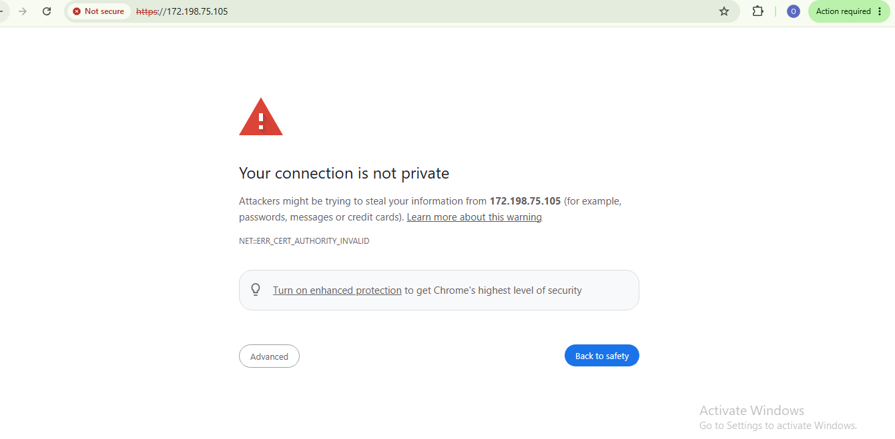</a>
 <b>Exhibit 13 — Browser warning after ufw</b>
 Self-signed certificate warning, Nginx reached on 443
</td>
</tr>
<tr>
<td align="center" valign="top" width="50%">

<a href="screenshots/14-website-after-ufw.png">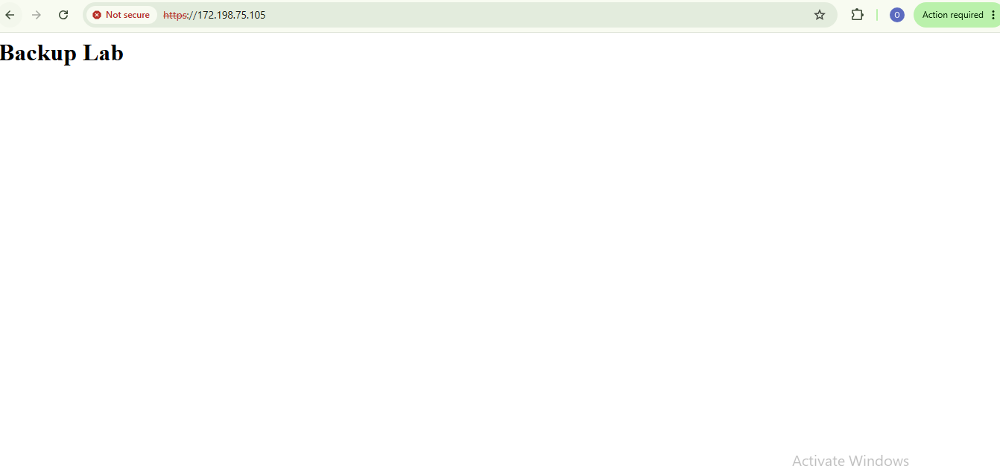</a>
 <b>Exhibit 14 — Website after ufw</b>
 <code>Backup Lab</code> page opens over HTTPS
</td>
<td align="center" valign="top" width="50%">

<a href="screenshots/15-ssh-hardening-file.png">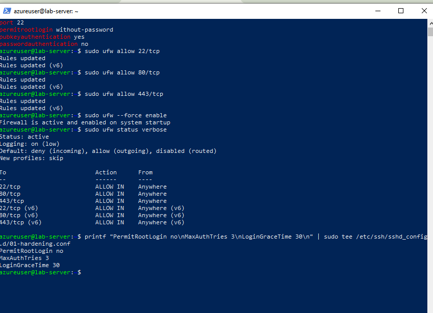</a>
 <b>Exhibit 15 — SSH hardening file</b>
 <code>PermitRootLogin no</code>, <code>MaxAuthTries 3</code>, <code>LoginGraceTime 30</code>
</td>
</tr>
<tr>
<td align="center" valign="top" width="50%">

<a href="screenshots/16-sshd-configtest.png">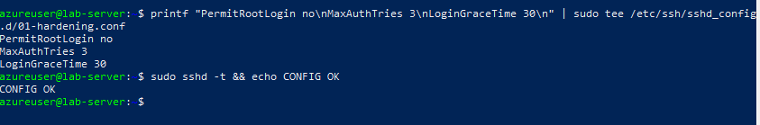</a>
 <b>Exhibit 16 — SSH config test</b>
 <code>CONFIG OK</code> before the restart
</td>
<td align="center" valign="top" width="50%">

<a href="screenshots/17-ssh-restarted.png">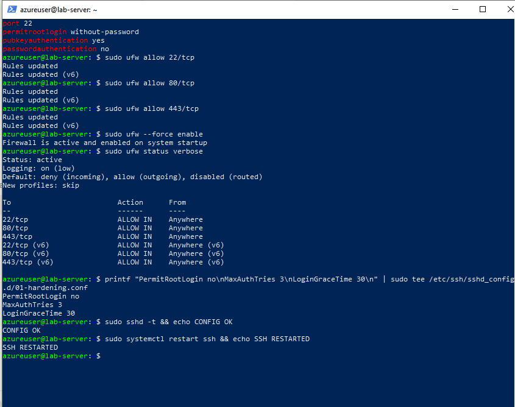</a>
 <b>Exhibit 17 — SSH restarted</b>
 <code>SSH RESTARTED</code>
</td>
</tr>
<tr>
<td align="center" valign="top" width="50%">

<a href="screenshots/18-new-login-after-restart.png">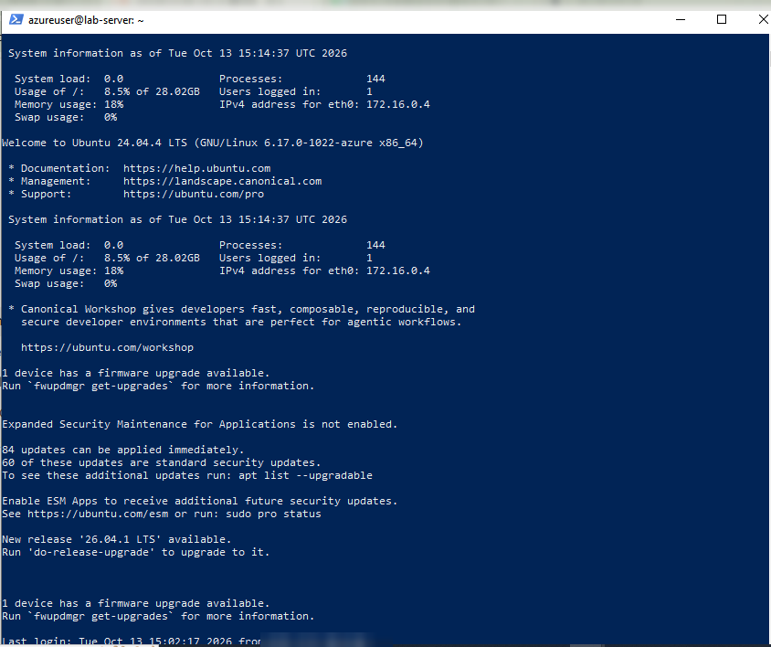</a>
 <b>Exhibit 18 — New login</b>
 Fresh login from the laptop
</td>
<td align="center" valign="top" width="50%">

<a href="screenshots/19-ssh-settings-after.png">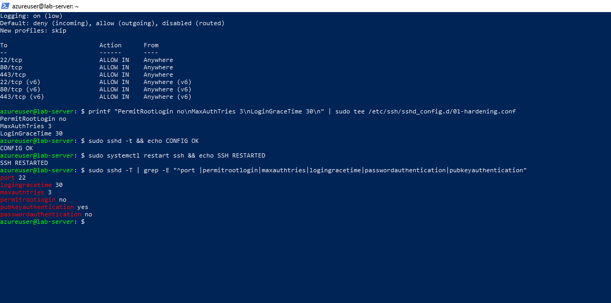</a>
 <b>Exhibit 19 — SSH settings after</b>
 Root login <code>no</code>, 3 tries, 30 s grace time
</td>
</tr>
</table>

---

## 🟠 Module 3 — Patching

Exhibits 20 to 26.

<table>
<tr>
<td align="center" valign="top" width="50%">

<a href="screenshots/20-updates-pending-list.png">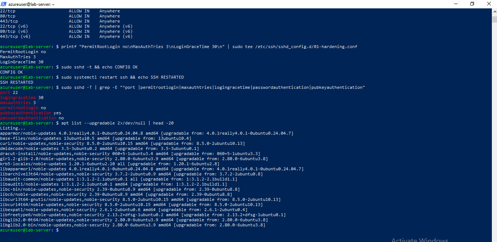</a>
 <b>Exhibit 20 — Pending updates</b>
 First 20 packages from the upgradable list
</td>
<td align="center" valign="top" width="50%">

<a href="screenshots/21-apt-update.png">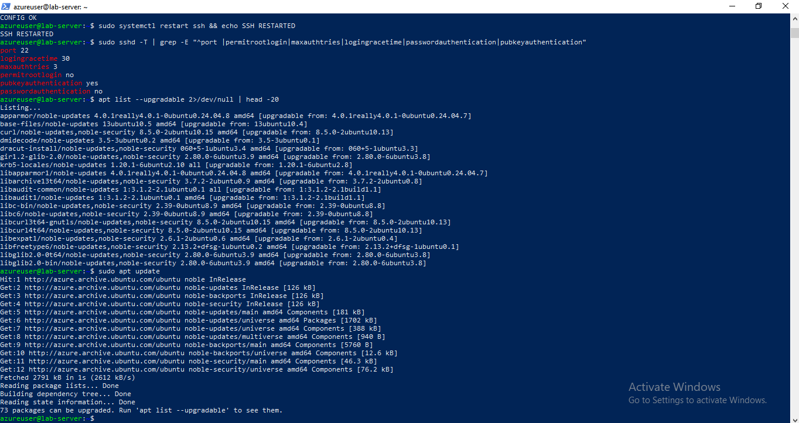</a>
 <b>Exhibit 21 — Package lists refreshed</b>
 73 packages can be upgraded
</td>
</tr>
<tr>
<td align="center" valign="top" width="50%">

<a href="screenshots/22-apt-upgrade-kernel-pending.png">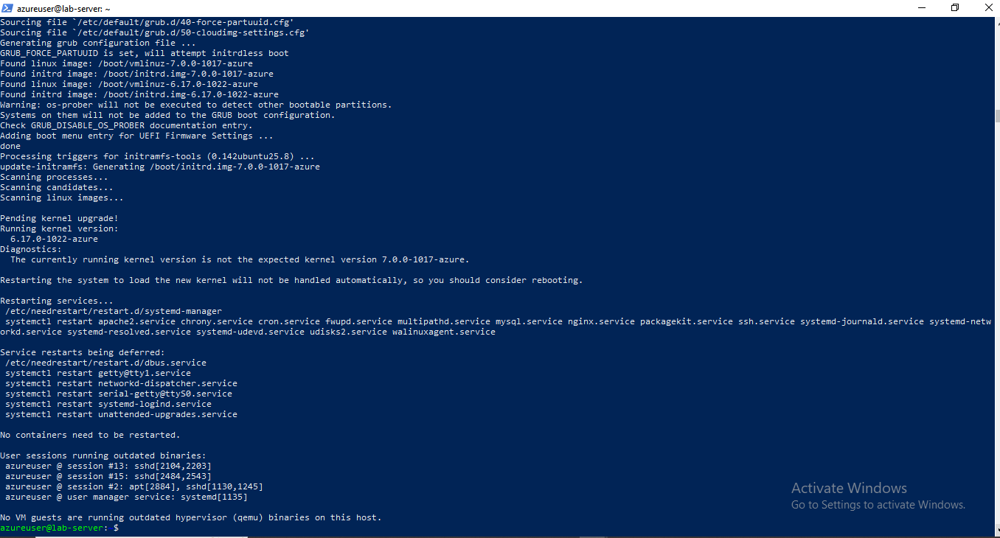</a>
 <b>Exhibit 22 — Upgrade output</b>
 Pending kernel upgrade, services restarted
</td>
<td align="center" valign="top" width="50%">

<a href="screenshots/23-apt-history-log.png">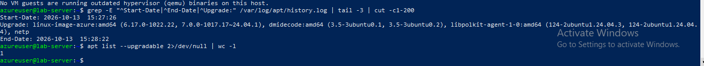</a>
 <b>Exhibit 23 — apt history</b>
 Upgrade list and run time, no package left
</td>
</tr>
<tr>
<td align="center" valign="top" width="50%">

<a href="screenshots/24-reboot-and-relogin.png">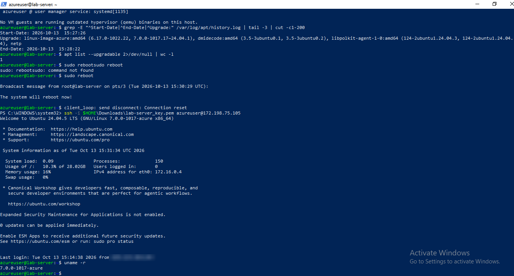</a>
 <b>Exhibit 24 — Reboot and re-login</b>
 Kernel <code>7.0.0-1017-azure</code>, 0 updates
</td>
<td align="center" valign="top" width="50%">

<a href="screenshots/25-ufw-and-services-after-reboot.png">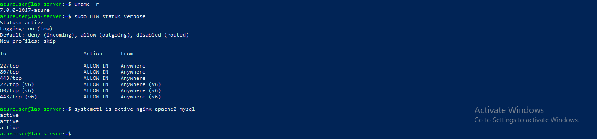</a>
 <b>Exhibit 25 — Firewall and services after reboot</b>
 ufw active, Nginx, Apache and MySQL active
</td>
</tr>
<tr>
<td align="center" valign="top" width="50%">

<a href="screenshots/26-website-after-reboot.png">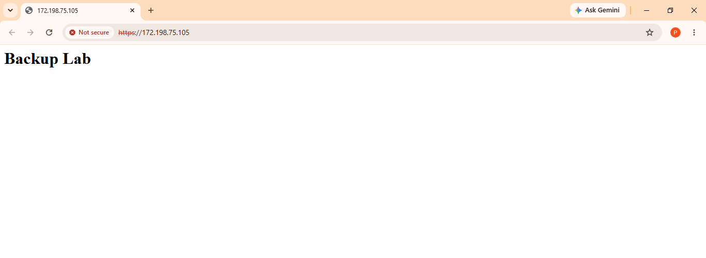</a>
 <b>Exhibit 26 — Website after reboot</b>
 <code>Backup Lab</code> still opens
</td>
<td width="50%"></td>
</tr>
</table>

---

## 🟢 Module 4 — Automation and Protection

Exhibits 27 to 30.

<table>
<tr>
<td align="center" valign="top" width="50%">

<a href="screenshots/27-unattended-upgrades-status.png">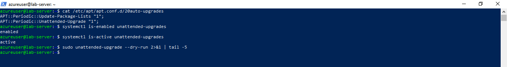</a>
 <b>Exhibit 27 — Automatic updates</b>
 Service enabled and active, both config lines set to 1
</td>
<td align="center" valign="top" width="50%">

<a href="screenshots/28-fail2ban-installed.png">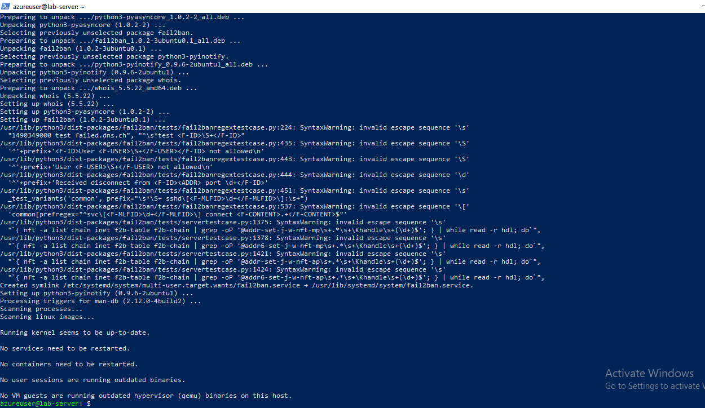</a>
 <b>Exhibit 28 — fail2ban installed</b>
 Install output ends cleanly
</td>
</tr>
<tr>
<td align="center" valign="top" width="50%">

<a href="screenshots/29-fail2ban-enabled-and-status.png">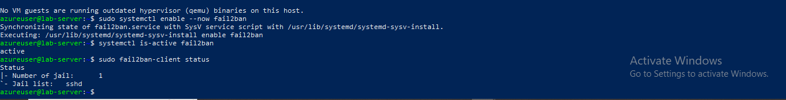</a>
 <b>Exhibit 29 — fail2ban enabled</b>
 Service active, 1 jail: <code>sshd</code>
</td>
<td align="center" valign="top" width="50%">

<a href="screenshots/30-fail2ban-sshd-jail.png">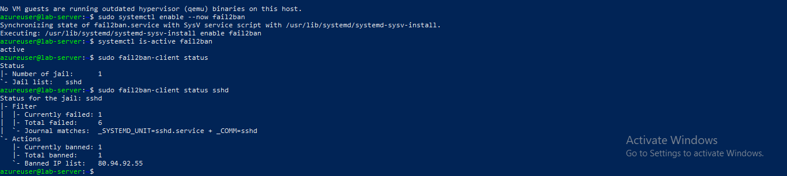</a>
 <b>Exhibit 30 — sshd jail status</b>
 6 failed logins, 1 IP banned
</td>
</tr>
</table>

---

## 📝 Verdict

**Complete** — firewall on, SSH tightened, server patched and rebooted into the new kernel, automatic updates and fail2ban running, and the website still works.

| Element | Finding |
|---|---|
| Firewall | `ufw` active, default deny incoming, 22, 80, 443 allowed |
| SSH | `PermitRootLogin no`, `MaxAuthTries 3`, `LoginGraceTime 30`, password login already `no` |
| Updates | 84 in the login banner → 0 after upgrade and reboot |
| Kernel | `6.17.0-1022-azure` → `7.0.0-1017-azure` |
| Automatic updates | `unattended-upgrades` enabled and active |
| fail2ban | Active, 1 jail (`sshd`), 1 IP banned |

---

## 🎯 Verification Checklist

| Check | Method | Module | Status |
|:---:|---|---|:---:|
| Snapshot created | Azure deployment complete | Module 1 | ✅ Confirmed |
| Only ports 22, 80, 443 allowed | `ufw status verbose` | Module 2 | ✅ Confirmed |
| Website opens after ufw | Browser, HTTPS page | Module 2 | ✅ Confirmed |
| SSH settings applied | `sshd -T` before and after | Module 2 | ✅ Confirmed |
| SSH config valid | `sshd -t` returned `CONFIG OK` | Module 2 | ✅ Confirmed |
| SSH login works after the changes | Fresh login from the laptop, also after the reboot | Modules 2 + 3 | ✅ Confirmed |
| New kernel running | `uname -r` after reboot, 0 updates in the banner | Module 3 | ✅ Confirmed |
| Services and firewall after reboot | `systemctl is-active`, `ufw status`, browser | Module 3 | ✅ Confirmed |
| Automatic updates on | `systemctl is-enabled` and `is-active` | Module 4 | ✅ Confirmed |
| fail2ban jail running | `fail2ban-client status sshd` | Module 4 | ✅ Confirmed |

> [!NOTE]
> The order matters: ufw allows SSH before it is turned on, and the SSH config is tested with `sshd -t` before the restart. A second SSH window and the snapshot were ready as a way back, and neither was needed.

---

[⬆️ Back to top](#top) &nbsp;·&nbsp; [📖 Full README](README.md)

☁️ **[Azure portal](https://portal.azure.com/)** · 🔐 **[OpenSSH](https://www.openssh.com/)** · 🚫 **[fail2ban](https://github.com/fail2ban/fail2ban)** · 🐧 **[Ubuntu](https://ubuntu.com/)**

