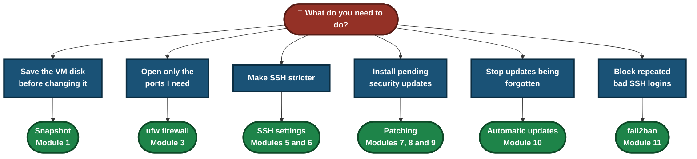
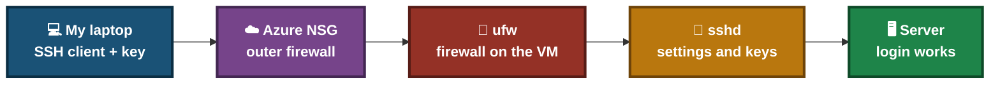
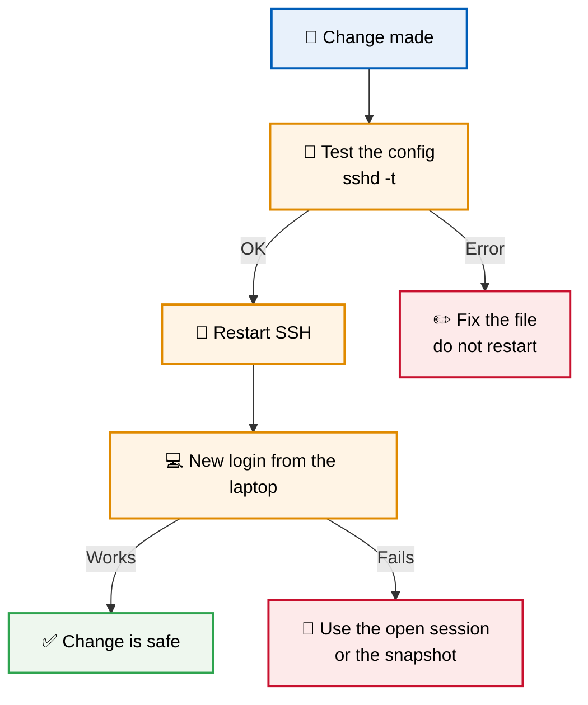
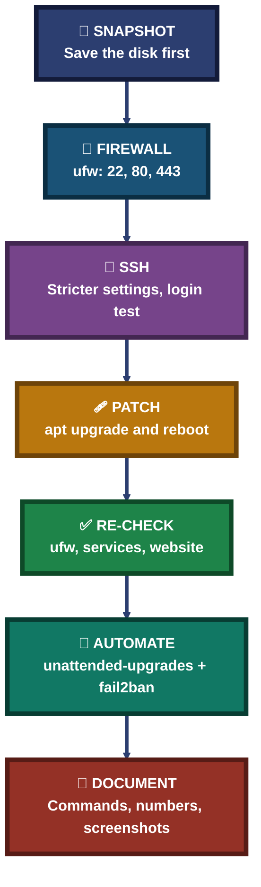

<div align="center">

# 🔐 Lab 03 — SSH Hardening, Firewall & Patching

**Ubuntu 24.04 on Azure · sshd Settings · ufw Firewall · apt Patching · Reboot · Unattended Upgrades · fail2ban**

A hands-on Linux sysadmin lab. I took a snapshot of the VM, set up a `ufw` firewall, tightened the SSH settings, installed 73 pending updates, rebooted into a new kernel, turned on automatic security updates, and added `fail2ban` for SSH. After each change I checked that I could still log in and that the website still worked.


The method: take a snapshot, change one thing, test that access still works, and keep the evidence.

### [📸 Jump to the modules](#modules)  ·  [🗂 Screenshot index](INDEX.md)

</div>

---

## 📑 Table of Contents

1. [At a Glance](#at-a-glance)
2. [Objective](#objective)
3. [Environment](#environment)
4. [Tools & Technologies](#tools)
5. [The Lab Flow](#flow)
6. [Which Module Do I Need?](#which-module)
7. [Modules](#modules)
8. [Results](#results)
9. [Where a Lock-Out Can Happen](#lockout)
10. [Hardening Method Pipeline](#pipeline)
11. [Command Cheat Sheet](#cheat-sheet)
12. [Challenges & Fixes](#problems-fixes)
13. [Scope & Limitations](#scope-limitations)
14. [What I Learned](#what-i-learned)
15. [Skills Demonstrated](#skills-demonstrated)
16. [Folder Structure](#folder-structure)

---

<a id="at-a-glance"></a>
## 📊 At a Glance

| 🖥 Server | 📦 Pending Updates | 🧬 Kernel | 🛡 SSH Jail |
|:---:|:---:|:---:|:---:|
| **1 Ubuntu 24.04 VM** | **84 → 0** | **6.17.0-1022 → 7.0.0-1017** | **fail2ban `sshd`, 1 IP banned** |

---

<a id="objective"></a>
## 🎯 Objective

Show that I can harden a small public Linux server without locking myself out of it.

- Take a disk snapshot before changing anything.
- Turn on the `ufw` firewall with SSH, HTTP and HTTPS allowed.
- Tighten the SSH settings (`PermitRootLogin no`, `MaxAuthTries 3`, `LoginGraceTime 30`) and check them with `sshd -T`.
- Install all pending updates, reboot, and confirm the new kernel is running.
- Turn on automatic security updates.
- Install `fail2ban` and check the SSH jail.
- After patching, confirm that the firewall, the services and the website still work.

<div align="center">

### 🧩 Lab Workflow at a Glance

<table>
<tr>
<td align="center" valign="top" width="18%">

**📸 Snapshot**<br>
<sub>Save the disk<br>before changes</sub>

</td>
<td align="center" valign="middle" width="2.5%">

**➜**

</td>
<td align="center" valign="top" width="18%">

**🧱 Harden**<br>
<sub>ufw rules and<br>SSH settings</sub>

</td>
<td align="center" valign="middle" width="2.5%">

**➜**

</td>
<td align="center" valign="top" width="18%">

**🩹 Patch**<br>
<sub>apt upgrade<br>and reboot</sub>

</td>
<td align="center" valign="middle" width="2.5%">

**➜**

</td>
<td align="center" valign="top" width="18%">

**🤖 Automate**<br>
<sub>Automatic<br>security updates</sub>

</td>
<td align="center" valign="middle" width="2.5%">

**➜**

</td>
<td align="center" valign="top" width="18%">

**🚫 Block**<br>
<sub>fail2ban<br>for SSH</sub>

</td>
</tr>
<tr>
<td colspan="9" align="center">


<br>
<sub>Built-in Ubuntu tools and free packages, no paid software</sub>

</td>
</tr>
</table>

</div>

---

<a id="environment"></a>
## 🧱 Environment

| Item | Value |
|---|---|
| Cloud | Azure virtual machine, India South Central |
| VM name / size | `lab-server` · Standard B2ls v2 (2 vCPU, 4 GiB) |
| Disk | 30 GiB, Premium SSD LRS |
| Operating system | Ubuntu 24.04.4 LTS before patching, 24.04.5 LTS after |
| Kernel | `6.17.0-1022-azure` before, `7.0.0-1017-azure` after |
| Other services on the VM | Nginx, Apache and MySQL (from Lab 1 and Lab 2) |
| Access | SSH with a key file from my Windows laptop, user `azureuser` |
| Firewall (`ufw`) | Turned on in this lab |
| Date of lab | 13 Oct 2026 (VM clock is UTC) |

> [!NOTE]
> The subscription ID, account email and deployment correlation ID are blurred in the Azure screenshots.

---

<a id="tools"></a>
## 🛠️ Tools & Technologies

| Tool | Purpose |
|------|---------|
| `ssh` | Connect to the VM from my laptop with a key file |
| `ufw` | Host firewall on the VM |
| `sshd -t`, `sshd -T` | Test the SSH config and print the settings the server really uses |
| `systemctl` | Restart SSH, check service status, enable services |
| `apt list`, `apt update`, `apt upgrade` | See, refresh and install updates |
| `reboot`, `uname -r` | Restart the VM and check the running kernel |
| `unattended-upgrades` | Install security updates automatically |
| `fail2ban-client` | Check the `sshd` jail and banned IPs |
| Azure portal | Create the disk snapshot |

---

<a id="flow"></a>
## ⏱️ The Lab Flow

```mermaid
flowchart LR
    subgraph G1["🟣 PREPARE"]
        direction TB
        A1["Snapshot<br/>lab-server-before-lab3"]
        A2["Baseline<br/>sshd -T before"]
    end
    subgraph G2["🔵 HARDEN"]
        direction TB
        B1["Firewall<br/>ufw 22, 80, 443"]
        B2["SSH settings<br/>root off, 3 tries, 30 s"]
        B3["Test login<br/>key still works"]
    end
    subgraph G3["🟠 PATCH"]
        direction TB
        C1["apt update + upgrade<br/>73 packages"]
        C2["Reboot<br/>new kernel"]
        C3["Re-check<br/>ufw, services, website"]
    end
    subgraph G4["🟢 PROTECT"]
        direction TB
        D1["Auto updates<br/>unattended-upgrades"]
        D2["fail2ban<br/>sshd jail"]
    end
    G1 ==> G2 ==> G3 ==> G4

    classDef pr fill:#f0eaf8,stroke:#6f42c1,stroke-width:2px,color:#000
    classDef po fill:#e8f1fb,stroke:#005EB8,stroke-width:2px,color:#000
    classDef di fill:#fff4e5,stroke:#e08a00,stroke-width:2px,color:#000
    classDef re fill:#eef7ee,stroke:#2ea44f,stroke-width:2px,color:#000
    class A1,A2 pr
    class B1,B2,B3 po
    class C1,C2,C3 di
    class D1,D2 re
```



<p align="center"><em>The groups show the four stages of the lab, from preparing the VM to adding automatic protection.</em></p>

---

<a id="which-module"></a>
## 🧭 Which Module Do I Need?



---

<a id="modules"></a>
## 📸 Modules

### Module 1 — Check the VM and take a snapshot

The VM `lab-server` in the `sysadmin-labs` resource group: Linux (Ubuntu 24.04), Standard B2ls v2, India South Central, created 13/10/2026 11:48 UTC. Status was `Running`.


The VM has one OS disk, 30 GiB Premium SSD LRS, and no data disks.


The disk detail page, where **Create snapshot** is available.


Snapshot `lab-server-before-lab3`: source type disk, incremental, `Standard_ZRS`. Validation passed.


The deployment finished: "Your deployment is complete".


### Module 2 — Record the SSH settings before hardening

```bash
sudo sshd -T | grep -E "passwordauthentication|permitrootlogin|pubkeyauthentication|port "
```

Before any change: `port 22`, `permitrootlogin without-password`, `pubkeyauthentication yes`, `passwordauthentication no`. (`without-password` is the older name for "root can log in with a key only".) This is the "before" evidence.


### Module 3 — Set up the firewall with ufw

SSH is allowed **before** the firewall is turned on, so the current session is not cut off.

```bash
sudo ufw allow 22/tcp
sudo ufw allow 80/tcp
sudo ufw allow 443/tcp
sudo ufw --force enable
sudo ufw status verbose
```

Ports 22 and 80 allowed first:


Then port 443:


Firewall turned on: "Firewall is active and enabled on system startup".


`Status: active`, default `deny (incoming)` and `allow (outgoing)`, with `22/tcp`, `80/tcp` and `443/tcp` allowed for IPv4 and IPv6.


> [!NOTE]
> `ufw` runs on the VM. The Azure Network Security Group (NSG) is a separate firewall in front of the VM. A port has to be open in **both** to be reachable. The HTTPS page loading from my laptop in Module 4 shows port 443 is open in both.

### Module 4 — Check the website through the firewall

`https://<VM public IP>` from my laptop browser. Chrome shows `NET::ERR_CERT_AUTHORITY_INVALID` because the certificate is self-signed (from Lab 2).


After choosing Advanced and Proceed, the "Backup Lab" page loads with the firewall on.


### Module 5 — Harden the SSH settings

A drop-in file in `/etc/ssh/sshd_config.d/` sets three options and keeps the main config file unchanged:

```bash
printf "PermitRootLogin no\nMaxAuthTries 3\nLoginGraceTime 30\n" | sudo tee /etc/ssh/sshd_config.d/01-hardening.conf
```

What each option does:

- `PermitRootLogin no` blocks SSH login as `root`.
- `MaxAuthTries 3` allows 3 failed attempts per connection before it is closed.
- `LoginGraceTime 30` gives 30 seconds to log in before the connection is dropped.


The config is tested **before** restarting. `sshd -t` printed nothing wrong and the `echo` printed `CONFIG OK`.

```bash
sudo sshd -t && echo CONFIG OK
```


### Module 6 — Restart SSH, test the login, confirm the settings

```bash
sudo systemctl restart ssh && echo SSH RESTARTED
```

First login test after the restart. It worked, but it was done in an Administrator PowerShell window with a double-pasted line above it, so I repeated it cleanly below.


Clean test from a normal PowerShell window on my laptop. The key login works after hardening ("Welcome to Ubuntu 24.04.4 LTS", 15:14 UTC).

```powershell
ssh -i $HOME\Downloads\lab-server_key.pem azureuser@<VM public IP>
```


`sshd -T` shows what the server really uses. `permitrootlogin` changed from `without-password` to `no`; `maxauthtries 3` and `logingracetime 30` are new.


| Setting | Before | After |
|---|---|---|
| `permitrootlogin` | `without-password` | `no` |
| `maxauthtries` | not recorded in Module 2 | `3` |
| `logingracetime` | not recorded in Module 2 | `30` |
| `passwordauthentication` | `no` | `no` |
| `pubkeyauthentication` | `yes` | `yes` |

### Module 7 — Patch the server

The login banner said **84 updates can be applied immediately** (60 of them security updates). First the list of pending updates:

```bash
apt list --upgradable 2>/dev/null | head -20
```


Refresh the package list. It ends with **73 packages can be upgraded**. The number is lower than 84 because the list was refreshed.

```bash
sudo apt update
```


Install the updates:

```bash
sudo apt upgrade -y
```

The apt log shows the run from 15:27:26 to 15:28:22 (about 1 minute). It included `linux-image-azure` (6.17.0-1022 → 7.0.0-1017), `dmidecode` and `libpolkit-agent-1-0`. Afterwards `apt list --upgradable | wc -l` printed `1`, which is only the "Listing..." line, so nothing was left pending.


### Module 8 — Reboot into the new kernel

After the upgrade, Ubuntu printed "Pending kernel upgrade": the new kernel was installed, but the old one was still running. I rebooted at 15:30 UTC and logged in again about 1 minute later.

```bash
sudo reboot
uname -r
```

The banner says Ubuntu 24.04.5 LTS (GNU/Linux 7.0.0-1017-azure) and "0 updates can be applied immediately". `uname -r` returns `7.0.0-1017-azure`.


### Module 9 — Check the firewall, services and website after patching

```bash
sudo ufw status verbose
systemctl is-active nginx apache2 mysql
```

`ufw` is still `active` with the same 22, 80 and 443 rules, and Nginx, Apache and MySQL are all `active`.


The "Backup Lab" page still loads over HTTPS after the reboot.


### Module 10 — Turn on automatic security updates

```bash
sudo apt install -y unattended-upgrades
```

The package was already installed (`2.9.1+nmu4ubuntu1`), so apt changed nothing: `0 newly installed`. (The `ssh` line and "Permission denied" below it come from a mistaken paste, see Challenges.)


Turn it on and check it:

```bash
sudo dpkg-reconfigure -f noninteractive unattended-upgrades
cat /etc/apt/apt.conf.d/20auto-upgrades
systemctl is-enabled unattended-upgrades
systemctl is-active unattended-upgrades
sudo unattended-upgrade --dry-run
```

The config file has `Update-Package-Lists "1"` and `Unattended-Upgrade "1"`. The service is `enabled` and `active`. The dry run printed nothing and no error, because no update was pending.


### Module 11 — Install fail2ban and check the SSH jail

```bash
sudo apt install -y fail2ban
```

`fail2ban 1.0.2-3ubuntu0.1` installed. The `SyntaxWarning: invalid escape sequence` lines come from fail2ban's own Python test files and did not stop the install.


```bash
sudo systemctl enable --now fail2ban
systemctl is-active fail2ban
sudo fail2ban-client status
```

The service is `active`, with `Number of jail: 1` and `Jail list: sshd`.


```bash
sudo fail2ban-client status sshd
```

The `sshd` jail reads the `sshd` service log. At the time of the screenshot: `Currently failed: 1`, `Total failed: 6`, `Currently banned: 1`, `Total banned: 1`, banned IP `80.94.92.55`. That IP is not mine; fail2ban banned it on its own.


---

<a id="results"></a>
## ✅ Results

| Check | Result |
|---|---|
| Snapshot | `lab-server-before-lab3` created, deployment complete |
| Firewall | `ufw` active, 22, 80, 443 allowed (IPv4 and IPv6), default deny incoming |
| SSH settings | `permitrootlogin no`, `maxauthtries 3`, `logingracetime 30` shown by `sshd -T` |
| SSH login after hardening | Key login works from my laptop |
| Pending updates | 84 at login → 73 after `apt update` → 0 after `apt upgrade` |
| Kernel | `6.17.0-1022-azure` → `7.0.0-1017-azure` after reboot |
| After patching | `ufw` active, Nginx, Apache and MySQL active, website loads |
| Automatic updates | Config file set to `1` and `1`, service `enabled` and `active` |
| fail2ban | Active, `sshd` jail, 1 IP banned (not mine) |

---

<a id="lockout"></a>
## 🔍 Where a Lock-Out Can Happen



<p align="center"><em>A mistake in any box can block SSH. The red box (ufw) is the one that can lock me out right after it is turned on.</em></p>

### 🔍 Analyst Note — Why Every Change Is Followed by a Login Test

An SSH setting that looks right in the file can still stop me from logging in. The safe order is: allow SSH, test the config, restart, and log in again from a new window.



---

<a id="pipeline"></a>
## 🧭 Hardening Method Pipeline

How the lab turns a plain server into a patched, firewalled server with SSH protection



---

<a id="cheat-sheet"></a>
## 🧾 Command Cheat Sheet

| Command | Purpose |
|---------|---------|
| `sudo ufw allow <port>/tcp` | Allow a TCP port through the firewall |
| `sudo ufw --force enable` | Turn the firewall on without the confirmation question |
| `sudo ufw status verbose` | Show firewall status, default policy and rules |
| `sudo sshd -t && echo CONFIG OK` | Test the SSH config before restarting |
| `sudo sshd -T \| grep -E "<options>"` | Show the SSH settings the server really uses |
| `sudo systemctl restart ssh` | Apply SSH config changes |
| `apt list --upgradable` | List packages with pending updates |
| `sudo apt update` | Refresh the package list |
| `sudo apt upgrade -y` | Install pending updates |
| `sudo reboot` · `uname -r` | Restart, then check the running kernel |
| `systemctl is-active <service>` | Check that a service is running |
| `sudo dpkg-reconfigure -f noninteractive unattended-upgrades` | Turn on automatic updates without questions |
| `cat /etc/apt/apt.conf.d/20auto-upgrades` | Show the automatic update settings |
| `sudo unattended-upgrade --dry-run` | Test automatic updates without installing |
| `sudo systemctl enable --now fail2ban` | Start fail2ban now and at every boot |
| `sudo fail2ban-client status [jail]` | List jails, or show one jail with banned IPs |

---

<a id="problems-fixes"></a>
## ⚠️ Challenges & Fixes

| ❌ Challenge | ✅ Solution |
|---|---|
| The login command printed `Identity file /home/azureuserDownloadslab-server_key.pem not accessible` and `Permission denied (publickey)` | I ran my laptop's `ssh -i $HOME\Downloads\...` command inside the Linux session. There it is the wrong path, and the VM does not have my key. Ran the login from a PowerShell prompt that starts with `PS C:\`, on the laptop |
| `ssh: Could not resolve hostname ...105ssh: No such host is known` | The command was pasted twice in one line. Pasted it once |
| `sudo rebootsudo reboot` returned `command not found` | The same double-paste mistake. Nothing broke; ran `sudo reboot` again |
| `command not found` after I pasted the two lines of `20auto-upgrades` back into the terminal | Those lines are file content, not commands. The file was only read with `cat`, so it was not changed. Took a clean screenshot of the `cat` output |
| `SyntaxWarning: invalid escape sequence` during the fail2ban install | These warnings come from fail2ban's own Python test files. The install finished and the service started |

---

<a id="scope-limitations"></a>
## 🚧 Scope & Limitations

- **A password login being refused was not tested.** `sshd -T` shows `passwordauthentication no`, but it already said `no` in the Module 2 baseline, and I have no screenshot of a password attempt failing.
- **I did not test a fail2ban ban myself.** The `sshd` jail shows 1 banned IP (`80.94.92.55`) that is not mine, so the ban works on real traffic. The jail totals are for all IPs, so I cannot say how many of the 6 failed attempts belong to that IP.
- **Default fail2ban settings.** I did not set a custom ban time or retry count.
- **Automatic updates were not seen installing anything.** The dry run was empty because no update was pending after patching, and I did not wait for the daily timer.
- **SSH is open to the whole internet.** `ufw` allows port 22 from anywhere (the `Anywhere` rows). I did not limit it to my own IP or use `ufw limit`.
- **The Azure NSG rules were not reviewed in this lab.** I only showed that 443 reaches the VM, because the page loads.
- **The snapshot was never restored.** I took it as a safety net but did not test going back to it.
- **Only part of the update list was captured.** The screenshot shows the first 20 of 84 pending updates. I did not review each package.
- **Not done:** the firmware upgrade and the move to the next Ubuntu release (`26.04.1 LTS`), both offered in the login banner.
- **The HTTPS certificate is self-signed,** so the browser shows a warning (Lab 2).
- **Small lab server.** One VM with one user, so this does not show how to manage many servers.

---

<a id="what-i-learned"></a>
## 🧠 What I Learned

- **Allow SSH before you turn the firewall on.** The rule order matters; otherwise the firewall can lock me out.
- **`sshd -t` before restart, a new login after.** The config test catches typos, and only a new login proves access still works.
- **`sshd -T` shows the real settings.** It is better evidence than reading the config file.
- **`ufw` and the Azure NSG are two separate firewalls.** A port needs to be open in both.
- **Installing a kernel update is not enough.** The old kernel keeps running until a reboot, and `uname -r` shows which one is live.
- **Check the services after patching.** A restart of Nginx, Apache and MySQL happened during the upgrade, so I confirmed the website still loaded.
- **Real scanners find a public SSH port fast.** fail2ban banned an outside IP during the lab.
- **Keep the evidence, including my mistakes.** A wrong paste is easy to explain when it is documented.

---

<a id="skills-demonstrated"></a>
## 🛠️ Skills Demonstrated

- Taking an Azure disk snapshot before risky changes
- Configuring a `ufw` firewall without cutting off SSH
- Hardening `sshd` with a drop-in config and verifying it with `sshd -T`
- Testing SSH access from a second session after each change
- Patching Ubuntu with `apt`, rebooting, and confirming the kernel
- Re-checking services and a website after maintenance
- Enabling automatic security updates
- Installing and checking `fail2ban` for SSH
- Documenting a lab with commands, numbers, screenshots and honest limits

---

<a id="folder-structure"></a>
## 📁 Folder Structure

```text
lab03-ssh-firewall-patching/
|-- README.md
|-- INDEX.md
`-- screenshots/
    |-- Lab3-01-vm-overview.png
    |-- Lab3-02-vm-disks.png
    |-- Lab3-03-os-disk-detail.png
    |-- Lab3-04-snapshot-validation.png
    |-- Lab3-05-snapshot-deployment-complete.png
    |-- Lab3-06-sshd-before-hardening.png
    |-- Lab3-07-ufw-allow-22-80.png
    |-- Lab3-08-ufw-allow-443.png
    |-- Lab3-09-ufw-force-enable.png
    |-- Lab3-10-ufw-status-verbose.png
    |-- Lab3-11-browser-cert-warning.png
    |-- Lab3-12-browser-https-backup-lab.png
    |-- Lab3-13-ssh-hardening-config-written.png
    |-- Lab3-14-sshd-config-test-ok.png
    |-- Lab3-15-first-key-login-test.png
    |-- Lab3-16-new-login-after-restart.png
    |-- Lab3-17-sshd-hardening-after.png
    |-- Lab3-18-pending-updates.png
    |-- Lab3-19-apt-update.png
    |-- Lab3-20-apt-upgrade.png
    |-- Lab3-21-after-reboot-kernel.png
    |-- Lab3-22-post-patch-ufw-services.png
    |-- Lab3-23-post-patch-website.png
    |-- Lab3-24-unattended-install.png
    |-- Lab3-25-unattended-enable-status.png
    |-- Lab3-26-fail2ban-install.png
    |-- Lab3-27-fail2ban-status.png
    `-- Lab3-28-fail2ban-sshd-jail.png
```
