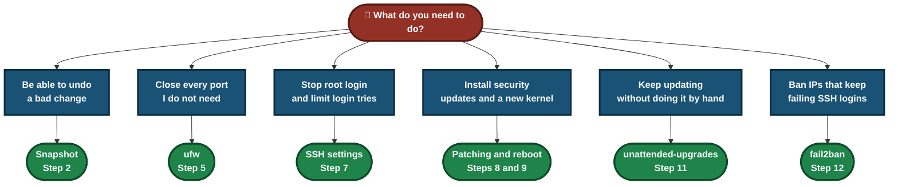
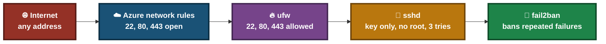
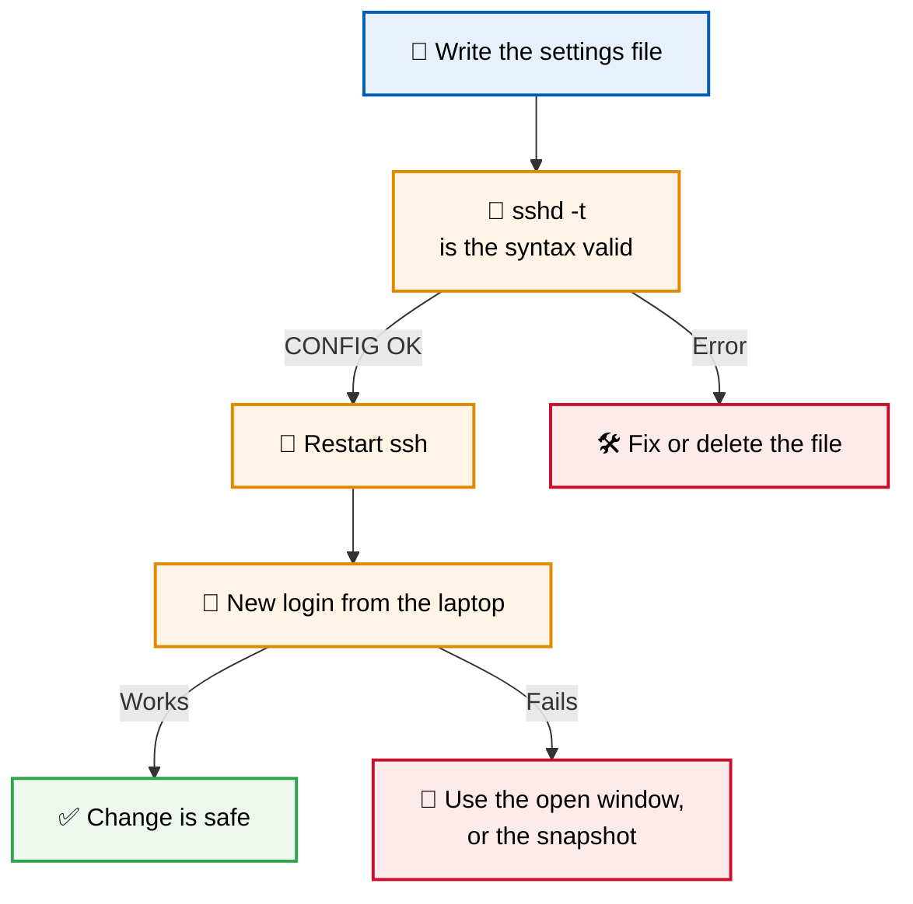
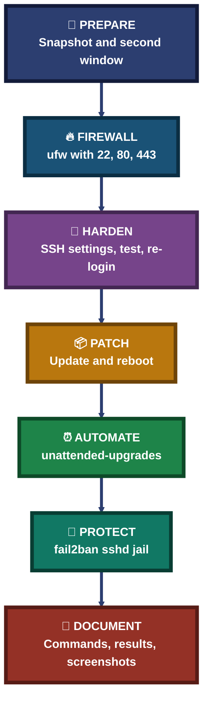

<div align="center">

# 🛡️ Lab 03 — SSH Hardening, Firewall & Patching

**Ubuntu 24.04 on Azure · OpenSSH · ufw · apt Updates · unattended-upgrades · fail2ban**

A hands-on Linux sysadmin lab. I took a snapshot of the VM, turned on the ufw firewall with only the ports I need, tightened the SSH settings, installed the pending updates and rebooted into the new kernel, then turned on automatic updates and fail2ban.


The method: take a snapshot, keep a second SSH window open, change one thing at a time, test it, and keep the evidence.

### [📑 Open the Index](INDEX.md) &nbsp;·&nbsp; [📸 Jump to the steps](#steps)

</div>

---

## 📑 Table of Contents

1. [At a Glance](#at-a-glance)
2. [Objective](#objective)
3. [Environment](#environment)
4. [Tools & Technologies](#tools)
5. [The Lab Flow](#flow)
6. [Which Step Do I Need?](#which-step)
7. [Steps](#steps)
8. [Results](#results)
9. [Where a Lockout Can Happen](#lockout)
10. [Hardening Method Pipeline](#pipeline)
11. [Command Cheat Sheet](#cheat-sheet)
12. [Challenges & Fixes](#problems-fixes)
13. [Scope & Limitations](#scope-limitations)
14. [What I Learned](#what-i-learned)
15. [Skills Demonstrated](#skills-demonstrated)
16. [Folder Structure](#folder-structure)

---

<a id="at-a-glance"></a>
## 📊 At a Glance

| 🖥 Server | 🔥 Firewall | 📦 Updates | 🚫 fail2ban |
|:---:|:---:|:---:|:---:|
| **1 Ubuntu 24.04 VM** | **ufw active, ports 22, 80, 443** | **84 pending → 0 left, new kernel** | **1 jail (`sshd`), 1 IP banned** |

---

<a id="objective"></a>
## 🎯 Objective

Show that I can make a small public server safer without locking myself out.

- Take a snapshot of the VM disk before changing anything.
- Turn on the ufw firewall and allow only SSH, HTTP and HTTPS.
- Tighten the SSH settings and check them after a restart.
- Install the pending updates, reboot into the new kernel, and confirm the services still work.
- Turn on automatic updates and fail2ban.

<div align="center">

### 🧩 Lab Workflow at a Glance

<table>
<tr>
<td align="center" valign="top" width="18%">

**🧯 Prepare**<br>
<sub>Snapshot and<br>second SSH window</sub>

</td>
<td align="center" valign="middle" width="2.5%">

**➜**

</td>
<td align="center" valign="top" width="18%">

**🔥 Firewall**<br>
<sub>ufw with<br>22, 80, 443</sub>

</td>
<td align="center" valign="middle" width="2.5%">

**➜**

</td>
<td align="center" valign="top" width="18%">

**🔐 Harden SSH**<br>
<sub>Settings file,<br>test, restart</sub>

</td>
<td align="center" valign="middle" width="2.5%">

**➜**

</td>
<td align="center" valign="top" width="18%">

**📦 Patch**<br>
<sub>Update, reboot,<br>check kernel</sub>

</td>
<td align="center" valign="middle" width="2.5%">

**➜**

</td>
<td align="center" valign="top" width="18%">

**🚫 Protect**<br>
<sub>Auto updates<br>and fail2ban</sub>

</td>
</tr>
<tr>
<td colspan="9" align="center">


<br>
<sub>Standard Ubuntu tools, no paid software</sub>

</td>
</tr>
</table>

</div>

---

<a id="environment"></a>
## 🧱 Environment

| Item | Value |
|---|---|
| Cloud | Azure virtual machine, India South Central |
| VM name / size | `lab-server` · Standard B2ls_v2 (2 vCPU, 4 GiB) |
| Operating system | Ubuntu 24.04.4 LTS before patching, 24.04.5 LTS after the reboot |
| Kernel | `6.17.0-1022-azure` before, `7.0.0-1017-azure` after |
| Web servers | Nginx on 80 and 443, Apache on 8080 (set up in Lab 2) |
| Database | MySQL 8.0 |
| Access | SSH with a key file, user `azureuser` |
| Firewall (`ufw`) | Inactive before this lab, active after Step 5 |
| Azure network rules | SSH 22, HTTP 80, HTTPS 443 allowed. Not changed in this lab |
| Date of lab | 13 Oct 2026 (VM clock is UTC) |

> [!NOTE]
> Public IP details, subscription ID, account email and my own home IP address are blurred in the screenshots. The VM details are shown in Step 1.

---

<a id="tools"></a>
## 🛠️ Tools & Technologies

| Tool | Purpose |
|------|---------|
| Azure portal | Check the VM and create the disk snapshot |
| `ssh` | Connect to the VM from my laptop |
| `sshd -T`, `sshd -t` | Show the active SSH settings and test the config file |
| `ufw` | Host firewall on the VM |
| `apt` | List, download and install updates |
| `uname -r` | Show the running kernel |
| `systemctl` | Restart SSH, reboot checks, service status |
| `unattended-upgrades` | Install updates automatically |
| `fail2ban-client` | Check the fail2ban jail and banned IPs |
| Web browser | Check that the website still opens after each change |

---

<a id="flow"></a>
## ⏱️ The Lab Flow

```mermaid
flowchart LR
    subgraph G1["🟣 PREPARE"]
        direction TB
        A1["Snapshot<br/>lab-server-before-lab3"]
        A2["Second SSH window<br/>as a safety net"]
    end
    subgraph G2["🔵 PROTECT"]
        direction TB
        B1["ufw<br/>allow 22, 80, 443"]
        B2["SSH hardening<br/>test, restart, re-login"]
    end
    subgraph G3["🟠 PATCH"]
        direction TB
        C1["apt update<br/>and upgrade"]
        C2["Reboot<br/>new kernel"]
    end
    subgraph G4["🟢 AUTOMATE"]
        direction TB
        D1["unattended-upgrades<br/>enabled"]
        D2["fail2ban<br/>sshd jail"]
    end
    G1 ==> G2 ==> G3 ==> G4

    classDef pr fill:#f0eaf8,stroke:#6f42c1,stroke-width:2px,color:#000
    classDef po fill:#e8f1fb,stroke:#005EB8,stroke-width:2px,color:#000
    classDef di fill:#fff4e5,stroke:#e08a00,stroke-width:2px,color:#000
    classDef re fill:#eef7ee,stroke:#2ea44f,stroke-width:2px,color:#000
    class A1,A2 pr
    class B1,B2 po
    class C1,C2 di
    class D1,D2 re
```



<p align="center"><em>The groups show the four stages of the lab, from preparing a safety net to turning on automatic protection.</em></p>

---

<a id="which-step"></a>
## 🧭 Which Step Do I Need?



---

<a id="steps"></a>
## 📸 Steps

### Step 1 — Check the VM in Azure

The VM `lab-server` in the `sysadmin-labs` resource group: Linux (Ubuntu 24.04), Standard B2ls_v2, India South Central, created 13/10/2026 11:48 UTC. Status was `Running` when this screenshot was taken.


### Step 2 — Take a snapshot before changing anything

If SSH or the firewall locked me out, the snapshot is the way back. The VM has one OS disk (30 GiB, Premium SSD LRS) and no data disks.


Opened the OS disk. The **Create snapshot** button is at the top.


Snapshot form: name `lab-server-before-lab3`, type Incremental, storage type Standard_ZRS. Validation passed.


The deployment finished: `Your deployment is complete`.


### Step 3 — Record the SSH settings before the change

```bash
sudo sshd -T | grep -E "passwordauthentication|permitrootlogin|pubkeyauthentication|port "
```

Before: port 22, `permitrootlogin without-password`, `pubkeyauthentication yes`, `passwordauthentication no`. Password login was already off, so I did not need to change it.


### Step 4 — Open a second SSH window as a safety net

A second PowerShell window on my laptop, logged in to the VM with the key file. I kept it open while changing the firewall and SSH. The login banner shows `84 updates can be applied immediately` and `60 of these updates are standard security updates`.

```powershell
ssh -i $HOME\Downloads\lab-server_key.pem azureuser@<VM public IP>
```


### Step 5 — Turn on the firewall (ufw)

I allowed SSH **first**, then HTTP and HTTPS, and only then turned the firewall on. ufw and the Azure network rules are two separate layers.

```bash
sudo ufw allow 22/tcp
```


```bash
sudo ufw allow 80/tcp
```


```bash
sudo ufw allow 443/tcp
```


```bash
sudo ufw --force enable
```

`Firewall is active and enabled on system startup`. My SSH window stayed connected.


```bash
sudo ufw status verbose
```

`Status: active`, default `deny (incoming)` and `allow (outgoing)`. Ports 22, 80 and 443 are allowed for IPv4 and IPv6.


### Step 6 — Check that the website still works

Opened `https://<VM public IP>` in my browser. Chrome shows the self-signed certificate warning from Lab 2, which means the connection reached Nginx on port 443.


After choosing Advanced and Proceed, the page `Backup Lab` opens. The firewall did not block the website.


### Step 7 — Harden SSH

I did not edit the main `sshd_config`. I added a separate settings file, so undoing the change means deleting one file and restarting SSH.

```bash
printf "PermitRootLogin no\nMaxAuthTries 3\nLoginGraceTime 30\n" | sudo tee /etc/ssh/sshd_config.d/01-hardening.conf
```

The file contains three lines: `PermitRootLogin no`, `MaxAuthTries 3`, `LoginGraceTime 30`.


Tested the config before restarting. `CONFIG OK` means the syntax is valid.

```bash
sudo sshd -t && echo CONFIG OK
```


```bash
sudo systemctl restart ssh && echo SSH RESTARTED
```


After the restart I opened a **new** login from my laptop. It worked, so the new settings did not lock me out.


Checked the active settings:

```bash
sudo sshd -T | grep -E "^port |permitrootlogin|maxauthtries|logingracetime|passwordauthentication|pubkeyauthentication"
```

After: `permitrootlogin no`, `maxauthtries 3`, `logingracetime 30`, `pubkeyauthentication yes`, `passwordauthentication no`.


### Step 8 — Install the updates

Listed the first 20 pending updates:

```bash
apt list --upgradable 2>/dev/null | head -20
```


Refreshed the package lists. apt reported `73 packages can be upgraded` after the refresh (the login banner had shown 84 before it).

```bash
sudo apt update
```


Installed the updates with `apt upgrade`. The end of the output says `Pending kernel upgrade!`: the running kernel is `6.17.0-1022-azure`, the new one is `7.0.0-1017-azure`, and a reboot is needed to load it. The tool also restarted several services (including `apache2`, `mysql`, `nginx` and `ssh`) and deferred a few system services until the reboot.


Checked the apt history log. The upgrade list includes `linux-image-azure` (6.17.0-1022 → 7.0.0-1017), and the run took from 15:27:26 to 15:28:22 UTC. The last command counts the lines of `apt list --upgradable`; `1` is only the `Listing...` header, so no package was left.

```bash
grep -E "^Start-Date|^End-Date|^Upgrade:" /var/log/apt/history.log | tail -3 | cut -c1-200
apt list --upgradable 2>/dev/null | wc -l
```


### Step 9 — Reboot and check the kernel

```bash
sudo reboot
```

The reboot message says 15:30:29 UTC. I logged in again from my laptop and the banner time is 15:31:34 UTC, about one minute later. The banner now shows Ubuntu 24.04.5 LTS, kernel `7.0.0-1017-azure`, and `0 updates can be applied immediately`. `uname -r` confirms the kernel.

```bash
uname -r
```

> A typo (`sudo rebootsudo reboot`) came back with `command not found` and is visible in the screenshot. The second try worked.


### Step 10 — Check the firewall and services after the reboot

```bash
sudo ufw status verbose
systemctl is-active nginx apache2 mysql
```

ufw is still active with the same six rules (22, 80, 443 for IPv4 and IPv6). Nginx, Apache and MySQL all return `active`.


The website still opens over HTTPS after the reboot.


### Step 11 — Turn on automatic updates

`unattended-upgrades` was already installed (`2.9.1+nmu4ubuntu1`, no new install needed), and I ran the reconfigure step. Both install and reconfigure are in [`extra-not-for-readme/x06-unattended-upgrades-install-and-ssh-error.png`](extra-not-for-readme/x06-unattended-upgrades-install-and-ssh-error.png) and [`extra-not-for-readme/x07-unattended-upgrades-config-with-paste-errors.png`](extra-not-for-readme/x07-unattended-upgrades-config-with-paste-errors.png).

```bash
sudo apt install -y unattended-upgrades
sudo dpkg-reconfigure -f noninteractive unattended-upgrades
```

The config file has both lines set to `"1"`, and the service is `enabled` and `active`:

```bash
cat /etc/apt/apt.conf.d/20auto-upgrades
systemctl is-enabled unattended-upgrades
systemctl is-active unattended-upgrades
```


### Step 12 — Install and check fail2ban

Installed fail2ban with apt. The install output ends cleanly (`No services need to be restarted`). It also printed Python `SyntaxWarning` lines from the package's own test files, which did not stop the install.


Started it now and at every boot, then checked the service and the jail list:

```bash
sudo systemctl enable --now fail2ban
systemctl is-active fail2ban
sudo fail2ban-client status
```

The service is `active` and there is 1 jail: `sshd`.


```bash
sudo fail2ban-client status sshd
```

The `sshd` jail shows 6 failed logins in total, 1 IP currently banned, 1 IP banned in total. I did not cause this ban.


---

<a id="results"></a>
## ✅ Results

| Check | Result |
|---|---|
| Snapshot | `lab-server-before-lab3` created (Incremental), deployment complete |
| ufw | Active, default deny incoming, 22, 80, 443 allowed (IPv4 and IPv6) |
| Website after ufw | `Backup Lab` page opens over HTTPS |
| `PermitRootLogin` | `without-password` → `no` |
| `MaxAuthTries` / `LoginGraceTime` | Set to `3` and `30` |
| Password login | Already `no` before the lab, still `no` |
| New SSH login after restart | Worked |
| Pending updates | 84 in the login banner (60 security) → 0 after upgrade and reboot |
| Kernel | `6.17.0-1022-azure` → `7.0.0-1017-azure` |
| Reboot | 15:30:29 UTC → logged in again 15:31:34 UTC (about 1 min) |
| After reboot | ufw active, Nginx, Apache, MySQL `active`, website opens |
| Automatic updates | Service `enabled` and `active`, both config lines `"1"` |
| fail2ban | `active`, 1 jail (`sshd`), 6 failed logins seen, 1 IP banned |

> [!NOTE]
> The reboot time includes my own typing and one typo. It only shows that this small VM came back quickly, not how a bigger server behaves.

---

<a id="lockout"></a>
## 🔍 Where a Lockout Can Happen



<p align="center"><em>The red box is the weak point: SSH is still open to any address. The other layers make that safer but do not close it.</em></p>

### 🔍 Analyst Note — Why I Test the Config Before Restarting SSH

A typing mistake in the SSH config can lock me out. Testing first, and keeping a second window open, keeps the way back open.



---

<a id="pipeline"></a>
## 🧭 Hardening Method Pipeline

How the lab turns a default server into a safer one, one change at a time



---

<a id="cheat-sheet"></a>
## 🧾 Command Cheat Sheet

| Command | Purpose |
|---------|---------|
| `sudo sshd -T \| grep -E "permitrootlogin\|maxauthtries"` | Show the SSH settings that are really active |
| `sudo sshd -t && echo CONFIG OK` | Test the SSH config before a restart |
| `sudo systemctl restart ssh` | Apply SSH changes |
| `sudo ufw allow 22/tcp` | Allow a port (do this for SSH before enabling ufw) |
| `sudo ufw --force enable` | Turn the firewall on |
| `sudo ufw status verbose` | Show the firewall state and rules |
| `apt list --upgradable` | List pending updates |
| `sudo apt update` | Refresh the package lists |
| `sudo apt upgrade` | Install the pending updates |
| `uname -r` | Show the running kernel |
| `sudo reboot` | Restart the server (loads a new kernel) |
| `systemctl is-active <service>` | Check that a service is running |
| `systemctl is-enabled <service>` | Check that a service starts at boot |
| `sudo dpkg-reconfigure -f noninteractive unattended-upgrades` | Turn on automatic updates |
| `sudo fail2ban-client status sshd` | Show failed logins and banned IPs for SSH |

---

<a id="problems-fixes"></a>
## ⚠️ Challenges & Fixes

| ❌ Challenge | ✅ Solution |
|---|---|
| My first login test returned `Permission denied (publickey)` and `Identity file ... not accessible` ([screenshot 1](extra-not-for-readme/x04-ssh-attempt-inside-vm-publickey-denied.png), [screenshot 2](extra-not-for-readme/x05-ssh-attempt-inside-vm-publickey-denied-2.png)) | I ran the `ssh` command inside the VM session. The key file is on my laptop, and `$HOME` inside the VM is a different folder. Opened a new PowerShell window on the laptop (prompt starting with `PS C:\`) and ran it there. One attempt also had the key name typed with `-` instead of `_` |
| The same kind of attempt earlier, run inside the VM ([screenshot](extra-not-for-readme/x01-ssh-attempt-inside-vm-fingerprint.png)) | Same cause and same fix. It also added the VM to `known_hosts` on the VM, which does no harm |
| Pasting the `ssh` command twice in one line gave `Could not resolve hostname` ([screenshot](extra-not-for-readme/x03-second-window-paste-error.png)) | Pasted it once, on its own line |
| Config lines like `APT::Periodic::Unattended-Upgrade "1";` gave `command not found` ([screenshot](extra-not-for-readme/x07-unattended-upgrades-config-with-paste-errors.png)) | Those lines belong in a config file, not in the shell. Nothing broke. I read the real file with `cat /etc/apt/apt.conf.d/20auto-upgrades` |
| `sudo rebootsudo reboot` gave `command not found` | Two commands were pasted together. Typed `sudo reboot` on its own |
| fail2ban printed Python `SyntaxWarning` lines while installing | The warnings come from the package's own test files. The install finished and the service started, so I left it |

---

<a id="scope-limitations"></a>
## 🚧 Scope & Limitations

- **SSH is still open to any address.** ufw allows port 22 from `Anywhere`, and the Azure rule for SSH (set up in Lab 2, not changed here) also has Any as the source.
- **Only package updates were installed.** The server stays on Ubuntu 24.04 (no release upgrade), and Expanded Security Maintenance is not enabled.
- **Times are from the VM clock (UTC).**

---

<a id="what-i-learned"></a>
## 🧠 What I Learned

- **Have a way back before changing access.** The snapshot and the second SSH window cost a few minutes and removed most of the lockout risk.
- **Allow SSH in ufw before turning it on.** Then check that the website still works.
- **ufw and the Azure network rules are separate layers.** Both must allow a port for traffic to arrive.
- **Test the SSH config, restart, then log in again from a fresh window.** `sshd -t` catches typing mistakes, and a new login proves the change is safe.
- **A new kernel only runs after a reboot.** The update said `Pending kernel upgrade!`, and `uname -r` showed the new kernel only afterwards.
- **A public server gets failed SSH logins quickly.** fail2ban had already banned one IP that I did not cause.
- **Run each command in the right terminal.** Several of my mistakes came from running a laptop command inside the VM.
- **Keep the evidence, including the mistakes.** The screenshots show what happened and when.

---

<a id="skills-demonstrated"></a>
## 🛠️ Skills Demonstrated

- Taking an Azure disk snapshot before risky changes
- Managing a host firewall with ufw
- Hardening SSH with a separate settings file and checking the active settings
- Avoiding a lockout with a second session and a config test
- Installing updates with apt and moving to a new kernel with a reboot
- Checking services and the website after a reboot
- Turning on automatic updates with unattended-upgrades
- Setting up fail2ban and reading its jail status
- Documenting a lab with commands, times, screenshots and honest limits

---

<a id="folder-structure"></a>
## 📁 Folder Structure

```text
lab03-ssh-firewall-patching/
|-- INDEX.md
|-- README.md
|-- screenshots/
|   |-- 01-vm-running.png
|   |-- 02-vm-disks.png
|   |-- 03-os-disk-page.png
|   |-- 04-snapshot-form.png
|   |-- 05-snapshot-created.png
|   |-- 06-ssh-settings-before.png
|   |-- 07-second-ssh-window.png
|   |-- 08-ufw-allow-ssh.png
|   |-- 09-ufw-allow-80.png
|   |-- 10-ufw-allow-443.png
|   |-- 11-ufw-enabled.png
|   |-- 12-ufw-status.png
|   |-- 13-browser-warning-after-ufw.png
|   |-- 14-website-after-ufw.png
|   |-- 15-ssh-hardening-file.png
|   |-- 16-sshd-configtest.png
|   |-- 17-ssh-restarted.png
|   |-- 18-new-login-after-restart.png
|   |-- 19-ssh-settings-after.png
|   |-- 20-updates-pending-list.png
|   |-- 21-apt-update.png
|   |-- 22-apt-upgrade-kernel-pending.png
|   |-- 23-apt-history-log.png
|   |-- 24-reboot-and-relogin.png
|   |-- 25-ufw-and-services-after-reboot.png
|   |-- 26-website-after-reboot.png
|   |-- 27-unattended-upgrades-status.png
|   |-- 28-fail2ban-installed.png
|   |-- 29-fail2ban-enabled-and-status.png
|   `-- 30-fail2ban-sshd-jail.png
`-- extra-not-for-readme/
    |-- x01-ssh-attempt-inside-vm-fingerprint.png
    |-- x02-ssh-attempt-inside-vm-and-settings.png
    |-- x03-second-window-paste-error.png
    |-- x04-ssh-attempt-inside-vm-publickey-denied.png
    |-- x05-ssh-attempt-inside-vm-publickey-denied-2.png
    |-- x06-unattended-upgrades-install-and-ssh-error.png
    `-- x07-unattended-upgrades-config-with-paste-errors.png
```

---

<div align="center">

[⬆️ Back to top](#) &nbsp;·&nbsp; [📑 Index](INDEX.md)

</div>
