

# 🌐 Lab 04 — Index
### BIND9 DNS Server — Zone `lab.local`
**Lab 04 of the Linux SysAdmin Labs**

**Quick guide to every step and screenshot in this lab.**

### [📖 Open the full README](README.md)

---

| 🧩 Steps | 🖼️ Screenshots | 🛠️ Tools Used | 📜 Zone Records |
|:---:|:---:|:---:|:---:|
| **12** | **22** | **10** | **7** |

🧩 <b>Case:</b> Zone <code>lab.local</code> · VM private IP <code>172.16.0.4</code> · BIND 9.18.39 on Ubuntu 24.04

---

## 📑 Step Index

| # | Step | Module | Result | Evidence |
|:---:|---|:---:|---|:---:|
| 1 | Check the VM in Azure | 🟣 Module 1 | `lab-server` is `Running` | [Exhibit 00](#ex00) |
| 2 | Check what uses port 53 | 🟣 Module 2 | Only `systemd-resolved` listens, no clash | [Exhibit 01](#ex01) |
| 3 | Install BIND9 | 🟣 Module 3 | `bind9` and `dnsutils` installed | [Exhibit 02](#ex02) |
| 4 | Declare the zone | 🔵 Module 4 | One `zone "lab.local"` block added | [Exhibit 03](#ex03) |
| 5 | Create the zone file | 🔵 Module 5 | SOA, NS, MX, TXT and 3 A records written | [Exhibit 04](#ex04) |
| 6 | Set the listen address | 🔵 Module 6 | `listen-on` set to `127.0.0.1` and `172.16.0.4` | [Exhibit 05](#ex05) |
| 7 | Check the configuration | 🟠 Module 7 | `loaded serial 2`, `OK` | [Exhibit 06](#ex06) |
| 8 | Restart BIND and check the service | 🟠 Module 8 | `active (running)`, `enabled` | [Exhibit 07](#ex07) |
| 9 | Check port 53 again | 🟠 Module 9 | `named` listens on both addresses | [Exhibit 08](#ex08) |
| 10 | Query the records | 🟢 Module 10 | A, MX, TXT, NS host and NXDOMAIN answered correctly | [Exhibits 09–13](#module-10) |
| 11 | Check the firewall | 🔴 Module 11 | `ufw` active, no rule for port 53 | [Exhibit 14](#ex14) |
| 12 | Extra checks | 🔴 Module 12 | Version, private IP query, SOA, `nslookup`, boot setting, logs | [Exhibits 15–21](#module-12) |

---

## 🟣 Module 1–3 — Prepare

Exhibits 00 to 02.

<table>
<tr>
<td align="center" valign="top" width="33%">

<a href="screenshots/lab04-00-vm-overview.png">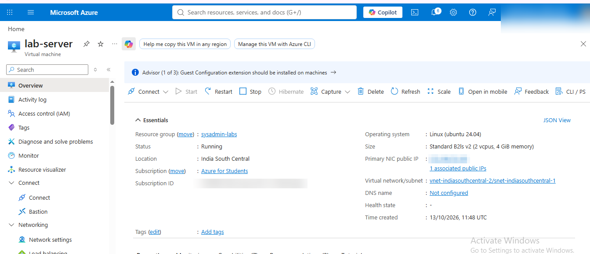</a>
 <b>Exhibit 00 — Azure VM</b>
 <code>lab-server</code> running, subscription ID, email and public IP blurred
</td>
<td align="center" valign="top" width="33%">

<a href="screenshots/lab04-01-port53.png">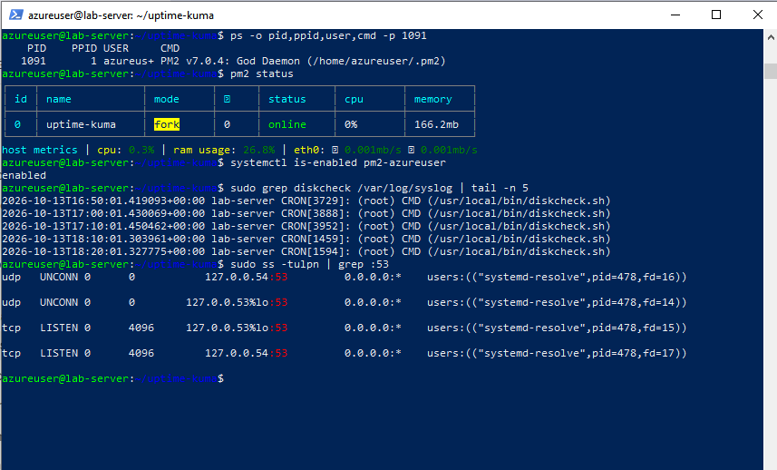</a>
 <b>Exhibit 01 — Port 53 before BIND</b>
 Only <code>systemd-resolved</code> is listening
</td>
<td align="center" valign="top" width="33%">

<a href="screenshots/lab04-02-install.png">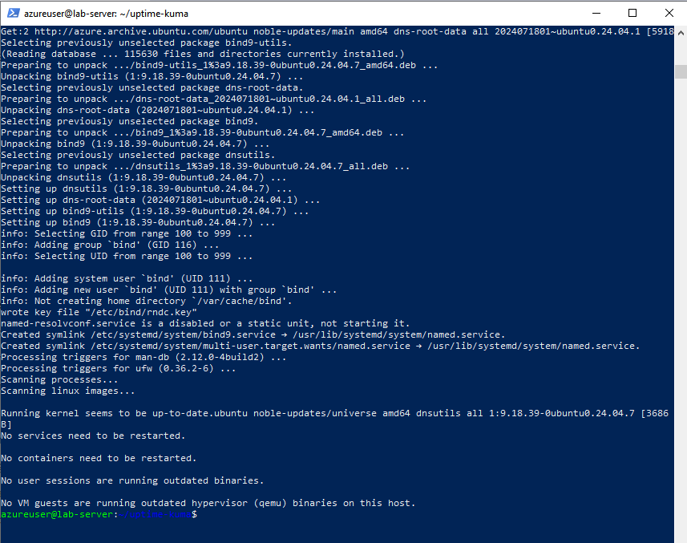</a>
 <b>Exhibit 02 — BIND9 installed</b>
 Install finished, prompt returned
</td>
</tr>
</table>

---

## 🔵 Module 4–6 — Configure

Exhibits 03 to 05.

<table>
<tr>
<td align="center" valign="top" width="33%">

<a href="screenshots/lab04-03-zone-declared.png">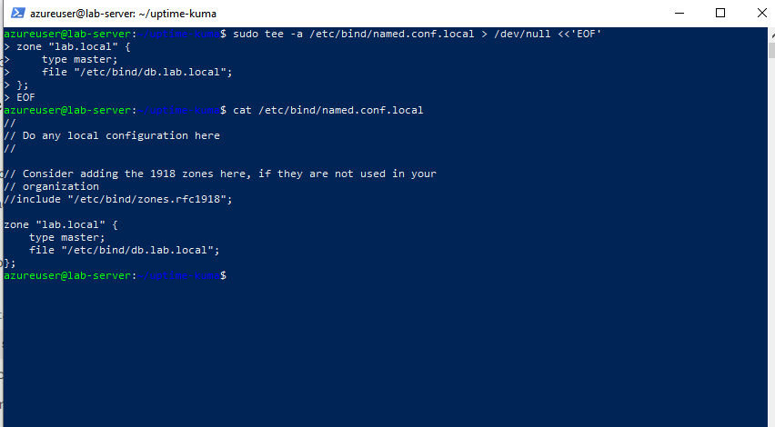</a>
 <b>Exhibit 03 — Zone declared</b>
 <code>named.conf.local</code> with the <code>lab.local</code> block
</td>
<td align="center" valign="top" width="33%">

<a href="screenshots/lab04-04-zone-file.png">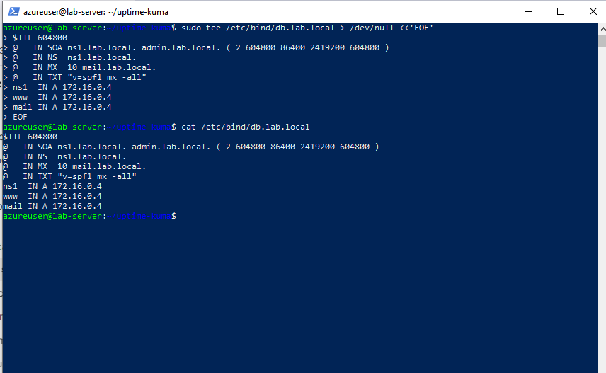</a>
 <b>Exhibit 04 — Zone file</b>
 <code>db.lab.local</code> with 7 records
</td>
<td align="center" valign="top" width="33%">

<a href="screenshots/lab04-05-listen-on.png">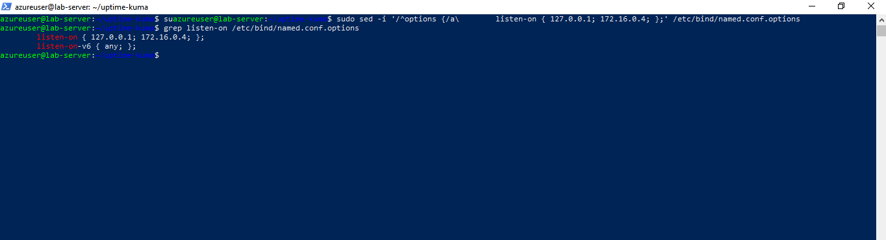</a>
 <b>Exhibit 05 — Listen address</b>
 <code>listen-on</code> line added once
</td>
</tr>
</table>

---

## 🟠 Module 7–9 — Validate

Exhibits 06 to 08.

<table>
<tr>
<td align="center" valign="top" width="33%">

<a href="screenshots/lab04-06-checks.png">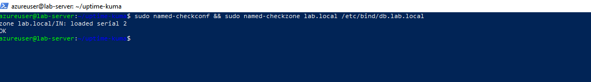</a>
 <b>Exhibit 06 — Config checks</b>
 <code>named-checkzone</code> shows serial 2 and <code>OK</code>
</td>
<td align="center" valign="top" width="33%">

<a href="screenshots/lab04-07-status.png">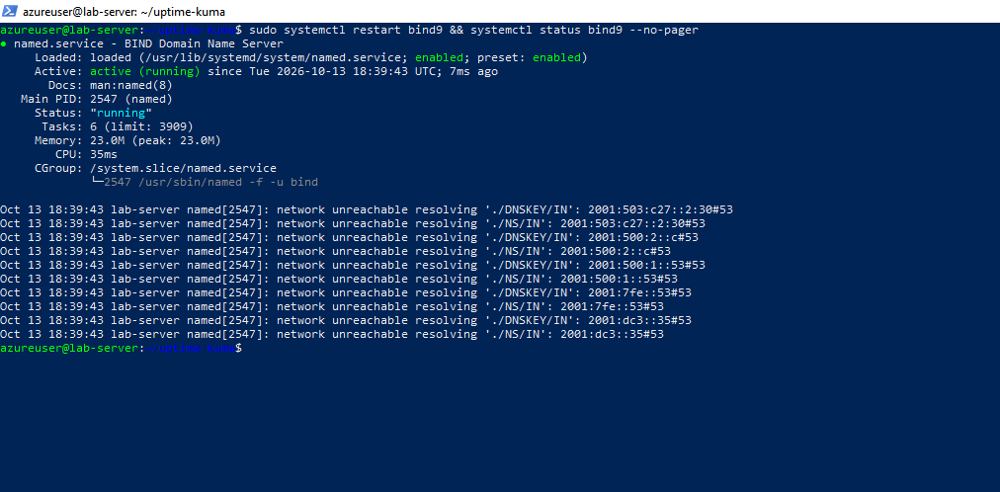</a>
 <b>Exhibit 07 — Service status</b>
 <code>active (running)</code>, PID 2547
</td>
<td align="center" valign="top" width="33%">

<a href="screenshots/lab04-08-port53-after.png">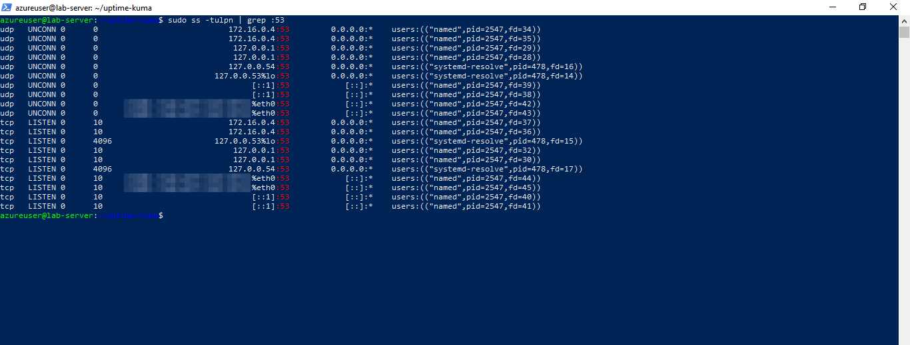</a>
 <b>Exhibit 08 — Port 53 after BIND</b>
 <code>named</code> on <code>172.16.0.4</code> and <code>127.0.0.1</code>, IPv6 address blurred
</td>
</tr>
</table>

---

## 🟢 Module 10 — Query the Records

Exhibits 09 to 13.

<table>
<tr>
<td align="center" valign="top" width="33%">

<a href="screenshots/lab04-09-dig-a.png">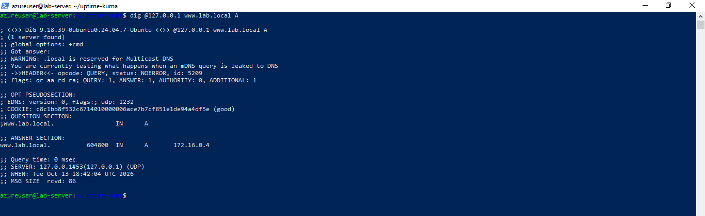</a>
 <b>Exhibit 09 — A record</b>
 <code>www.lab.local</code> → <code>172.16.0.4</code>
</td>
<td align="center" valign="top" width="33%">

<a href="screenshots/lab04-10-dig-mx.png">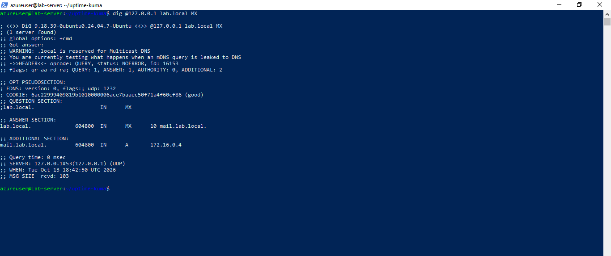</a>
 <b>Exhibit 10 — MX record</b>
 <code>10 mail.lab.local.</code>
</td>
<td align="center" valign="top" width="33%">

<a href="screenshots/lab04-11-dig-txt.png">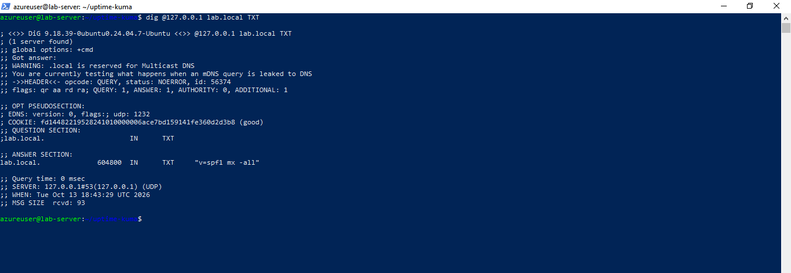</a>
 <b>Exhibit 11 — TXT record</b>
 SPF policy <code>v=spf1 mx -all</code>
</td>
</tr>
<tr>
<td align="center" valign="top" width="33%">

<a href="screenshots/lab04-12-dig-ns1.png">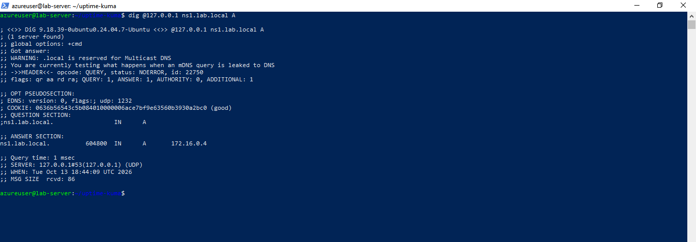</a>
 <b>Exhibit 12 — Name server host</b>
 <code>ns1.lab.local</code> → <code>172.16.0.4</code>
</td>
<td align="center" valign="top" width="33%">

<a href="screenshots/lab04-13-nxdomain.png">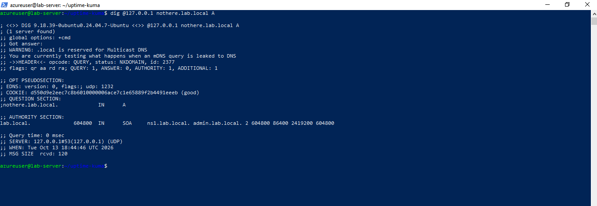</a>
 <b>Exhibit 13 — Missing name</b>
 <code>NXDOMAIN</code> for <code>nothere.lab.local</code>
</td>
<td></td>
</tr>
</table>

---

## 🔴 Module 11 — Firewall Check

Exhibit 14.

<table>
<tr>
<td align="center" valign="top" width="50%">

<a href="screenshots/lab04-14-ufw.png">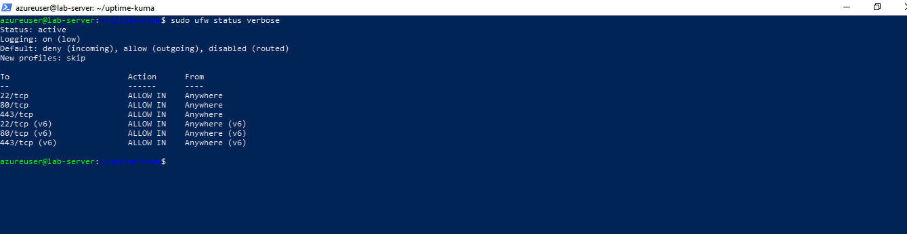</a>
 <b>Exhibit 14 — ufw status</b>
 Active, ports 22, 80 and 443 allowed, no rule for 53
</td>
</tr>
</table>

---

## 🔴 Module 12 — Extra Checks

Exhibits 15 to 21.

<table>
<tr>
<td align="center" valign="top" width="33%">

<a href="screenshots/lab04-15-named-version.png">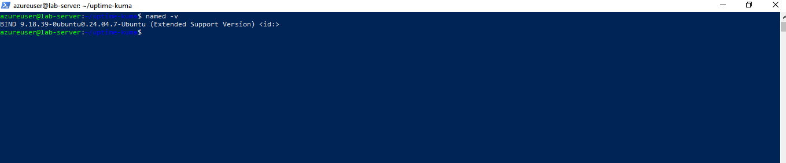</a>
 <b>Exhibit 15 — BIND version</b>
 BIND 9.18.39, Ubuntu package
</td>
<td align="center" valign="top" width="33%">

<a href="screenshots/lab04-16-dig-private-ip.png">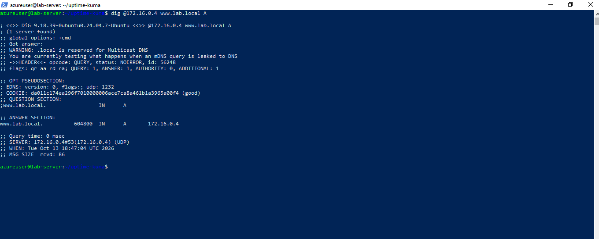</a>
 <b>Exhibit 16 — Query through private IP</b>
 Answered by <code>172.16.0.4#53</code>
</td>
<td align="center" valign="top" width="33%">

<a href="screenshots/lab04-17-dig-short.png">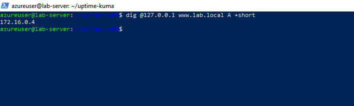</a>
 <b>Exhibit 17 — Short answer</b>
 <code>+short</code> prints only <code>172.16.0.4</code>
</td>
</tr>
<tr>
<td align="center" valign="top" width="33%">

<a href="screenshots/lab04-18-dig-soa.png">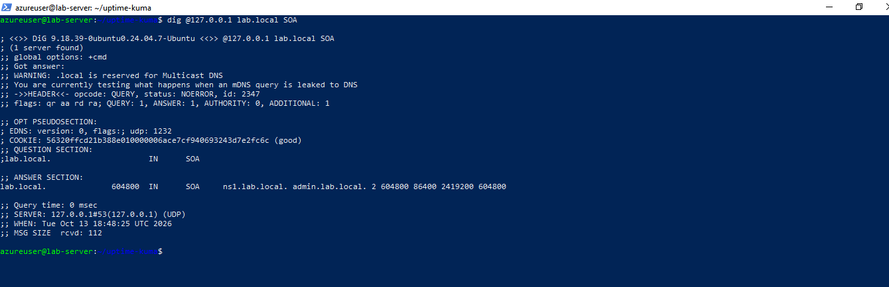</a>
 <b>Exhibit 18 — SOA record</b>
 Serial number <code>2</code>
</td>
<td align="center" valign="top" width="33%">

<a href="screenshots/lab04-19-nslookup.png">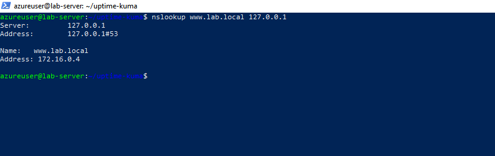</a>
 <b>Exhibit 19 — nslookup</b>
 Second tool, same answer
</td>
<td align="center" valign="top" width="33%">

<a href="screenshots/lab04-20-enabled.png">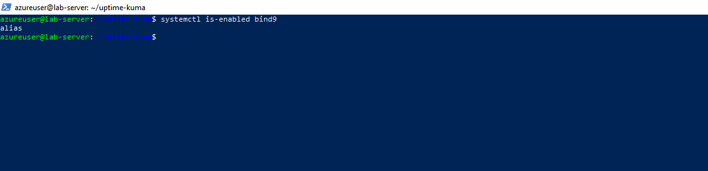</a>
 <b>Exhibit 20 — Boot setting</b>
 <code>bind9</code> is an alias of <code>named.service</code>
</td>
</tr>
<tr>
<td align="center" valign="top" width="33%">

<a href="screenshots/lab04-21-logs.png">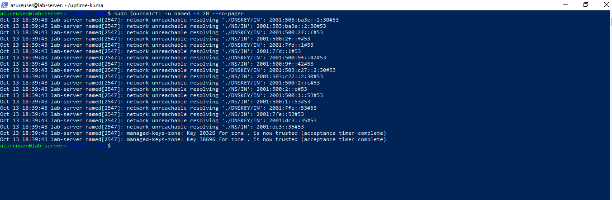</a>
 <b>Exhibit 21 — Service logs</b>
 Last 20 <code>named</code> log lines
</td>
<td></td>
<td></td>
</tr>
</table>

---

## 📝 Result

**Complete** — BIND9 is installed, the `lab.local` zone passes the config checks, and every record answers correctly when queried from the VM itself.

| Element | Finding |
|---|---|
| Zone | `lab.local`, serial `2` |
| Records | SOA, NS, MX, TXT and 3 × A (`ns1`, `www`, `mail`) |
| Service | `named` `active (running)`, `enabled` |
| Listening on | `127.0.0.1` and `172.16.0.4`, port 53 (UDP and TCP) |
| Missing name | `NXDOMAIN` (correct reply) |
| Firewall | `ufw` active, no rule for port 53 |

---

## 🎯 Verification Checklist

| Check | Method | Module | Status |
|:---:|---|---|:---:|
| Port 53 free for BIND | `ss -tulpn` before install | Module 2 | ✅ Confirmed |
| Config and zone file valid | `named-checkconf`, `named-checkzone` | Module 7 | ✅ Confirmed |
| Service running | `systemctl status bind9` | Module 8 | ✅ Confirmed |
| BIND on its own addresses | `ss -tulpn` after install | Module 9 | ✅ Confirmed |
| A, MX, TXT, NS host and SOA answer | `dig` on `127.0.0.1` | Modules 10 + 12 | ✅ Confirmed |
| Missing name returns `NXDOMAIN` | `dig` for `nothere.lab.local` | Module 10 | ✅ Confirmed |
| Private IP also answers | `dig @172.16.0.4` | Module 12 | ✅ Confirmed |
| Cross-tool corroboration | `dig` vs `nslookup` | Modules 10 + 12 | ✅ Confirmed (agree) |

> [!NOTE]
> `dig` prints a warning that `.local` is reserved for multicast DNS. The lab uses `lab.local` only as a private test name.

---

[⬆️ Back to top](#top) &nbsp;·&nbsp; [📖 Full README](README.md)

🌐 **[ISC BIND](https://www.isc.org/bind/)** · 📚 **[BIND 9 documentation](https://bind9.readthedocs.io/)**

