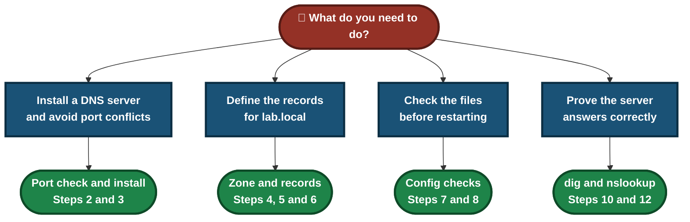
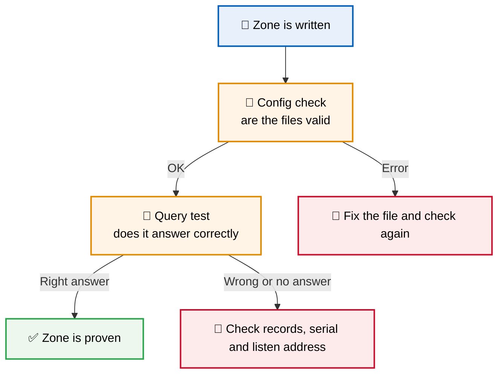
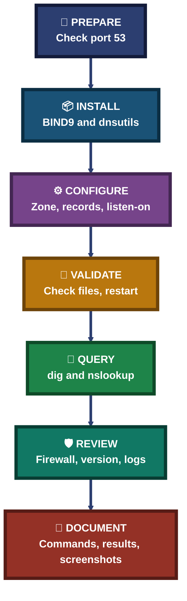

<div align="center">

# 🌐 Lab 04 — BIND9 DNS Server

**Ubuntu 24.04 on Azure · BIND 9.18 · Zone `lab.local` · A, MX, TXT, NS and SOA Records · dig · nslookup**

A hands-on Linux sysadmin lab. I installed BIND9 on an Ubuntu VM, wrote a zone file for `lab.local`, checked the configuration, restarted the service, and tested every record with `dig` and `nslookup`.


The method: check the port, install the server, write the zone, validate the files, restart, and test every record.

### [🗂️ Open the INDEX](INDEX.md) &nbsp;·&nbsp; [📸 Jump to the steps](#steps)

</div>

---

## 📑 Table of Contents

1. [At a Glance](#at-a-glance)
2. [Objective](#objective)
3. [Environment](#environment)
4. [Tools & Technologies](#tools)
5. [The Lab Flow](#flow)
6. [Which Step Do I Need?](#which-step)
7. [Steps](#steps)
8. [Results](#results)
9. [Where DNS Can Break](#dns-breaks)
10. [DNS Method Pipeline](#pipeline)
11. [Command Cheat Sheet](#cheat-sheet)
12. [Challenges & Fixes](#problems-fixes)
13. [Scope](#scope-limitations)
14. [What I Learned](#what-i-learned)
15. [Skills Demonstrated](#skills-demonstrated)
16. [Folder Structure](#folder-structure)

---

<a id="at-a-glance"></a>
## 📊 At a Glance

| 🖥 Server | 🌐 DNS Zone | 🔎 Record Types Tested | 📸 Screenshots |
|:---:|:---:|:---:|:---:|
| **1 Ubuntu 24.04 VM** | **`lab.local`, 7 records** | **A, MX, TXT, SOA, NXDOMAIN** | **22** |

---

<a id="objective"></a>
## 🎯 Objective

Show that I can set up an authoritative DNS server on Linux and prove that it answers correctly.

- Install BIND9 and make sure it does not clash with `systemd-resolved` on port 53.
- Write a zone file for `lab.local` with SOA, NS, MX, TXT and A records.
- Check the configuration and the zone file before restarting the service.
- Query the server with `dig` and `nslookup` and confirm every answer.

<div align="center">

### 🧩 Lab Workflow at a Glance

<table>
<tr>
<td align="center" valign="top" width="18%">

**🧪 Prepare**<br>
<sub>Check port 53<br>and install BIND9</sub>

</td>
<td align="center" valign="middle" width="2.5%">

**➜**

</td>
<td align="center" valign="top" width="18%">

**⚙️ Configure**<br>
<sub>Zone, records<br>and listen address</sub>

</td>
<td align="center" valign="middle" width="2.5%">

**➜**

</td>
<td align="center" valign="top" width="18%">

**✅ Validate**<br>
<sub>Check the files,<br>restart the service</sub>

</td>
<td align="center" valign="middle" width="2.5%">

**➜**

</td>
<td align="center" valign="top" width="18%">

**🔎 Query**<br>
<sub>Test every record<br>with dig</sub>

</td>
<td align="center" valign="middle" width="2.5%">

**➜**

</td>
<td align="center" valign="top" width="18%">

**🛡 Review**<br>
<sub>Firewall, version<br>and logs</sub>

</td>
</tr>
<tr>
<td colspan="9" align="center">


<br>
<sub>Built-in Linux tools and the Ubuntu BIND package, no paid software</sub>

</td>
</tr>
</table>

</div>

---

<a id="environment"></a>
## 🧱 Environment

| Item | Value |
|---|---|
| Cloud | Azure virtual machine, India South Central |
| VM name / size | `lab-server` · Standard B2ls v2 (2 vCPU, 4 GiB) |
| Operating system | Ubuntu 24.04 |
| DNS server | BIND 9.18.39 (Ubuntu package, Extended Support Version) |
| Zone | `lab.local` |
| VM private IP | `172.16.0.4` |
| Access | SSH with a key file, user `azureuser` |
| Firewall (`ufw`) | Active, default deny incoming, allows 22, 80 and 443 (IPv4 and IPv6) |
| Date of lab | 13 Oct 2026 (VM clock is UTC) |

> [!NOTE]
> The subscription ID, the account email and the public IP are blurred in the Azure screenshot, and the IPv6 link-local address is blurred in the port 53 screenshot. The VM details are shown in Step 1.

---

<a id="tools"></a>
## 🛠️ Tools & Technologies

| Tool | Purpose |
|------|---------|
| `ssh` | Connect to the VM from my laptop |
| `ss -tulpn` | See which program listens on port 53 |
| `apt` | Install BIND9 and the DNS tools |
| `tee` | Write the zone declaration and the zone file |
| `sed`, `grep` | Add the `listen-on` line and check it |
| `named-checkconf`, `named-checkzone` | Check the configuration and the zone file |
| `systemctl` | Restart BIND, check its status and boot setting |
| `dig`, `nslookup` | Query the DNS server |
| `ufw` | Check the firewall status |
| `journalctl` | Read the BIND service logs |

---

<a id="flow"></a>
## ⏱️ The Lab Flow

```mermaid
flowchart LR
    subgraph G1["🟣 PREPARE"]
        direction TB
        A1["Check port 53<br/>who is listening"]
        A2["Install BIND9<br/>and dnsutils"]
    end
    subgraph G2["🔵 CONFIGURE"]
        direction TB
        B1["Declare zone<br/>named.conf.local"]
        B2["Zone file<br/>db.lab.local"]
        B3["Listen address<br/>named.conf.options"]
    end
    subgraph G3["🟠 VALIDATE"]
        direction TB
        C1["Check files<br/>named-checkconf and checkzone"]
        C2["Restart<br/>systemctl status"]
    end
    subgraph G4["🟢 QUERY"]
        direction TB
        D1["dig A, MX, TXT, SOA"]
        D2["NXDOMAIN test<br/>nslookup"]
    end
    G1 ==> G2 ==> G3 ==> G4

    classDef pr fill:#f0eaf8,stroke:#6f42c1,stroke-width:2px,color:#000
    classDef po fill:#e8f1fb,stroke:#005EB8,stroke-width:2px,color:#000
    classDef di fill:#fff4e5,stroke:#e08a00,stroke-width:2px,color:#000
    classDef re fill:#eef7ee,stroke:#2ea44f,stroke-width:2px,color:#000
    class A1,A2 pr
    class B1,B2,B3 po
    class C1,C2 di
    class D1,D2 re
```



<p align="center"><em>The groups show the four stages of the lab, from preparing the server to querying the records.</em></p>

---

<a id="which-step"></a>
## 🧭 Which Step Do I Need?



---

<a id="steps"></a>
## 📸 Steps

### Step 1 — Check the VM in Azure

The VM `lab-server` in the `sysadmin-labs` resource group: Linux (Ubuntu 24.04), Standard B2ls v2, India South Central, created 13/10/2026 11:48 UTC. Status was `Running` when this screenshot was taken.


### Step 2 — Check what uses port 53

Before installing BIND, I checked which program already listens on port 53:

```bash
sudo ss -tulpn | grep :53
```

Only `systemd-resolved` (PID 478) is listening, on `127.0.0.53` and `127.0.0.54`. No other DNS server is running, so BIND will not clash with it. The lines above the command in this screenshot are from earlier checks on the same VM.


### Step 3 — Install BIND9

```bash
sudo apt update && sudo apt install bind9 dnsutils -y
```

`bind9`, `bind9-utils`, `dns-root-data` and `dnsutils` were installed. The line `named-resolvconf.service is a disabled or a static unit, not starting it` is a normal message, not an error.


### Step 4 — Declare the zone

Added the zone to `/etc/bind/named.conf.local`:

```bash
sudo tee -a /etc/bind/named.conf.local > /dev/null <<'EOF'
zone "lab.local" {
    type master;
    file "/etc/bind/db.lab.local";
};
EOF
cat /etc/bind/named.conf.local
```

The file shows the default Ubuntu comments and one `zone "lab.local"` block. `type master` means this server is the authoritative source for the zone.


### Step 5 — Create the zone file

`/etc/bind/db.lab.local`, using the VM private IP `172.16.0.4`:

```bash
sudo tee /etc/bind/db.lab.local > /dev/null <<'EOF'
$TTL 604800
@   IN SOA ns1.lab.local. admin.lab.local. ( 2 604800 86400 2419200 604800 )
@   IN NS  ns1.lab.local.
@   IN MX  10 mail.lab.local.
@   IN TXT "v=spf1 mx -all"
ns1  IN A 172.16.0.4
www  IN A 172.16.0.4
mail IN A 172.16.0.4
EOF
cat /etc/bind/db.lab.local
```

What each record does:

- `SOA` holds the zone's main details. The first number (`2`) is the serial and must be increased after every edit.
- `NS` names the name server for the zone, `ns1.lab.local`.
- `MX` says mail for the domain goes to `mail.lab.local` with priority 10.
- `TXT` carries an SPF policy: `mx` allows mail only from the domain's MX hosts, `-all` rejects everything else.
- The three `A` records (`ns1`, `www`, `mail`) turn names into the IP `172.16.0.4`.


### Step 6 — Set the listen address

BIND listens only on the loopback address and the VM private IP. This keeps it away from the `systemd-resolved` addresses:

```bash
sudo sed -i '/^options {/a\        listen-on { 127.0.0.1; 172.16.0.4; };' /etc/bind/named.conf.options
grep listen-on /etc/bind/named.conf.options
```

The line `listen-on { 127.0.0.1; 172.16.0.4; };` was added once. The default `listen-on-v6 { any; };` was left as it was. A stray `su` appears before the command in this screenshot's first line; the `grep` result below it shows the setting is in place.


### Step 7 — Check the configuration

```bash
sudo named-checkconf && sudo named-checkzone lab.local /etc/bind/db.lab.local
```

`named-checkconf` printed nothing, which means no errors. `named-checkzone` reported `zone lab.local/IN: loaded serial 2` and `OK`.


### Step 8 — Restart BIND and check the service

```bash
sudo systemctl restart bind9 && systemctl status bind9 --no-pager
```

The service is `active (running)` and `enabled`, main PID 2547. The log lines under the status say `network unreachable resolving ... 2001:...`. These are IPv6 root server addresses that the VM could not reach; they did not stop the service (see Challenges).


### Step 9 — Check port 53 again

```bash
sudo ss -tulpn | grep :53
```

`named` (PID 2547) now listens on `172.16.0.4:53` and `127.0.0.1:53`, on both UDP and TCP. `systemd-resolved` still listens on its own addresses, so there is no conflict. The extra `[::1]` and `fe80::` lines are IPv6 addresses from the default `listen-on-v6 { any; };` setting.


### Step 10 — Query the records

All queries went to the local server. Every answer has `status: NOERROR` and the `aa` flag (authoritative answer). `dig` also prints a warning that `.local` is reserved for multicast DNS; the lab uses it as a private test name.

**A record** for `www.lab.local`:

```bash
dig @127.0.0.1 www.lab.local A
```

The answer is `172.16.0.4`.


**MX record** for `lab.local`:

```bash
dig @127.0.0.1 lab.local MX
```

The answer is `10 mail.lab.local.` The additional section also carries the `A` record of `mail.lab.local` (`172.16.0.4`).


**TXT record** for `lab.local`:

```bash
dig @127.0.0.1 lab.local TXT
```

The answer is `"v=spf1 mx -all"`.


**Name server host** `ns1.lab.local`:

```bash
dig @127.0.0.1 ns1.lab.local A
```

The answer is `172.16.0.4`.


**A name that does not exist**, `nothere.lab.local`:

```bash
dig @127.0.0.1 nothere.lab.local A
```

The status is `NXDOMAIN` with `ANSWER: 0`, and the zone's SOA record appears in the authority section. This is the correct reply for a missing name, not an error.


### Step 11 — Check the firewall

```bash
sudo ufw status verbose
```

`ufw` is `active` with default deny for incoming traffic. Ports 22, 80 and 443 are allowed (IPv4 and IPv6). There is no rule for port 53.


### Step 12 — Extra checks

**BIND version:**

```bash
named -v
```

`BIND 9.18.39-0ubuntu0.24.04.7-Ubuntu (Extended Support Version)`.


**Query through the private IP**, which proves the `172.16.0.4` listen address works:

```bash
dig @172.16.0.4 www.lab.local A
```

The `SERVER` line shows `172.16.0.4#53` and the answer is `172.16.0.4`.


**Short answer:**

```bash
dig @127.0.0.1 www.lab.local A +short
```

Only `172.16.0.4` is printed.


**SOA record**, which shows the serial number:

```bash
dig @127.0.0.1 lab.local SOA
```

The answer is `ns1.lab.local. admin.lab.local. 2 604800 86400 2419200 604800`, so the serial is `2`.


**A second tool**, `nslookup`:

```bash
nslookup www.lab.local 127.0.0.1
```

`nslookup` returns the same address, `172.16.0.4`.


**Boot setting:**

```bash
systemctl is-enabled bind9
```

The result is `alias`. On Ubuntu 24.04, `bind9` is an alias of `named.service`, and Step 8 showed `named.service` as `enabled`.


**Service logs:**

```bash
sudo journalctl -u named -n 20 --no-pager
```

The last 20 lines are the IPv6 `network unreachable` messages and two `managed-keys-zone` lines saying keys for the root zone are now trusted.


---

<a id="results"></a>
## ✅ Results

| Check | Result |
|---|---|
| `named-checkconf` | No output, no errors |
| `named-checkzone` | `loaded serial 2`, `OK` |
| Service | `active (running)`, PID 2547, `enabled` |
| Port 53 | `named` listens on `172.16.0.4` and `127.0.0.1` (UDP and TCP) |
| A record | `www.lab.local` → `172.16.0.4` |
| MX record | `10 mail.lab.local.` |
| TXT record | `"v=spf1 mx -all"` |
| Name server host | `ns1.lab.local` → `172.16.0.4` |
| Missing name | `NXDOMAIN` for `nothere.lab.local` |
| SOA record | Serial `2` |
| Query through private IP | Answered by `172.16.0.4#53` |
| `nslookup` | Same answer as `dig` |
| Firewall | `ufw` active, no rule for port 53 |

---

<a id="dns-breaks"></a>
## 🔍 Where DNS Can Break


<p align="center"><em>The red box is the step that tied this lab to the VM: the server listens only on the loopback and private addresses, and ufw has no rule for port 53.</em></p>

### 🔍 Analyst Note — Why the Query Test Comes Last

A clean config check only proves the files are valid. Only a query proves the server gives the right answer.



---

<a id="pipeline"></a>
## 🧭 DNS Method Pipeline

How the lab turns a plain server into a DNS server that has been proven to answer



---

<a id="cheat-sheet"></a>
## 🧾 Command Cheat Sheet

| Command | Purpose |
|---------|---------|
| `sudo ss -tulpn \| grep :53` | See what is listening on port 53 |
| `sudo apt install bind9 dnsutils` | Install BIND9 and the DNS tools |
| `sudo named-checkconf` | Check the BIND configuration |
| `sudo named-checkzone <zone> <file>` | Check a zone file |
| `sudo systemctl restart bind9` | Restart the DNS server |
| `systemctl status bind9 --no-pager` | Check that BIND is running |
| `systemctl is-enabled bind9` | Check whether BIND starts at boot |
| `dig @<server> <name> <type>` | Ask a DNS server for a record |
| `dig @<server> <name> A +short` | Show only the answer |
| `nslookup <name> <server>` | Query a DNS server with a second tool |
| `named -v` | Show the BIND version |
| `sudo ufw status verbose` | Check the firewall rules |
| `sudo journalctl -u named -n 20 --no-pager` | Read the last BIND log lines |

---

<a id="problems-fixes"></a>
## ⚠️ Challenges & Fixes

| ❌ Challenge | ✅ Solution |
|---|---|
| `systemctl status` and `journalctl` show `network unreachable resolving ... 2001:...` | These are IPv6 root server addresses the VM could not reach. **Cause not confirmed.** The service stayed `active (running)` and every `lab.local` answer was correct, so I left it alone |
| `dig` prints `.local is reserved for Multicast DNS` | Expected. `.local` is reserved for multicast DNS, and I used it only as a private lab name |
| `systemctl is-enabled bind9` returned `alias`, not `enabled` | `bind9` is an alias of `named.service`. The status in Step 8 shows `named.service` as `enabled` |
| A stray `su` appeared before the `sed` command in the screenshot | **Cause not confirmed.** The `grep` result shows the `listen-on` line was added once, so nothing broke |

---

<a id="scope-limitations"></a>
## 🚧 Scope

- **One authoritative server** for one zone, `lab.local`, on a single Ubuntu VM.
- **`lab.local` is a private test name.** It is reserved for multicast DNS, so `dig` prints a warning, and it is only used inside this lab.
- **Seven records:** SOA, NS, MX, TXT and three A records (`ns1`, `www`, `mail`), all pointing to the VM private IP `172.16.0.4`.
- **Queries were run on the VM itself,** through `127.0.0.1` and `172.16.0.4`, with `dig` and `nslookup`.

---

<a id="what-i-learned"></a>
## 🧠 What I Learned

- **Check port 53 before installing a DNS server.** `systemd-resolved` already uses it on Ubuntu, so the `listen-on` line keeps BIND on its own addresses.
- **The SOA serial must go up after every zone edit,** or other servers will not pick up the change.
- **Check the files before restarting.** `named-checkconf` and `named-checkzone` catch mistakes that would otherwise stop the service.
- **The `aa` flag shows an authoritative answer.** `NXDOMAIN` for a missing name is a correct reply, not a fault.
- **Each record type has its own job.** A turns a name into an IP, MX points to the mail host, and TXT carries policies such as SPF.
- **Query from more than one angle.** I used the loopback address, the private IP and a second tool, `nslookup`.
- **Keep the evidence.** Screenshots of every check let me show what worked.

---

<a id="skills-demonstrated"></a>
## 🛠️ Skills Demonstrated

- Checking listening ports on Ubuntu with `ss`
- Installing and configuring BIND9
- Writing a DNS zone file with SOA, NS, MX, TXT and A records
- Validating DNS files with `named-checkconf` and `named-checkzone`
- Managing a service with `systemctl`
- Testing a DNS server with `dig` and `nslookup`
- Reading a `dig` answer (status, flags, sections)
- Checking firewall status with `ufw`
- Documenting a lab with commands, results, screenshots and honest limits

---

<a id="folder-structure"></a>
## 📁 Folder Structure

```text
lab04-bind9-dns/
|-- README.md
`-- screenshots/
    |-- lab04-00-vm-overview.png
    |-- lab04-01-port53.png
    |-- lab04-02-install.png
    |-- lab04-03-zone-declared.png
    |-- lab04-04-zone-file.png
    |-- lab04-05-listen-on.png
    |-- lab04-06-checks.png
    |-- lab04-07-status.png
    |-- lab04-08-port53-after.png
    |-- lab04-09-dig-a.png
    |-- lab04-10-dig-mx.png
    |-- lab04-11-dig-txt.png
    |-- lab04-12-dig-ns1.png
    |-- lab04-13-nxdomain.png
    |-- lab04-14-ufw.png
    |-- lab04-15-named-version.png
    |-- lab04-16-dig-private-ip.png
    |-- lab04-17-dig-short.png
    |-- lab04-18-dig-soa.png
    |-- lab04-19-nslookup.png
    |-- lab04-20-enabled.png
    `-- lab04-21-logs.png
```
