<div align="center">

# 👤 Lab 05 — Linux User Management & Offboarding

**Ubuntu 24.04 on Azure · Users & Groups · sudo · Account Lock · Archive · Delete**

A hands-on Linux sysadmin lab. I created a test user, `intern1` (a made-up account, not a real person), with admin rights, then offboarded it the way an admin would when someone leaves: locked the account, removed the admin rights, archived the home folder, checked the archive, and deleted the account.


The method: record the starting state, create the user, take access away in a safe order, keep the data, remove the account, and keep the evidence.

### [🗂️ Open the INDEX](INDEX.md) &nbsp;·&nbsp; [📸 Jump to the steps](#steps)

</div>

---

## 📑 Table of Contents

1. [At a Glance](#at-a-glance)
2. [Objective](#objective)
3. [Environment](#environment)
4. [Tools & Technologies](#tools)
5. [The Lab Flow](#flow)
6. [Which Step Do I Need?](#which-step)
7. [Steps](#steps)
8. [Results](#results)
9. [Where Offboarding Can Break](#offboarding-breaks)
10. [Offboarding Method Pipeline](#pipeline)
11. [Command Cheat Sheet](#cheat-sheet)
12. [Challenges & Fixes](#problems-fixes)
13. [Scope & Limitations](#scope-limitations)
14. [What I Learned](#what-i-learned)
15. [Skills Demonstrated](#skills-demonstrated)
16. [Folder Structure](#folder-structure)

---

<a id="at-a-glance"></a>
## 📊 At a Glance

| 🖥 Server | 👤 Test User | 🔒 Offboarding Actions | 📦 Archive Size |
|:---:|:---:|:---:|:---:|
| **1 Ubuntu 24.04 VM** | **`intern1` (UID 1001)** | **4: lock + expire, remove sudo, archive, delete** | **2,351 bytes** |

---

<a id="objective"></a>
## 🎯 Objective

Show that I can manage Linux user accounts and close one down properly when a person leaves.

- Create a user and give it sudo (admin) access.
- Lock the account and set it to expire, so nobody can log in with it.
- Remove the sudo access.
- Archive the user's home folder and check the archive before deleting anything.
- Delete the account and confirm it is gone while the archive is still there.
- Finish the day: stop (deallocate) the VM, resize it to B2ls_v2 and reconnect.

<div align="center">

### 🧩 Lab Workflow at a Glance

<table>
<tr>
<td align="center" valign="top" width="14%">

**🧪 Prepare**<br>
<sub>Create the user<br>and give sudo</sub>

</td>
<td align="center" valign="middle" width="2.5%">

**➜**

</td>
<td align="center" valign="top" width="14%">

**🔒 Lock**<br>
<sub>Lock and expire<br>the account</sub>

</td>
<td align="center" valign="middle" width="2.5%">

**➜**

</td>
<td align="center" valign="top" width="14%">

**🛡️ Remove rights**<br>
<sub>Take the user<br>out of sudo</sub>

</td>
<td align="center" valign="middle" width="2.5%">

**➜**

</td>
<td align="center" valign="top" width="14%">

**📦 Archive**<br>
<sub>Save the home<br>folder and check it</sub>

</td>
<td align="center" valign="middle" width="2.5%">

**➜**

</td>
<td align="center" valign="top" width="14%">

**🗑️ Delete**<br>
<sub>Remove the user<br>and confirm</sub>

</td>
<td align="center" valign="middle" width="2.5%">

**➜**

</td>
<td align="center" valign="top" width="14%">

**🧹 Wrap up**<br>
<sub>Deallocate, resize<br>and reconnect</sub>

</td>
</tr>
<tr>
<td colspan="11" align="center">


<br>
<sub>Built-in Linux tools and the Azure Portal, no paid software</sub>

</td>
</tr>
</table>

</div>

---

<a id="environment"></a>
## 🧱 Environment

| Item | Value |
|---|---|
| Cloud | Azure virtual machine, India South Central |
| VM name / size | `lab-server` · Standard B4as v2 (4 vCPU, 16 GiB) during Steps 1 to 10, resized to Standard B2ls_v2 (2 vCPU, 4 GiB) in Step 12 |
| Operating system | Ubuntu 24.04 LTS |
| Access | SSH with a key file from Windows PowerShell, user `azureuser` |
| Test account | `intern1`, a made-up account for this lab, not a real person (created and removed in this lab) |
| Date of lab | 13 Oct 2026 (VM clock is UTC) |

> [!NOTE]
> Public IP, subscription ID, account email, directory name and my own IP address are hidden with black boxes in the screenshots. The VM details are shown in Step 1.

---

<a id="tools"></a>
## 🛠️ Tools & Technologies

| Tool | Purpose |
|------|---------|
| `ssh` | Connect to the VM from my laptop |
| `adduser` | Create the user and its home folder |
| `id`, `getent group` | Check a user and the members of a group |
| `usermod` | Add a user to a group, lock an account, set its expiry |
| `passwd -S`, `chage -l` | Check the lock status and the expiry date |
| `gpasswd -d` | Remove a user from a group |
| `tar` | Pack the home folder and list what is inside |
| `deluser --remove-home` | Delete the user and its home folder |
| `ls -l` | Check owners and permissions |
| Azure Portal | Stop (deallocate) the VM and change its size |

---

<a id="flow"></a>
## ⏱️ The Lab Flow

```mermaid
flowchart LR
    subgraph G1["🟣 SET UP"]
        direction TB
        A1["Baseline<br/>who is on the VM"]
        A2["Create intern1<br/>adduser"]
        A3["Give sudo<br/>usermod -aG"]
        A4["Create a file<br/>notes.txt"]
    end
    subgraph G2["🔵 SECURE"]
        direction TB
        B1["Lock + expire<br/>usermod -L -e 1"]
        B2["Remove sudo<br/>gpasswd -d"]
    end
    subgraph G3["🟠 PRESERVE"]
        direction TB
        C1["Archive<br/>tar -czf"]
        C2["Check archive<br/>tar -tzf"]
    end
    subgraph G4["🟢 REMOVE"]
        direction TB
        D1["Delete<br/>deluser --remove-home"]
        D2["Verify<br/>user gone, archive kept"]
    end
    subgraph G5["🟡 WRAP UP"]
        direction TB
        E1["Stop the VM<br/>Stopped (deallocated)"]
        E2["Resize<br/>B2ls_v2"]
        E3["Reconnect<br/>SSH to the resized VM"]
    end
    G1 ==> G2 ==> G3 ==> G4 ==> G5

    classDef pr fill:#f0eaf8,stroke:#6f42c1,stroke-width:2px,color:#000
    classDef po fill:#e8f1fb,stroke:#005EB8,stroke-width:2px,color:#000
    classDef di fill:#fff4e5,stroke:#e08a00,stroke-width:2px,color:#000
    classDef re fill:#eef7ee,stroke:#2ea44f,stroke-width:2px,color:#000
    classDef wr fill:#fffbe5,stroke:#b9a000,stroke-width:2px,color:#000
    class A1,A2,A3,A4 pr
    class B1,B2 po
    class C1,C2 di
    class D1,D2 re
    class E1,E2,E3 wr
```

<p align="center"><em>The groups show the five stages of the lab, from setting up the user to confirming it is gone and wrapping up the VM.</em></p>

---

<a id="which-step"></a>
## 🧭 Which Step Do I Need?

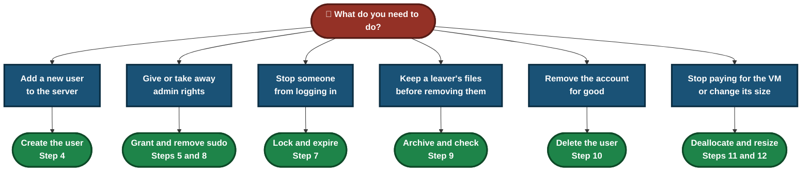

---

<a id="steps"></a>
## 📸 Steps

### Step 1 — Check the VM in Azure

The VM `lab-server` in the `sysadmin-labs` resource group: Linux (Ubuntu 24.04), Standard B4as v2, India South Central, created 13/10/2026 11:48 UTC. Status was `Running` when this screenshot was taken.

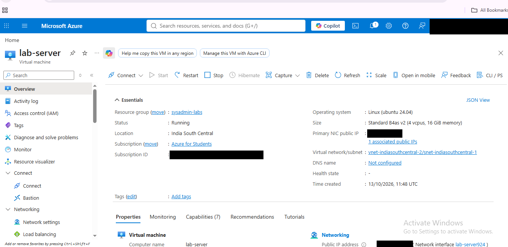

How the VM was created: the resource group `sysadmin-labs` holds `lab-server` (virtual machine), `lab-server-ip` (public IP address) and `lab-server-nsg` (network security group). The notification panel shows `Deployment in progress`.

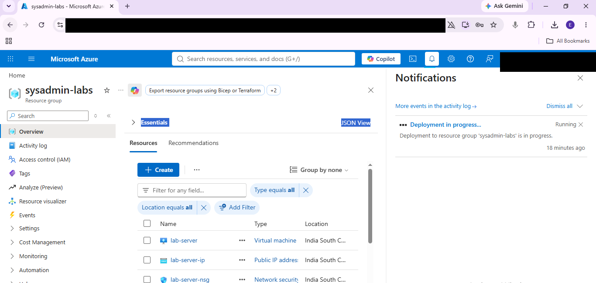

The deployment `CreateVirtualMachine-lab-server` in `sysadmin-labs` on the Azure for Students subscription, start time 13/10/2026 16:47:48 (local time, which matches the 11:48 UTC creation time above). The page also lists `Set up auto-shutdown` as a recommended next step.

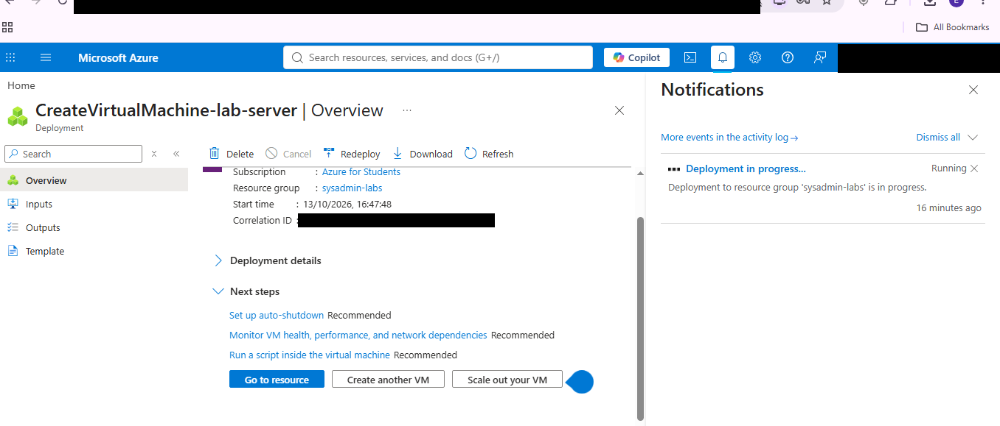

### Step 2 — Connect to the server

Connected to `lab-server` over SSH with the key file, then checked who I am, which machine this is and the time:

```bash
whoami; hostname; date
```

The output was `azureuser`, `lab-server` and `Tue Oct 13 13:05:31 UTC 2026`.

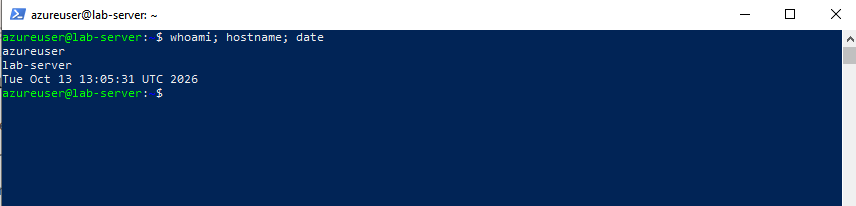

### Step 3 — Record the starting state

```bash
ls /home
getent group sudo
```

Only `azureuser` had a home folder, and the `sudo` group had one member: `sudo:x:27:azureuser`.

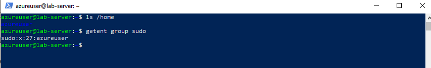

### Step 4 — Create the user `intern1`

```bash
sudo adduser --disabled-password --gecos "" intern1
```

`adduser` picked UID/GID 1001, created the group `intern1`, created `/home/intern1` from `/etc/skel` and added the user to the group `users`. I used `--disabled-password`, so this account has no password login.

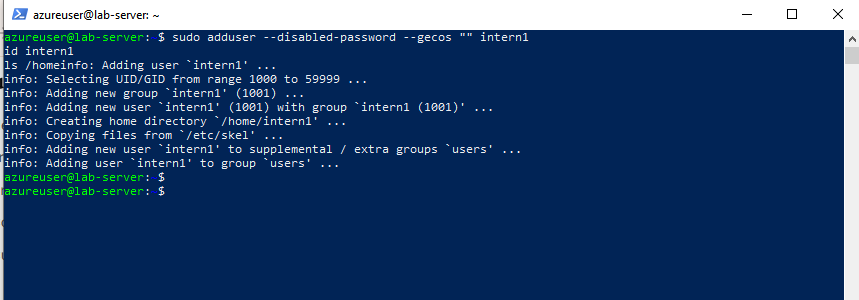

Then checked the user:

```bash
id intern1
ls /home
```

The result was `uid=1001(intern1) gid=1001(intern1) groups=1001(intern1),100(users)`.

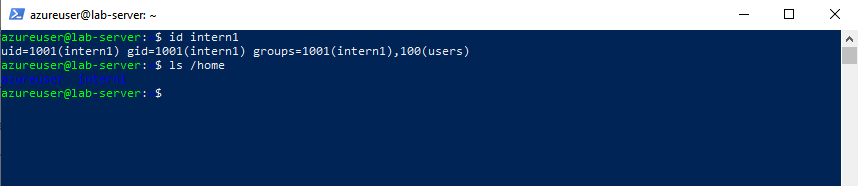

### Step 5 — Give `intern1` sudo access

```bash
sudo usermod -aG sudo intern1
getent group sudo
ls -l /home
```

The `sudo` group became `sudo:x:27:azureuser,intern1`. Both home folders are `drwxr-x---`, one owned by `azureuser` and one by `intern1`.

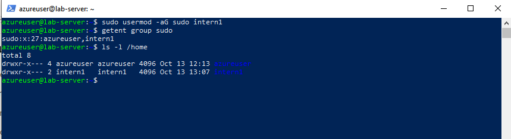

### Step 6 — Create some user data

A small file written as `intern1`, so the offboarding has something to archive:

```bash
sudo -u intern1 bash -c 'echo "intern1 project notes" > /home/intern1/notes.txt'
ls -l /home/intern1
```

`ls` as `azureuser` returned `Permission denied`. The home folder is private to its owner, which is expected.

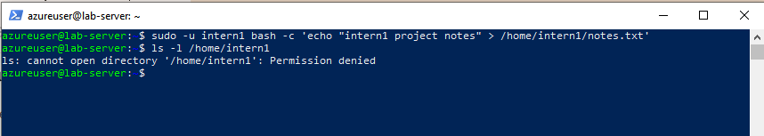

With `sudo`, the file is visible:

```bash
sudo ls -l /home/intern1
```

`notes.txt` is owned by `intern1`, 22 bytes, created at 13:12.

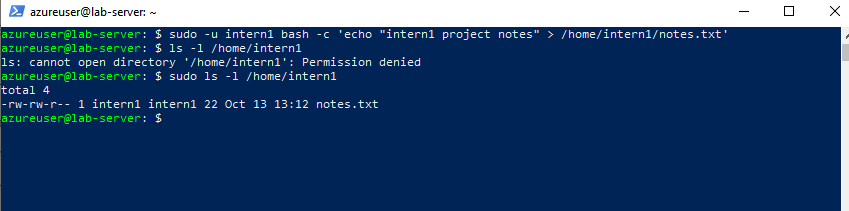

### Step 7 — Offboarding: lock and expire the account

```bash
sudo usermod -L -e 1 intern1
sudo passwd -S intern1
sudo chage -l intern1
```

- `-L` locks the password.
- `-e 1` sets the account expiry to day 1 after 1 Jan 1970.

`passwd -S` shows status `L` (locked), and `chage -l` shows `Account expires : Jan 02, 1970`.

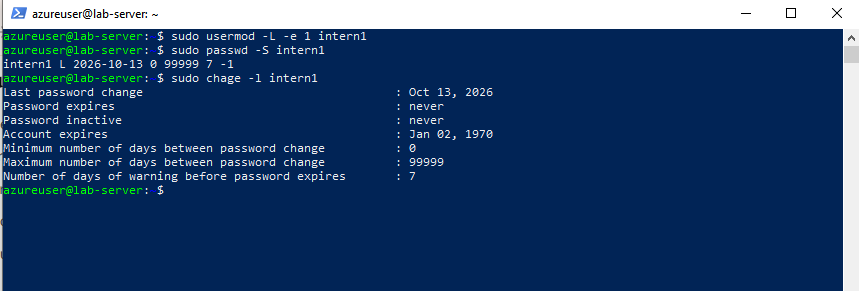

### Step 8 — Offboarding: remove sudo access

```bash
sudo gpasswd -d intern1 sudo
getent group sudo
```

The output said `Removing user intern1 from group sudo`, and the group is back to `sudo:x:27:azureuser`, the same as the baseline.

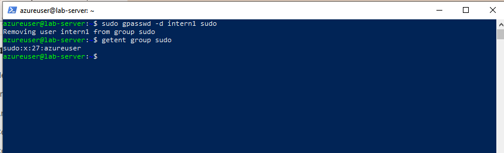

### Step 9 — Offboarding: archive the home folder

```bash
sudo mkdir -p /var/backups/offboarded
sudo tar -czf /var/backups/offboarded/intern1_2026-10-13.tar.gz -C /home intern1
ls -l /var/backups/offboarded
```

The archive `intern1_2026-10-13.tar.gz` is 2,351 bytes and owned by `root`.

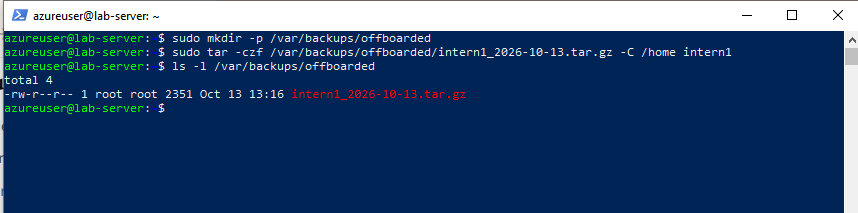

Checked what is inside, without extracting it:

```bash
sudo tar -tzf /var/backups/offboarded/intern1_2026-10-13.tar.gz
```

The archive holds `intern1/`, `intern1/notes.txt`, `intern1/.profile`, `intern1/.bash_logout` and `intern1/.bashrc`.

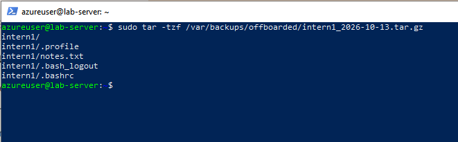

### Step 10 — Offboarding: delete the user

```bash
sudo deluser --remove-home intern1
id intern1
ls /home
ls -l /var/backups/offboarded
```

`deluser` reported removing the files, the crontab and the user. `id intern1` now says `no such user`, `/home` only has `azureuser`, and the archive is still in `/var/backups/offboarded`.

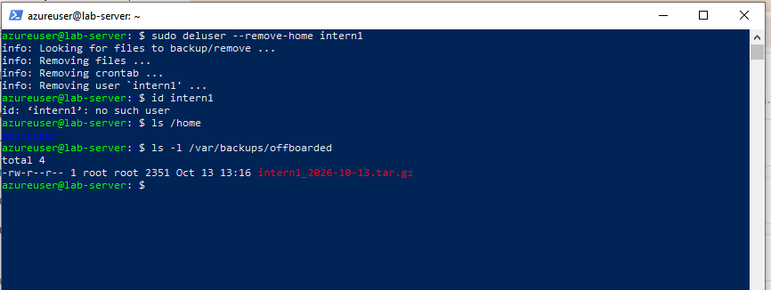

### Step 11 — Wrap up: stop (deallocate) the VM

After the lab, I stopped the VM from the Azure Portal. The Overview shows `Stopped (deallocated)`, size Standard B4as v2, so compute billing stops.

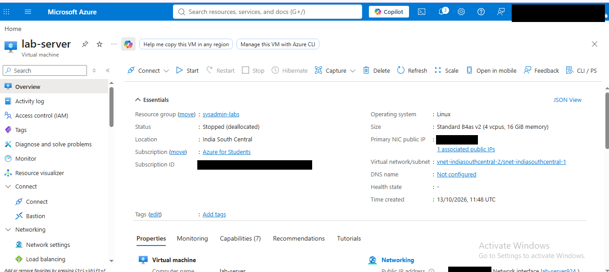

### Step 12 — Wrap up: resize the VM

Changed the size from Standard B4as v2 (4 vCPU, 16 GiB) to **Standard B2ls_v2 (2 vCPU, 4 GiB)**, a cheaper size that is enough for these labs. The Overview shows status `Running` with the new size.

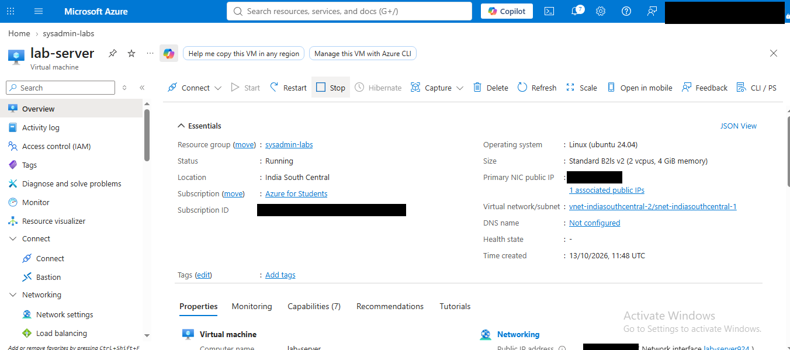

### Step 13 — Wrap up: reconnect to the resized VM

Connected again over SSH:

```powershell
ssh -i $HOME\Downloads\lab-server_key.pem azureuser@<public IP>
```

The login banner shows Ubuntu 24.04.4 LTS (kernel 6.17.0-1022-azure) and the system information from `Tue Oct 13 13:37:37 UTC 2026`: 139 processes, 0 users logged in, `/` at 8.5% of 28.02 GB, memory usage 17%.

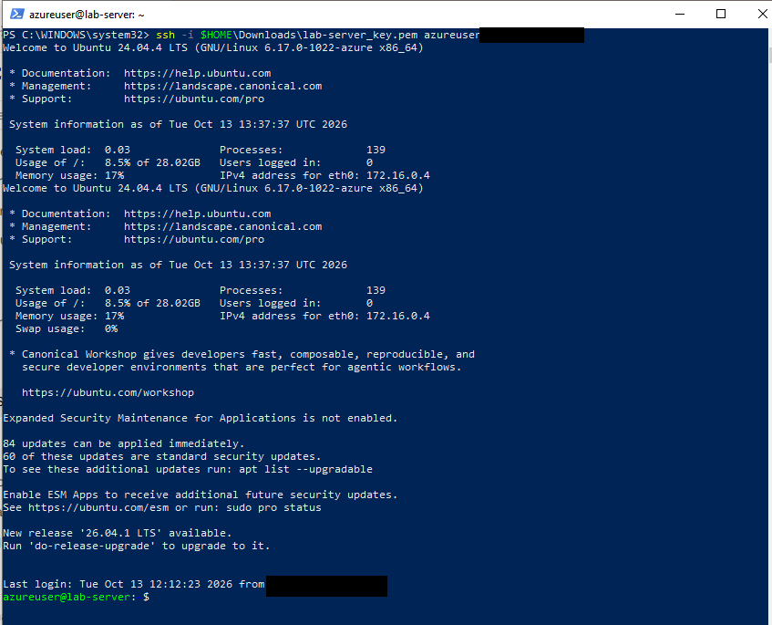

---

<a id="results"></a>
## ✅ Results

| Check | Result |
|---|---|
| User created | `intern1`, UID/GID 1001, home `/home/intern1` |
| Sudo granted | `sudo` group was `azureuser,intern1` |
| Account locked | `passwd -S` shows `L` |
| Account expired | `Account expires : Jan 02, 1970` |
| Sudo removed | `sudo` group back to `azureuser` only |
| Data archived | `intern1_2026-10-13.tar.gz`, 2,351 bytes, holds `notes.txt` |
| User deleted | `id intern1` returns `no such user`, `/home` has only `azureuser` |
| Archive after deletion | Still in `/var/backups/offboarded`, owned by `root` |
| VM stopped | Status `Stopped (deallocated)` |
| VM resized | Standard B4as v2 → Standard B2ls_v2, status `Running` |
| Reconnected | SSH login to the resized VM at 13:37:37 UTC |

> [!NOTE]
> This lab used one test user and one 22-byte file. The archive size says nothing about a real user's data.

---

<a id="offboarding-breaks"></a>
## 🔍 Where Offboarding Can Break

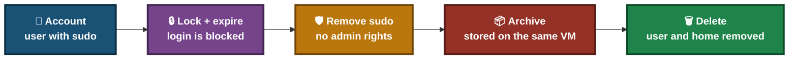

<p align="center"><em>The red box is the weak point in this lab: the archive sits on the same VM, unencrypted.</em></p>

### 🔍 Analyst Note — Why the Archive Is Checked Before the Delete

`deluser --remove-home` deletes the home folder, and there is no undo. The archive is the only copy afterwards, so it is listed first.

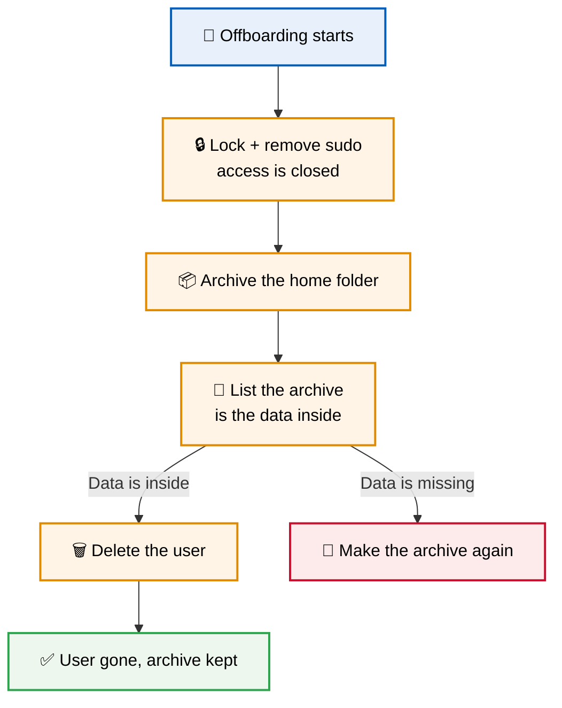

---

<a id="pipeline"></a>
## 🧭 Offboarding Method Pipeline

How the lab turns a working user account into a fully offboarded one

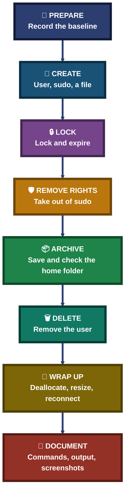

---

<a id="cheat-sheet"></a>
## 🧾 Command Cheat Sheet

| Command | Purpose |
|---------|---------|
| `sudo adduser --disabled-password --gecos "" <user>` | Create a user without a password login |
| `id <user>` | Show UID, GID and groups of a user |
| `getent group sudo` | List the members of the sudo group |
| `sudo usermod -aG sudo <user>` | Add a user to the sudo group |
| `sudo -u <user> bash -c '<command>'` | Run a command as another user |
| `ls -l /home` | Show owners and permissions of home folders |
| `sudo usermod -L -e 1 <user>` | Lock the password and set the account to expired |
| `sudo passwd -S <user>` | Show the password status (`L` = locked) |
| `sudo chage -l <user>` | Show password and account expiry dates |
| `sudo gpasswd -d <user> sudo` | Remove a user from the sudo group |
| `sudo tar -czf <file>.tar.gz -C /home <user>` | Archive a home folder |
| `sudo tar -tzf <file>.tar.gz` | List what is inside an archive |
| `sudo deluser --remove-home <user>` | Delete a user and its home folder |

---

<a id="problems-fixes"></a>
## ⚠️ Challenges & Fixes

| ❌ Challenge | ✅ Solution |
|---|---|
| I pasted several commands at once and they ran mixed together (for example `ls -l /hogetent group sudo`), and a stray `me` gave `Command 'me' not found` | The terminal mixed the pasted lines. Nothing on the server was damaged. I ran the commands one at a time, and running `usermod -aG` a second time is harmless |
| The `id` and `ls /home` typed after `adduser` showed no output in the screenshot | They were typed into the same paste while `adduser` was still running. I ran them again as Step 4 |
| `ls -l /home/intern1` returned `Permission denied` | Not an error. The home folder is `drwxr-x---`, so only its owner (and root) can enter it. I used `sudo` |
| Folder names from `ls /home` were dark blue on a dark blue background | Used `ls -l`, which shows owners in a readable colour (Step 5) |
| The account expiry shows `Jan 02, 1970`, not 1 Jan | `-e 1` means day 1 after 1 Jan 1970, which is 2 Jan 1970 |

---

<a id="scope-limitations"></a>
## 🚧 Scope & Limitations

- **The archive is on the same VM.** If the VM is lost, the archive is lost too. A real setup copies it somewhere else, with a retention rule.
- **The archive is not encrypted,** and the file is `-rw-r--r--`, so other users on the VM can read it. A real archive should be restricted to root or an admin group.
- **Only the home folder was archived.** I did not look for running processes, SSH keys, cron jobs outside the user's own crontab (`deluser` reported removing that one) or files owned by `intern1` elsewhere on the disk.
- **I did not check `/etc/sudoers.d`** for rules that could give sudo outside the `sudo` group.
- **Restoring or unlocking the user was not tested.**
- **Everything was typed by hand.** There is no script, so the archive file name and date were written manually.
- **One test user and one small file.** No groups other than `sudo`, no audit logging.

---

<a id="what-i-learned"></a>
## 🧠 What I Learned

- **Lock first, delete last.** Locking stops the login straight away, and the data stays until it is archived and checked.
- **Admin rights come from group membership.** Adding a user to the `sudo` group gives admin rights, and `gpasswd -d` takes them away.
- **Home folders are private by default.** `drwxr-x---` kept even `azureuser` out until I used `sudo`.
- **Check the archive before the delete.** `tar -tzf` lists the files without extracting anything.
- **Check every change with a command.** `getent`, `id`, `passwd -S`, `chage -l` and `ls -l` each gave proof for a step.
- **Run one command at a time.** Pasting several at once mixed them up, so the screenshots became unusable.

---

<a id="skills-demonstrated"></a>
## 🛠️ Skills Demonstrated

- Connecting to a Linux server over SSH with a key
- Creating and deleting Linux user accounts
- Managing group membership and sudo access
- Locking accounts and setting account expiry
- Reading file owners and permissions
- Archiving and checking a home folder with `tar`
- Following a safe offboarding order
- Stopping (deallocating) and resizing an Azure VM from the portal
- Documenting a lab with commands, output, screenshots and honest limits

---

<a id="folder-structure"></a>
## 📁 Folder Structure

```text
lab05-users-offboarding/
|-- README.md
`-- screenshots/
    |-- 00-azure-vm-overview.png
    |-- 00a-resource-group.png
    |-- 00b-vm-deployment.png
    |-- 01-ssh-connected.png
    |-- 02-baseline-users.png
    |-- 03-create-user.png
    |-- 04-verify-user.png
    |-- 05-grant-sudo.png
    |-- 06-home-permission-denied.png
    |-- 07-intern-file.png
    |-- 08-lock-account.png
    |-- 09-remove-sudo.png
    |-- 10-archive-home.png
    |-- 11-verify-archive.png
    |-- 12-delete-user.png
    |-- 13-vm-deallocated.png
    |-- 14-vm-resized.png
    `-- 15-ssh-reconnected.png
```
