<div align="center">

# 📡 Lab 06 — Disk & Uptime Monitoring

**Ubuntu 24.04 on Azure · Bash Disk Check · Cron · Syslog · Uptime Kuma · Nginx DOWN Test · pm2**

A hands-on Linux sysadmin lab. I wrote a script that warns when the disk is nearly full, ran it every 10 minutes with cron, then installed Uptime Kuma to watch my Nginx site. I stopped Nginx on purpose to see the monitor go DOWN, started it again to see it recover, and kept Uptime Kuma running in the background with pm2.


The method: write a check, test that it fires, schedule it, add a service monitor, break the service on purpose, and keep the evidence.

### [🗂️ Open the INDEX](INDEX.md) &nbsp;·&nbsp; [📸 Jump to the steps](#steps)

</div>

---

## 📑 Table of Contents

0. [🗂️ INDEX (step and screenshot guide)](INDEX.md)
1. [At a Glance](#at-a-glance)
2. [Objective](#objective)
3. [Environment](#environment)
4. [Tools & Technologies](#tools)
5. [The Lab Flow](#flow)
6. [Which Step Do I Need?](#which-step)
7. [Steps](#steps)
8. [Results](#results)
9. [Where Monitoring Can Break](#monitoring-breaks)
10. [Monitoring Method Pipeline](#pipeline)
11. [Command Cheat Sheet](#cheat-sheet)
12. [Challenges & Fixes](#problems-fixes)
13. [Scope & Limitations](#scope-limitations)
14. [What I Learned](#what-i-learned)
15. [Skills Demonstrated](#skills-demonstrated)
16. [Folder Structure](#folder-structure)

---

<a id="at-a-glance"></a>
## 📊 At a Glance

| 🖥 Server | 💽 Disk Alert | ⏰ Check Interval | 🌐 Uptime Monitor | 🔻 DOWN → UP |
|:---:|:---:|:---:|:---:|:---:|
| **1 Ubuntu 24.04 VM** | **80% of `/`** | **Cron, every 10 min** | **1 HTTPS monitor, every 20 s** | **22:05:52 → 22:07:32** |

---

<a id="objective"></a>
## 🎯 Objective

Show that I can notice a problem on a server before a user does.

- Write a script that checks disk usage and logs a warning above a threshold.
- Prove the alert really fires by lowering the threshold for a test, then putting it back.
- Schedule the script with cron.
- Install Uptime Kuma and monitor the Nginx site from Lab 2.
- Stop Nginx on purpose and confirm the monitor shows DOWN, then start it and confirm UP.
- Keep Uptime Kuma running after I close my terminal.

<div align="center">

### 🧩 Lab Workflow at a Glance

<table>
<tr>
<td align="center" valign="top" width="18%">

**💽 Check**<br>
<sub>Disk script<br>with a threshold</sub>

</td>
<td align="center" valign="middle" width="2.5%">

**➜**

</td>
<td align="center" valign="top" width="18%">

**🔔 Test**<br>
<sub>Lower the limit,<br>see the alert</sub>

</td>
<td align="center" valign="middle" width="2.5%">

**➜**

</td>
<td align="center" valign="top" width="18%">

**⏰ Schedule**<br>
<sub>Cron every<br>10 minutes</sub>

</td>
<td align="center" valign="middle" width="2.5%">

**➜**

</td>
<td align="center" valign="top" width="18%">

**🌐 Monitor**<br>
<sub>Uptime Kuma<br>watches Nginx</sub>

</td>
<td align="center" valign="middle" width="2.5%">

**➜**

</td>
<td align="center" valign="top" width="18%">

**💥 Break**<br>
<sub>Stop Nginx,<br>see DOWN, recover</sub>

</td>
</tr>
<tr>
<td colspan="9" align="center">


<br>
<sub>Open-source tools, no paid software</sub>

</td>
</tr>
</table>

</div>

---

<a id="environment"></a>
## 🧱 Environment

| Item | Value |
|---|---|
| Cloud | Azure virtual machine, India South Central |
| VM name / size | `lab-server` · Standard B2ls v2 |
| Operating system | Ubuntu 24.04.5 LTS |
| Web server being monitored | Nginx 1.24.0 (TLS reverse proxy from Lab 2, self-signed certificate) |
| Node.js / npm | 20.20.2 / 10.8.2 (from the NodeSource repository) |
| Monitoring tool | Uptime Kuma 2.5.5 (installed from source, `npm run setup`) |
| Process manager | pm2 (installed globally with npm) |
| Access | SSH with a key file, user `azureuser` |
| Dashboard access | SSH tunnel to port 3001 (no NSG rule added for 3001) |
| Date of lab | 13 Oct 2026 (VM clock and syslog are UTC; the Uptime Kuma dashboard shows Pakistan time, UTC+5) |

> [!NOTE]
> Public IP, my own IP, subscription details and account email are blurred in the screenshots. The VM details are shown in Step 1.

---

<a id="tools"></a>
## 🛠️ Tools & Technologies

| Tool | Purpose |
|------|---------|
| `ssh`, `ssh -L` | Connect to the VM, and forward port 3001 to my laptop |
| `df`, `tail`, `tr` | Read the disk usage percentage of `/` |
| `logger` | Write a warning into syslog |
| `sed` | Change the threshold in the script for the test |
| `crontab` | Schedule the disk check |
| `grep` | Find the warning in syslog and the cron run in syslog |
| `curl`, `apt` | Add the NodeSource repository and install Node.js |
| `git`, `npm` | Download and set up Uptime Kuma |
| `systemctl` | Stop and start Nginx for the DOWN test |
| `pm2` | Keep Uptime Kuma running in the background and start it at boot |

---

<a id="flow"></a>
## ⏱️ The Lab Flow

```mermaid
flowchart LR
    subgraph G1["🟣 DISK CHECK"]
        direction TB
        A1["Script<br/>diskcheck.sh"]
        A2["Test alert<br/>threshold 1"]
        A3["Restore<br/>threshold 80"]
    end
    subgraph G2["🔵 SCHEDULE"]
        direction TB
        B1["Cron<br/>every 10 min"]
        B2["Cron run<br/>seen in syslog"]
    end
    subgraph G3["🟠 UPTIME MONITOR"]
        direction TB
        C1["Install<br/>Node.js + Uptime Kuma"]
        C2["Monitor<br/>Nginx site"]
        C3["Stop Nginx<br/>DOWN"]
    end
    subgraph G4["🟢 RECOVER"]
        direction TB
        D1["Start Nginx<br/>UP"]
        D2["pm2<br/>keeps Kuma running"]
    end
    G1 ==> G2 ==> G3 ==> G4

    classDef pr fill:#f0eaf8,stroke:#6f42c1,stroke-width:2px,color:#000
    classDef po fill:#e8f1fb,stroke:#005EB8,stroke-width:2px,color:#000
    classDef di fill:#fff4e5,stroke:#e08a00,stroke-width:2px,color:#000
    classDef re fill:#eef7ee,stroke:#2ea44f,stroke-width:2px,color:#000
    class A1,A2,A3 pr
    class B1,B2 po
    class C1,C2,C3 di
    class D1,D2 re
```

<p align="center"><em>The groups show the four stages of the lab, from the disk check to keeping the monitor running.</em></p>

---

<a id="which-step"></a>
## 🧭 Which Step Do I Need?

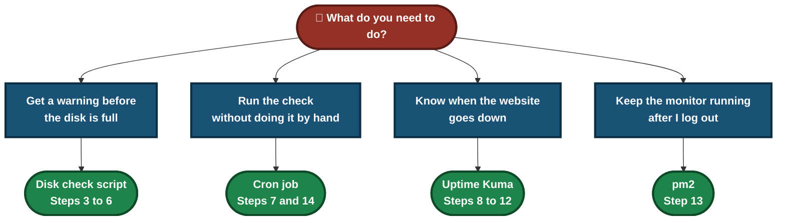

---

<a id="steps"></a>
## 📸 Steps

### Step 1 — Check the VM in Azure

The VM `lab-server` in the `sysadmin-labs` resource group: Linux (Ubuntu 24.04), Standard B2ls v2, India South Central, created 13/10/2026 11:48 UTC. Status was `Running` when this screenshot was taken.

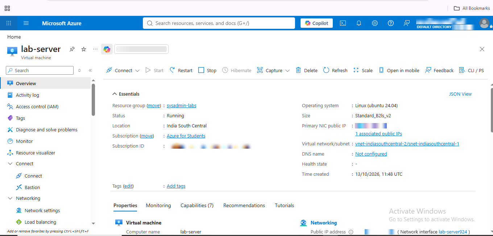

### Step 2 — Connect to the server

Connected to `lab-server` over SSH with the key file. The login banner shows `/` at 10.3% used and "0 updates can be applied immediately".

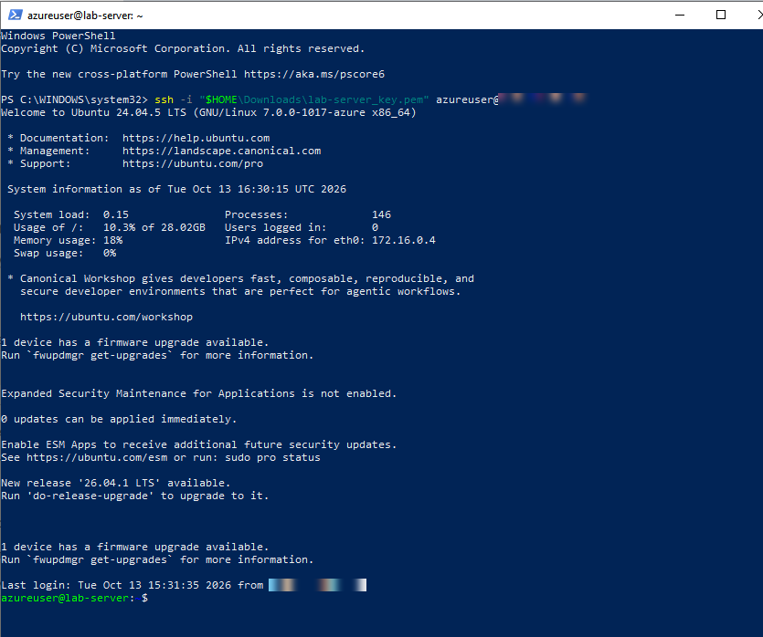

### Step 3 — Write the disk check script

Created `/usr/local/bin/diskcheck.sh` with a here-document:

```bash
sudo tee /usr/local/bin/diskcheck.sh > /dev/null << 'EOF'
#!/bin/bash
USAGE=$(df / --output=pcent | tail -1 | tr -dc '0-9')
if [ "$USAGE" -ge 80 ]; then
logger -p user.warning "DISK WARNING: / at ${USAGE}%"
echo "$(date) disk ${USAGE}%" >> /var/log/disk_alert.log
fi
EOF
```

What each line does:

- `df / --output=pcent | tail -1 | tr -dc '0-9'` reads the usage of `/` and keeps only the number.
- `if [ "$USAGE" -ge 80 ]` runs the alert part only when usage is 80% or more.
- `logger -p user.warning` writes a warning into syslog.
- `echo ... >> /var/log/disk_alert.log` adds a dated line to a small alert log.

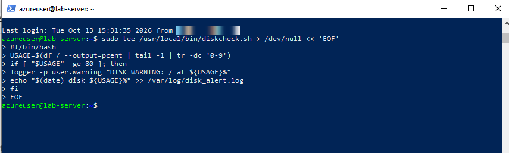

Made it executable:

```bash
sudo chmod +x /usr/local/bin/diskcheck.sh
```

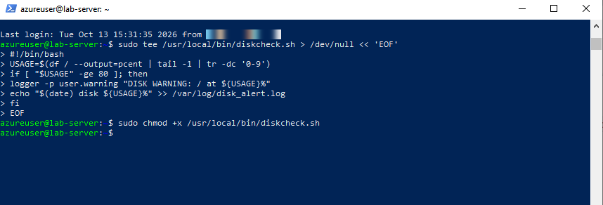

Checked the permissions and the content:

```bash
ls -l /usr/local/bin/diskcheck.sh && cat /usr/local/bin/diskcheck.sh
```

The file is `-rwxr-xr-x`, owner `root root`, 209 bytes, and all 6 lines are correct.

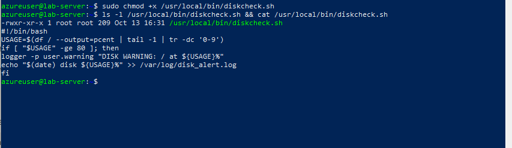

### Step 4 — Run it at the normal threshold (80)

```bash
sudo /usr/local/bin/diskcheck.sh; echo "exit code: $?"; ls -l /var/log/disk_alert.log
```

Exit code `0`, and `disk_alert.log` does not exist. Disk usage is about 10%, below 80, so the script correctly stayed quiet.

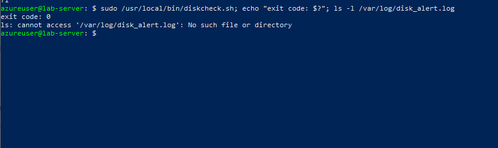

### Step 5 — Prove the alert works

The disk is nowhere near 80% full, so I lowered the threshold to 1 for the test only:

```bash
sudo sed -i 's/-ge 80/-ge 1/' /usr/local/bin/diskcheck.sh
```

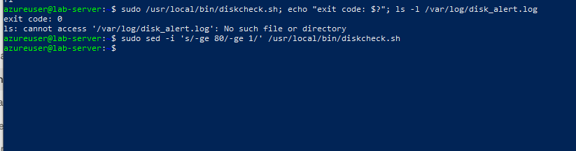

Ran the script again and read the alert log:

```bash
sudo /usr/local/bin/diskcheck.sh; echo "exit code: $?"; cat /var/log/disk_alert.log
```

The log now has the line `Tue Oct 13 16:37:53 UTC 2026 disk 11%`.

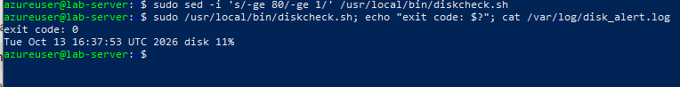

Checked that the warning also reached syslog:

```bash
sudo grep "DISK WARNING" /var/log/syslog
```

Syslog has `2026-10-13T16:37:53 lab-server root: DISK WARNING: / at 11%`. The user shows as `root` because I ran the script with `sudo`.

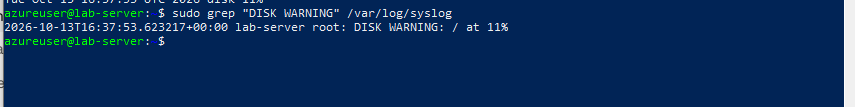

### Step 6 — Put the threshold back to 80

```bash
sudo sed -i 's/-ge 1/-ge 80/' /usr/local/bin/diskcheck.sh
```

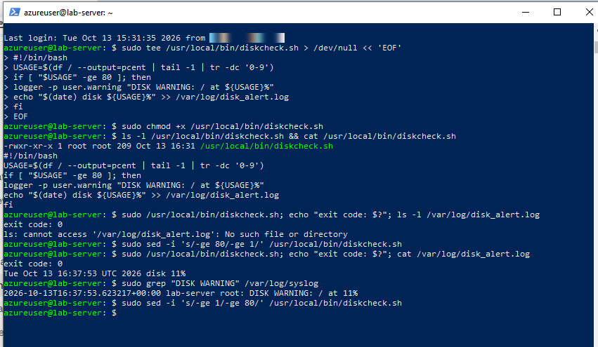

Checked it:

```bash
grep -n "ge" /usr/local/bin/diskcheck.sh
```

Line 3 shows `-ge 80` again. Line 4 also matches because the word `logger` contains "ge".

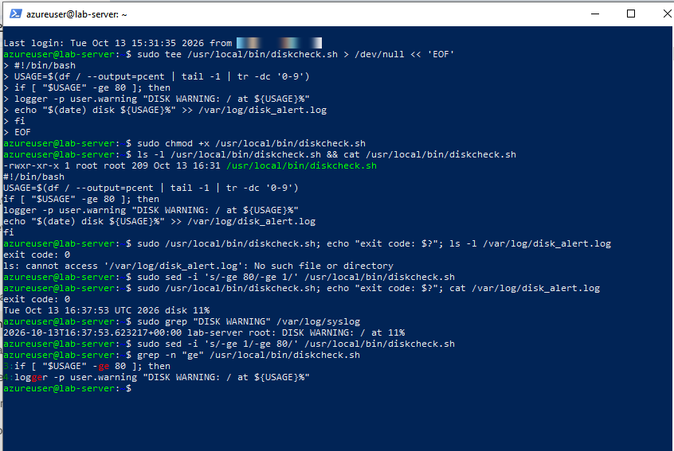

### Step 7 — Schedule it with cron

Added the job to root's crontab and kept the existing Lab 1 backup line:

```bash
(sudo crontab -l 2>/dev/null; echo "*/10 * * * * /usr/local/bin/diskcheck.sh") | sudo crontab -
```

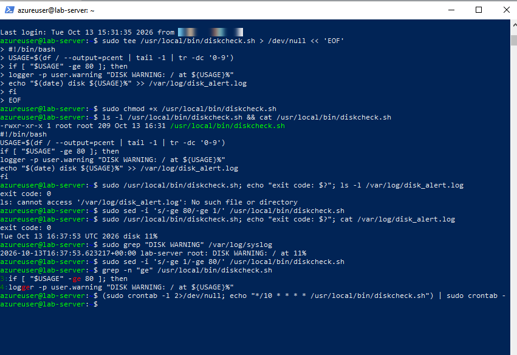

Listed the crontab:

```bash
sudo crontab -l
```

Both entries are there: `0 2 * * * /usr/local/bin/backup.sh` (Lab 1) and `*/10 * * * * /usr/local/bin/diskcheck.sh`.

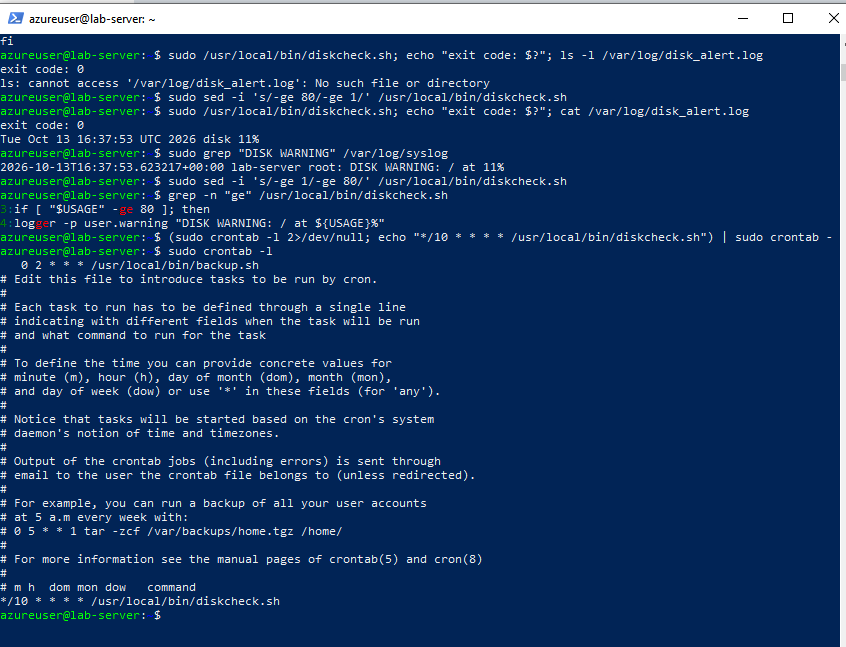

### Step 8 — Install Node.js 20

Uptime Kuma needs Node.js. Checked what was installed:

```bash
node -v; npm -v; git --version
```

`node` and `npm` were not found. `git` was already there (2.43.0).

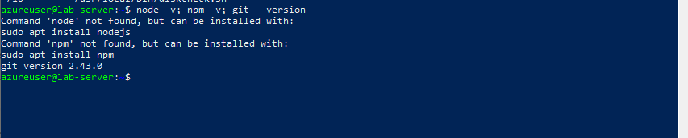

Added the NodeSource repository for Node.js 20:

```bash
curl -fsSL https://deb.nodesource.com/setup_20.x | sudo -E bash -
```

The output ends with "Repository configured successfully" and no errors.

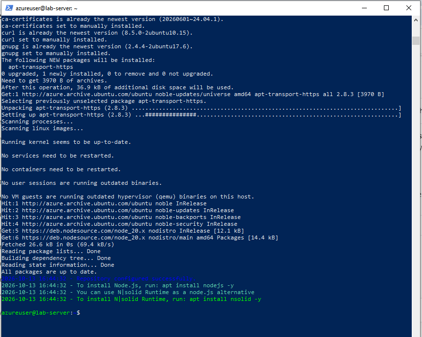

Installed Node.js:

```bash
sudo apt install -y nodejs
```

`nodejs 20.20.2-1nodesource1` was installed.

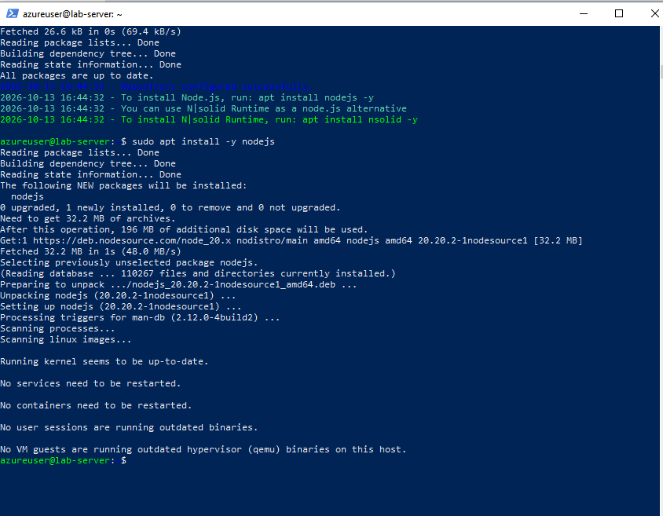

Checked the versions:

```bash
node -v; npm -v
```

Node.js `v20.20.2` and npm `10.8.2`.

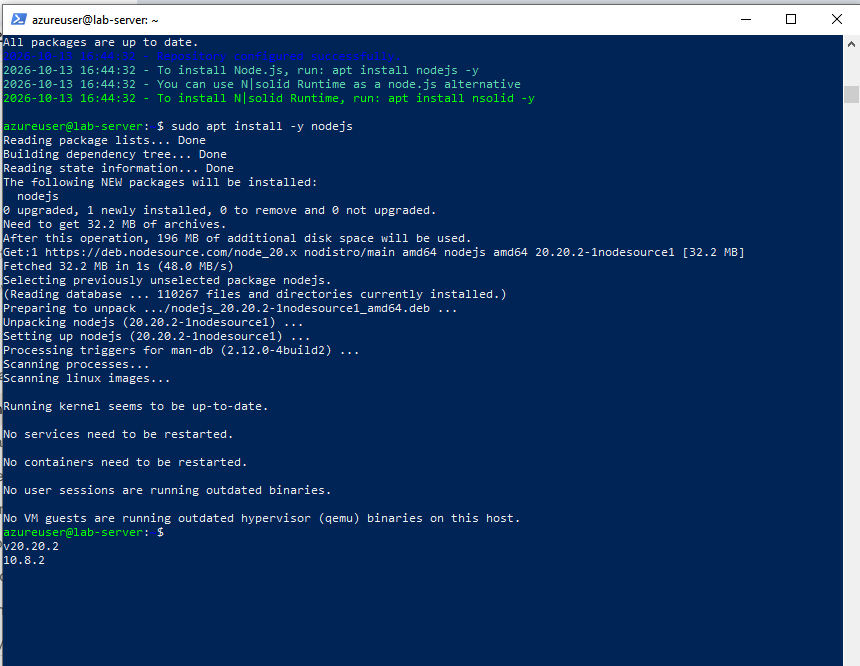

### Step 9 — Download and set up Uptime Kuma

```bash
git clone https://github.com/louislam/uptime-kuma.git
```

Cloned with no errors.

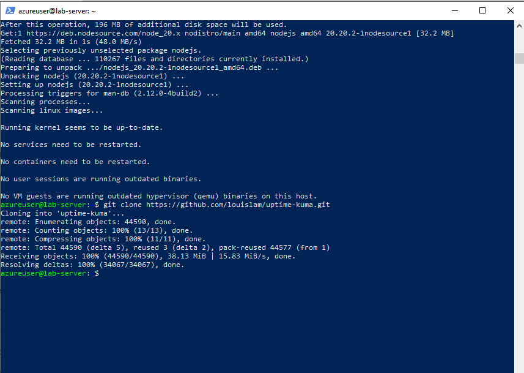

```bash
cd ~/uptime-kuma
npm run setup
```

`added 649 packages in 13s`, then the release files for version 2.5.5 were downloaded and extracted (`Done`). The `npm warn` lines are notices about old packages and a newer npm version, not errors.

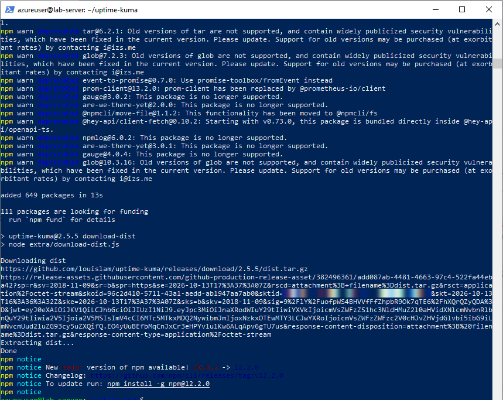

### Step 10 — Start Uptime Kuma and open the SSH tunnel

Started the server in the foreground to test it:

```bash
node server/server.js
```

The output shows `Uptime Kuma Version: 2.5.5` and `Listening on http://localhost:3001`. The last line, `Waiting for user action...`, appears because this was the first start and the setup page was not completed yet.

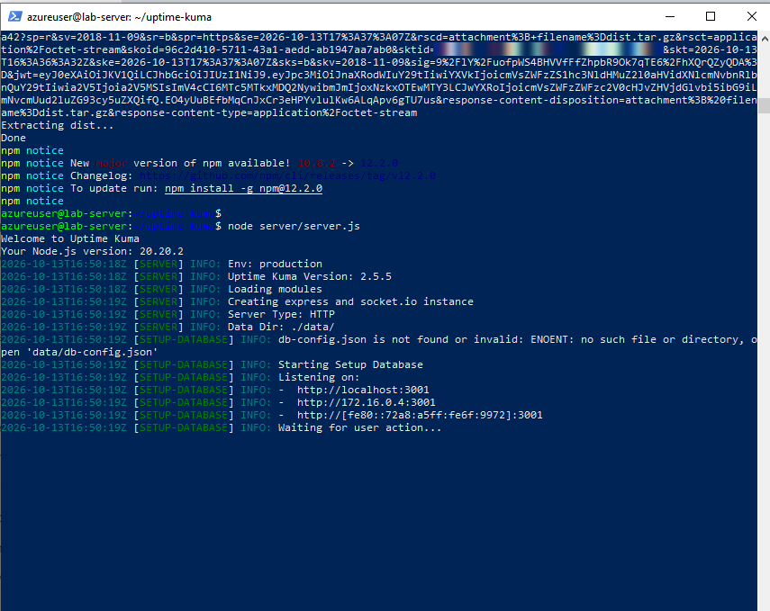

In a second PowerShell window on my laptop I opened an SSH tunnel, so port 3001 never has to be opened in Azure:

```powershell
ssh -i "$HOME\Downloads\lab-server_key.pem" -L 3001:localhost:3001 azureuser@<VM-public-IP>
```

The error line `-bash: http://localhost:3001: No such file or directory` is my mistake: I pasted the browser address into the terminal. It did not affect the tunnel (see Challenges).

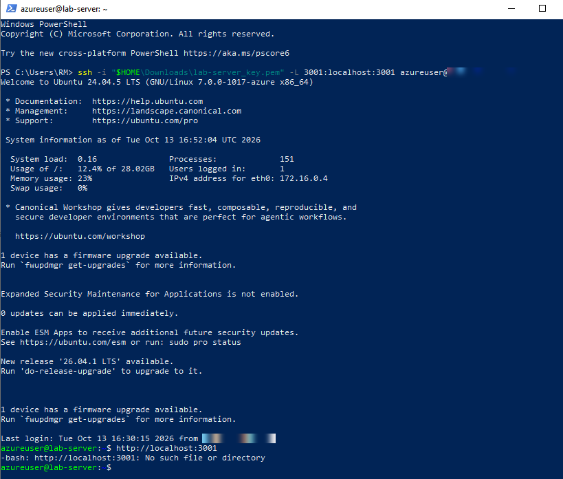

Opened `http://localhost:3001` in my laptop browser. The Uptime Kuma page "Create your admin account" opened. I created the admin account (the password is not stored in this repo).

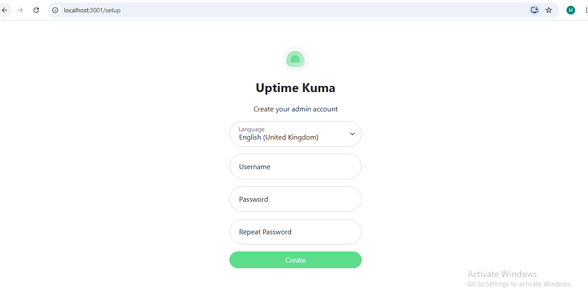

### Step 11 — Add a monitor for the Nginx site

Added a monitor named **Nginx Site**: type HTTP, URL `https://localhost/`, check every 20 seconds. The first check failed with `DOWN` and the message `self-signed certificate`, because the Lab 2 certificate is self-signed.

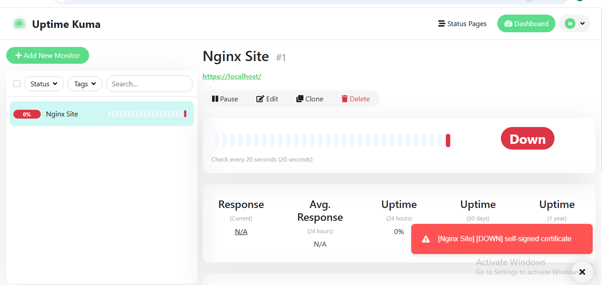

Edited the monitor and ticked **Ignore TLS/SSL errors**. The next check returned `200 - OK` and the monitor turned `UP` at 22:03:27.

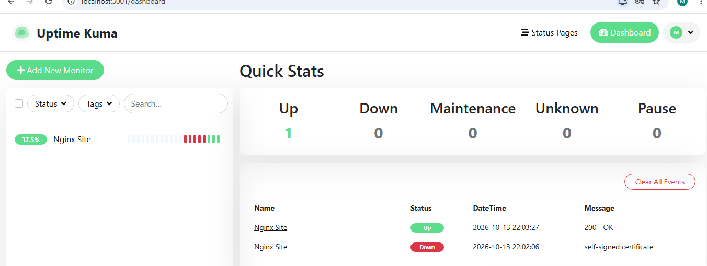

### Step 12 — Stop Nginx on purpose and watch it recover

Stopped Nginx:

```bash
sudo systemctl stop nginx
```

The lines `channel 4: open failed: connect failed: Connection refused` above the command come from the SSH tunnel window. I did not find their cause (see Challenges).

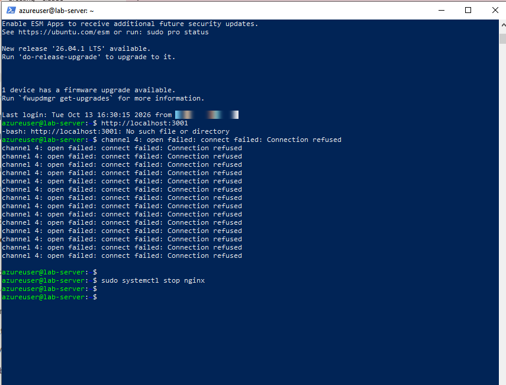

The dashboard showed **Down 1**, with the message `connect ECONNREFUSED 127.0.0.1:443` at 22:05:52, and two red pop-up alerts.

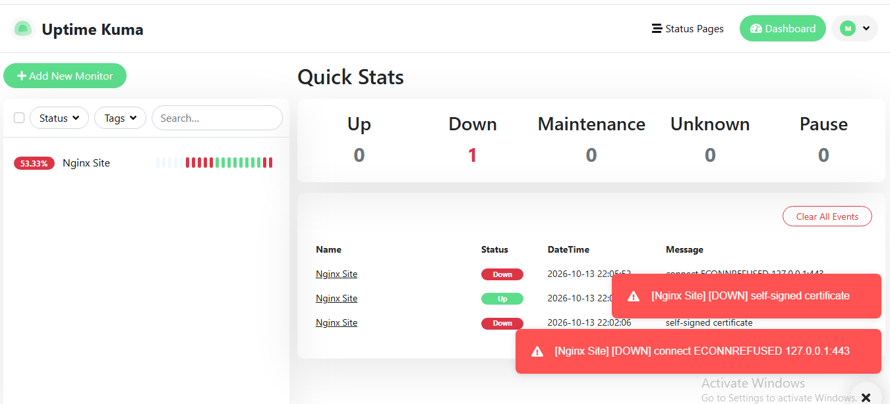

Started Nginx again:

```bash
sudo systemctl start nginx
```

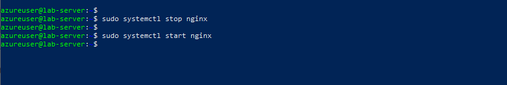

The monitor went back to `UP` with `200 - OK` at 22:07:32. The event list now has all four events: DOWN (self-signed certificate), UP, DOWN (connection refused), UP.

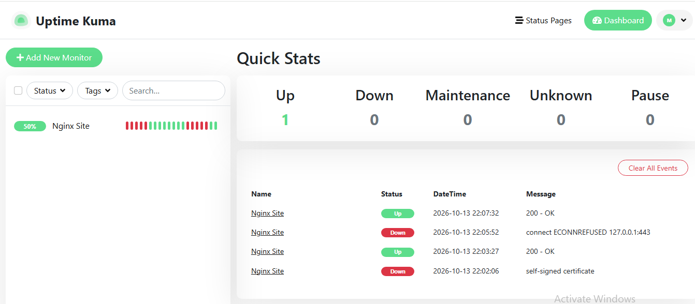

### Step 13 — Keep Uptime Kuma running with pm2

Until now Uptime Kuma ran inside one terminal window. I stopped it with `Ctrl+C` (the log shows `Called signal: SIGINT`). The same log shows the monitor history: the self-signed failures, then the `ECONNREFUSED` failures while Nginx was stopped.

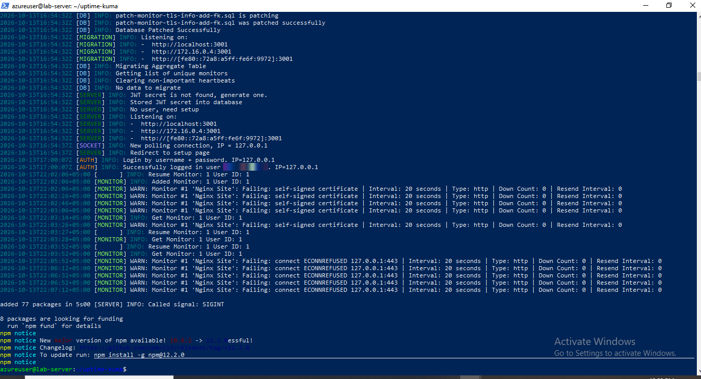

Started it again under pm2:

```bash
pm2 start server/server.js --name uptime-kuma
```

pm2 shows `uptime-kuma`, version 2.5.5, status `online`, user `azureuser`.

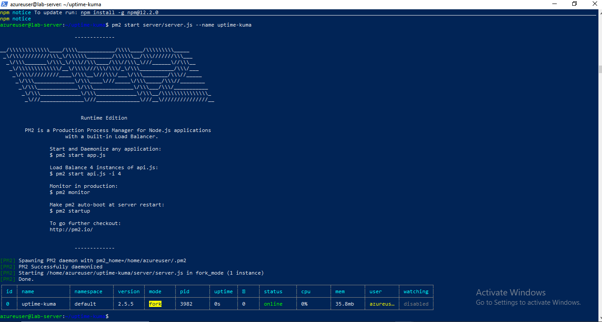

The dashboard came back with the same monitor and the same events, so the data is stored on disk and survived the restart.

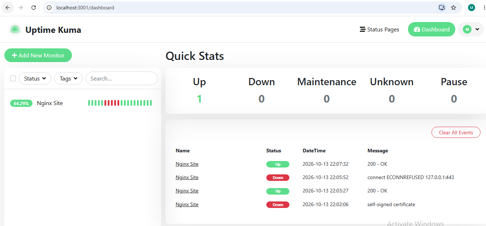

Asked pm2 how to start at boot:

```bash
pm2 startup
```

pm2 found `systemd` and printed the `sudo env PATH=... pm2 startup systemd -u azureuser --hp /home/azureuser` command to run.

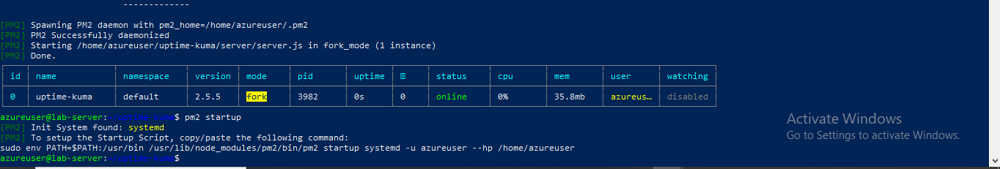

Ran the printed command. It wrote `/etc/systemd/system/pm2-azureuser.service`, enabled it (`systemctl enable pm2-azureuser`), and ended with `Command successfully executed`.

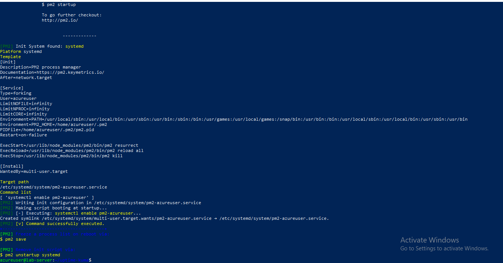

Saved the process list so pm2 knows what to start:

```bash
pm2 save
```

Saved to `/home/azureuser/.pm2/dump.pm2`.

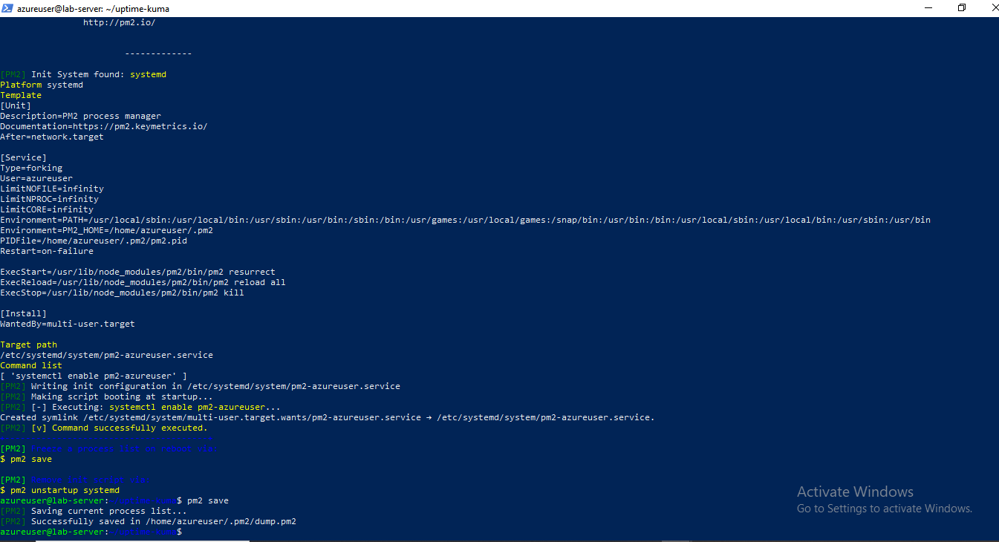

### Step 14 — Check that cron ran the disk check

```bash
sudo grep CRON /var/log/syslog | tail -3
```

Syslog shows `(root) CMD (/usr/local/bin/diskcheck.sh)` at **17:10:01 UTC**. The two other lines are the system's own `debian-sa1` job at 17:05 and 17:15. Disk usage was about 12%, below 80, so no alert was expected from this run.

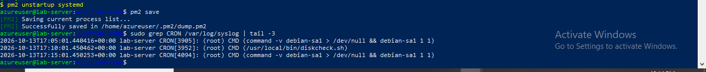

---

<a id="results"></a>
## ✅ Results

| Check | Result |
|---|---|
| Script permissions | `-rwxr-xr-x`, `root root`, 209 bytes |
| Run at threshold 80 (usage about 10%) | Exit code 0, no alert, no `disk_alert.log` |
| Run at threshold 1 (usage 11%) | Line written to `/var/log/disk_alert.log` and to syslog |
| Threshold restored | Line 3 shows `-ge 80` again |
| Cron entry | `*/10 * * * * /usr/local/bin/diskcheck.sh`, listed with `crontab -l` |
| Cron run seen | `diskcheck.sh` started by cron at 17:10:01 UTC in syslog |
| Node.js / npm | v20.20.2 / 10.8.2 |
| Uptime Kuma | Version 2.5.5 running, opened through an SSH tunnel |
| Monitor, Nginx running | `UP`, `200 - OK` (after ticking Ignore TLS/SSL errors) |
| Monitor, Nginx stopped | `DOWN`, `connect ECONNREFUSED 127.0.0.1:443` at 22:05:52 |
| Monitor, Nginx started | `UP`, `200 - OK` at 22:07:32 |
| Time between DOWN and UP events | 1 min 40 s (22:05:52 → 22:07:32) |
| Uptime Kuma under pm2 | `online`, same data after the restart |
| pm2 startup service | `pm2-azureuser.service` enabled and process list saved |

> [!NOTE]
> The Uptime Kuma dashboard shows Pakistan time (UTC+5), while syslog shows UTC. For example 22:03:27 on the dashboard is 17:03:27 UTC. The 1 min 40 s is the time between the two events on the dashboard, not an exact measure of how long Nginx was stopped.

---

<a id="monitoring-breaks"></a>
## 🔍 Where Monitoring Can Break

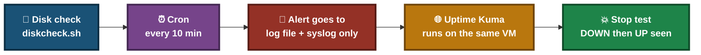

<p align="center"><em>The red box is a weak point: an alert in a log file only helps if someone reads the log.</em></p>

### 🔍 Analyst Note — Why Test the Alert on Purpose

A check that has never fired is only an assumption. A disk at 11% never triggers the 80% rule by itself, so the test lowers the threshold. The same idea applies to the monitor: only stopping Nginx proves the monitor reports DOWN.

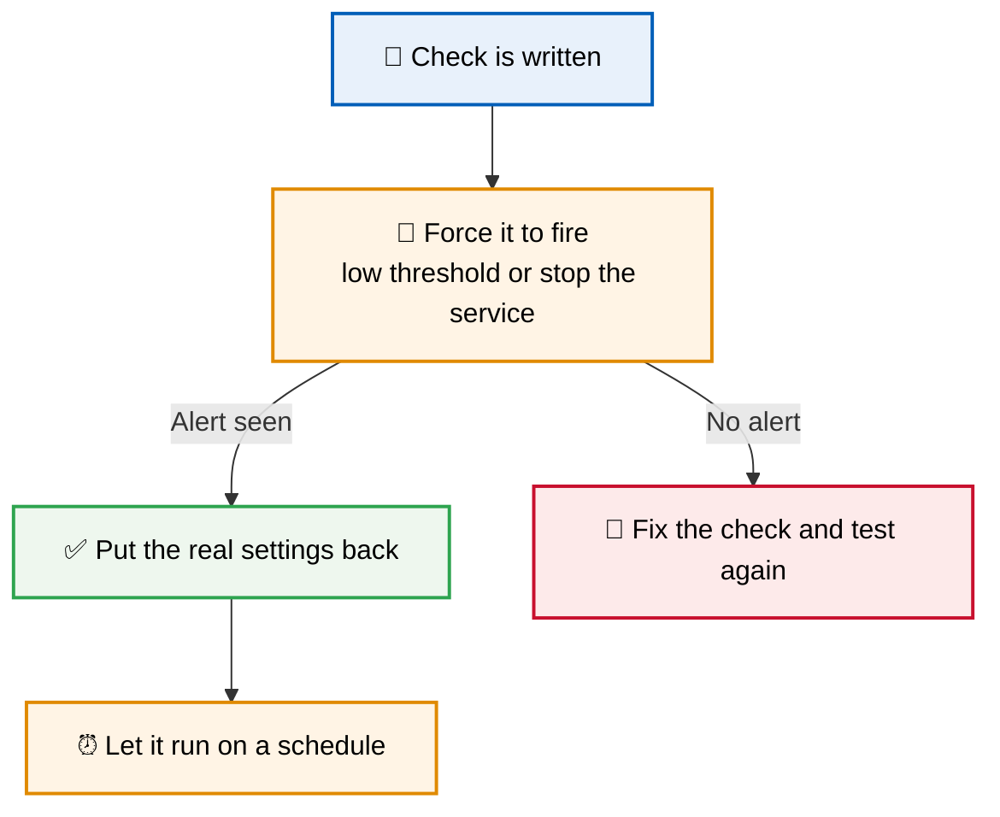

---

<a id="pipeline"></a>
## 🧭 Monitoring Method Pipeline

How the lab turns a plain server into one that reports its own problems

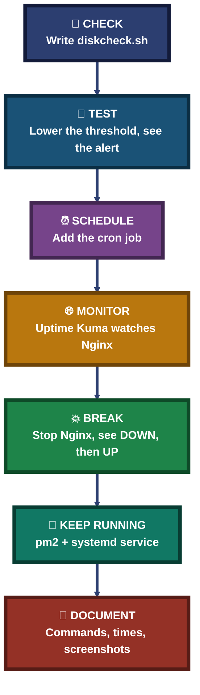

---

<a id="cheat-sheet"></a>
## 🧾 Command Cheat Sheet

| Command | Purpose |
|---------|---------|
| `df / --output=pcent` | Show the disk usage percentage of `/` |
| `tr -dc '0-9'` | Keep only the digits of a text |
| `logger -p user.warning "<text>"` | Write a warning into syslog |
| `sudo sed -i 's/<old>/<new>/' <file>` | Replace text inside a file |
| `grep -n "<text>" <file>` | Search a file and show line numbers |
| `sudo crontab -l` | List root's scheduled jobs |
| `sudo grep CRON /var/log/syslog \| tail -3` | See the latest cron runs |
| `curl -fsSL <url> \| sudo -E bash -` | Run a downloaded setup script as root |
| `node -v` · `npm -v` | Check Node.js and npm versions |
| `ssh -L 3001:localhost:3001 <user>@<ip>` | Forward a remote port to my laptop |
| `sudo systemctl stop nginx` · `sudo systemctl start nginx` | Stop and start Nginx |
| `pm2 start <file> --name <name>` | Run an app in the background under pm2 |
| `pm2 startup` · `pm2 save` | Start pm2 at boot and remember the app list |

---

<a id="problems-fixes"></a>
## ⚠️ Challenges & Fixes

| ❌ Challenge | ✅ Solution |
|---|---|
| I pasted `http://localhost:3001` into the SSH window and got `No such file or directory` | That address belongs in the laptop browser, not in the terminal. Bash tried to run it as a command. Nothing broke, and the tunnel kept working. I opened the address in the browser |
| `node` and `npm` were not installed | Added the NodeSource repository and installed Node.js 20. Uptime Kuma 2.x needs Node.js 20 or newer, and the default Ubuntu 24.04 package is older |
| `grep -n "ge"` showed two lines, not one | Line 4 (`logger`) also contains "ge". Line 3 is the real threshold line, `-ge 80` |
| The new monitor showed DOWN with `self-signed certificate` | The Nginx certificate from Lab 2 is self-signed. I ticked **Ignore TLS/SSL errors** on the monitor and it went UP |
| The SSH tunnel window printed `channel 4: open failed: connect failed: Connection refused` many times | **Cause not confirmed.** I did not investigate it. The dashboard opened and the monitor worked, so I carried on |
| `npm run setup` printed many `npm warn` lines | They are notices about old packages and a newer npm version. The setup ended with `Done` and no errors, so I left them alone |

---

<a id="scope-limitations"></a>
## 🚧 Scope & Limitations

- **Alerts only go to a log file, to syslog and to the dashboard.** I did not set up email, chat or any other notification, so nobody is told if they are not looking.
- **The disk alert was tested with a temporary threshold of 1,** not with a really full disk. The disk was about 11% used.
- **The disk check only looks at `/`** and runs every 10 minutes. It has no history or graph.
- **Cron ran the disk check once that I saw,** in syslog at 17:10:01 UTC. Usage was about 12%, so no alert was expected, and I did not look at the alert log after that run.
- **No log rotation** is set for `/var/log/disk_alert.log`.
- **Uptime Kuma runs on the same VM it watches.** If the VM goes down, the monitor goes down with it.
- **The monitor checks `https://localhost/` from inside the VM.** It tests Nginx, not whether the site is reachable from the internet.
- **The monitor ignores TLS errors,** so it would not warn about a bad or expired certificate.
- **Only one monitor** was created.
- **pm2 start-at-boot is set up but not tested.** I enabled `pm2-azureuser.service` and saved the process list, but I did not reboot the VM to see Uptime Kuma start on its own.
- **The dashboard is only reachable through an SSH tunnel.** I did not open port 3001 in the NSG and did not put HTTPS in front of Uptime Kuma.
- **The admin password is known only to me** and is not stored in this repo or in any screenshot.

---

<a id="what-i-learned"></a>
## 🧠 What I Learned

- **A check is not proven until it fires.** Lowering the threshold and stopping Nginx showed that both the script and the monitor react.
- **Always put test settings back.** The threshold of 1 had to go back to 80 before cron ran it every 10 minutes, or it would alert all the time.
- **`logger` and a log file are two different places.** I wrote the alert to both: syslog for the system, and a small file for quick reading.
- **Cron runs as the user whose crontab it is.** My jobs are in root's crontab, so syslog shows `(root)` for them.
- **Time zones matter when reading evidence.** The dashboard uses UTC+5 and syslog uses UTC, so the same event has two times.
- **A foreground process dies with its terminal.** pm2 keeps Uptime Kuma running after I close the window, and the service file lets it start at boot.
- **An SSH tunnel is a safer way to reach a dashboard** than opening a new port to the internet.

---

<a id="skills-demonstrated"></a>
## 🛠️ Skills Demonstrated

- Writing and testing a Bash disk-usage check
- Logging with `logger` and reading syslog
- Scheduling jobs with cron and finding the run in syslog
- Installing Node.js from a vendor repository
- Installing and running Uptime Kuma from source
- Reaching a private web dashboard with an SSH tunnel
- Setting up an HTTP monitor and proving DOWN detection by stopping Nginx
- Running a service in the background with pm2 and a systemd startup service
- Documenting a lab with commands, times, screenshots and honest limits

---

<a id="folder-structure"></a>
## 📁 Folder Structure

```text
lab06-monitoring/
|-- README.md
`-- screenshots/
    |-- lab06-01-azure-vm-running.png
    |-- lab06-02-ssh-login.png
    |-- lab06-03-diskcheck-created.png
    |-- lab06-04-chmod.png
    |-- lab06-05-verify-script.png
    |-- lab06-06-run-normal-no-alert.png
    |-- lab06-07-threshold-1-sed.png
    |-- lab06-08-alert-triggered.png
    |-- lab06-09-syslog-warning.png
    |-- lab06-10-threshold-restored.png
    |-- lab06-11-verify-80.png
    |-- lab06-12-cron-added.png
    |-- lab06-13-cron-verify.png
    |-- lab06-14-node-check-before.png
    |-- lab06-15-nodesource-repo.png
    |-- lab06-16-nodejs-install.png
    |-- lab06-17-node-npm-versions.png
    |-- lab06-18-kuma-clone.png
    |-- lab06-19-kuma-npm-setup.png
    |-- lab06-20-kuma-server-running.png
    |-- lab06-21-ssh-tunnel.png
    |-- lab06-22-kuma-setup-page.png
    |-- lab06-23-monitor-down-self-signed.png
    |-- lab06-24-monitor-up.png
    |-- lab06-25-nginx-stop.png
    |-- lab06-26-monitor-down-econnrefused.png
    |-- lab06-27-nginx-start.png
    |-- lab06-28-monitor-up-again.png
    |-- lab06-29-kuma-foreground-stopped-log.png
    |-- lab06-30-pm2-start.png
    |-- lab06-31-dashboard-after-pm2.png
    |-- lab06-32-pm2-startup-command.png
    |-- lab06-33-pm2-startup-enabled.png
    |-- lab06-34-pm2-save.png
    `-- lab06-35-cron-ran-in-syslog.png
```
